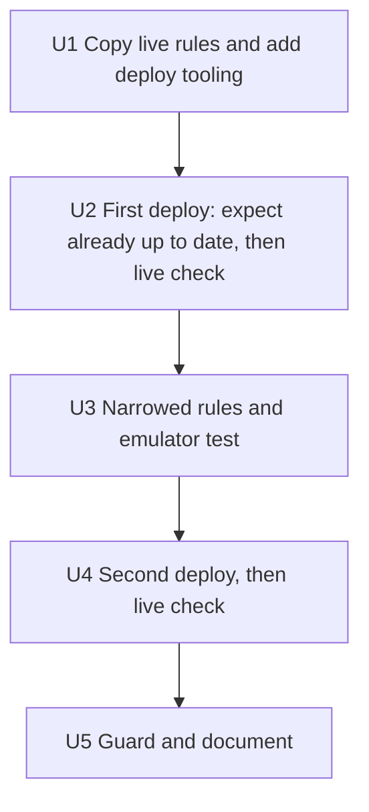

# Firestore Rules in the Repo - Plan

## Goal Capsule

- **Objective:** Only Elliott, Chloe and Barrie can read or write PlatePlan's household data. The rules that enforce this are kept in the repo, tested, and published from there, so nobody can reopen the data by mistake. This plan covers putting the real rules in the repo and limiting them to `households/elliott-chloe`. Rejecting badly shaped documents is not in scope.
- **Means:** The repo's `firestore.rules` becomes the deployed source. Barrie publishes it from his machine with the Firebase CLI (KTD2), and a local emulator test proves who is allowed and who is refused (KTD3).
- **Product authority:** Barrie decides and deploys. Elliott or Chloe confirm the app still works after each deploy.
- **Execution profile:** Repo changes plus two manual deploys. Barrie does the steps that need his Google login or the console: copying the live rules, `firebase login`, and both deploys.
- **Stop conditions:** Stop and roll back to the previous ruleset if the app fails to load or save after a deploy (R8). Stop before the second deploy if the first one uploads a ruleset that differs from the previous one in anything other than whitespace (KTD5).
- **Open blockers:** None.

---

## Product Contract

Product Contract preservation: the Summary, Problem Frame, Key Decisions, Requirements, Acceptance Examples, Scope Boundaries and work-relationships are unchanged. The four Outstanding Questions were all Deferred to Planning. Planning answered them in KTD1, KTD4, KTD5 and KTD6, so they were removed. The Java assumption was updated with what planning found.

### Summary

The repo becomes the only place the Firestore rules are published from. The rules allow the three listed accounts to read and write under `households/elliott-chloe` and refuse everything else. A local emulator test checks both the allowed and the refused cases. Rollout takes two deploys: first an unchanged copy of the live rules, then the narrowed version.

### Problem Frame

Barrie published household-only rules in the Firebase console on 2026-10-27. They allow only Elliott's, Chloe's and Barrie's UIDs to read and write. Those rules exist only in the console. The repo's `firestore.rules` is an older draft that lets any signed-in Google account read and write every household. If someone deploys that draft, or treats it as the reference, the data is open again. There is no `firebase.json`, so nothing can be deployed from the repo, and nothing tests the live rules. The app signs in with Google only and has no allowlist of its own, so the rules are the only thing keeping other accounts out.

Elliott builds through Google AI Studio, which syncs to this public repo. An AI edit to the rules file is plausible.

### Key Decisions

- **The repo is the source and Barrie deploys from his machine.** Edits in the repo, including Elliott's AI's, change nothing live until Barrie deploys. Governs R2, R3. (session-settled: user-approved — chosen over keeping the repo as a hand-synced copy, which drifts, and over GitHub Actions deploying on main, which needs a stored deploy credential and lets any push to main change data access)
- **Limit to the household path now, and leave shape validation for later.** The household limit is small and safe because all the data already sits under it. Shape validation covers 13 collections with several writers, and a wrong rule silently blocks saves. Governs R4, R5. (session-settled: user-approved — chosen over doing only the repo copy, and over including shape validation in this plan)
- **Prove the rules with emulator tests plus a live check.** Governs R7, R8. (session-settled: user-approved — chosen over checking by hand in the console Rules Playground, which can't be rerun, and over a live check alone, which never proves that other accounts are refused)
- **Barrie's UID stays, and is recorded as temporary.** Governs R6. (session-settled: user-directed — chosen over keeping it with no end date, and over removing it now, which would end Barrie's in-app testing during the rescue)
- **Two deploys, not one.** The first deploy changes nothing live, which proves the deploy path works. The second contains only the narrowing, so any breakage points at one change. The console keeps a rules history to roll back to. Governs R9.
- **UIDs may appear in the public repo, and email addresses may not.** A UID is not a secret: the rules compare it against the signed-in user's UID, which can't be faked. `CLAUDE.md` says to keep emails out. Governs R6.

### Requirements

**Repo as source of truth**

- R1. `firestore.rules` in the repo replaces the old "any signed-in user" draft. Before the first deploy, it matches the rules currently published in the console exactly.
- R2. The repo contains the Firebase project config needed for Barrie to publish the rules to project `plateplan-a5131` with one command. That command publishes Firestore rules only.
- R3. Pushing to any branch, `main` included, does not change the live rules. Only Barrie's deploy does.

**Access**

- R4. The three listed UIDs (Elliott, Chloe, Barrie) can read and write the `households/elliott-chloe` document and everything beneath it.
- R5. Everything else is refused: any other signed-in account, any signed-out request, and any path outside `households/elliott-chloe`, including other household IDs and top-level collections.
- R6. The rules file labels each UID by person, gives no email addresses, and marks Barrie's UID as temporary, to be removed when the rescue ends.

**Proof**

- R7. A local test runs the repo's rules in the Firestore emulator, checks every R4 and R5 case, and exits non-zero on failure, like the existing `scripts/test_*.js` scripts.
- R8. After each deploy, Elliott or Chloe confirms the app loads their data and saves a change.

**Rollout**

- R9. Rollout uses two deploys, each followed by the R8 check. The first publishes the R1 copy unchanged. The second publishes the R4/R5 narrowing.

**Guarding the file**

- R10. `workflow-enforcer.md` tells Elliott's AI not to edit the rules file or the Firebase config, and to send rule changes to Barrie instead.
- R11. The "Data and security" section of `CLAUDE.md` says the repo rules are the deployed rules, and covers how to test and deploy them.

### Acceptance Examples

- AE1. **Covers R4.** Given Chloe is signed in, when she reads or writes `households/elliott-chloe/recipes/<any id>`, then it is allowed.
- AE2. **Covers R5.** Given an unlisted Google account is signed in, when it reads `households/elliott-chloe/plans/current`, then it is refused.
- AE3. **Covers R5.** Given no one is signed in, when any household document is read, then it is refused.
- AE4. **Covers R5.** Given Elliott is signed in, when he writes `households/other-house/data/x` or a top-level `settings/x`, then it is refused.
- AE5. **Covers R1, R9.** Given the repo copy matches the console, when Barrie runs the first deploy, then the console's rules text is unchanged and the app still loads and saves.

### Scope Boundaries

- Rejecting badly shaped documents (field and type validation) is deferred to its own brainstorm.
- Running the emulator tests in GitHub Actions is deferred. CI would need Java and the emulator, and the tests run locally for now.
- Removing Barrie's UID is not part of this work. R6 records it as a later step.
- Deploying anything else through the Firebase CLI (Hosting, Functions, indexes) is out of scope. GitHub Pages stays the host.
- The app's own access checks and the missing sign-in button are separate work.
- Considered and not built: a CI check that fails when `firestore.rules` changes without a deploy. Nothing live changes from a repo edit (R3), and R10 tells Elliott's AI to leave the file alone. Reconsider if the repo file and the console drift apart in practice.

<!-- ce-section: work-relationships -->
### How This Work Fits Together

This plan covers getting the real rules into the repo and limiting them to the household path. That completes the remaining part of rescue Idea 1, which already includes verified backups and the household-only console rules. The list below is how the follow-on work looks today, not a committed roadmap.

- Shape validation (rejecting badly shaped documents)
  - Depends on this plan's repo rules, deploy path and emulator test, which it would extend.
  - Still to decide: which collections to cover first, and how to learn each one's real shape from backups without blocking current saves.
- Removing Barrie's UID when the rescue ends
  - Depends on R6's marker. It is one edit plus a deploy through this plan's path.
- Emulator tests in CI
  - Can proceed independently of shape validation once R7 exists.

### Dependencies / Assumptions

- Barrie's Google account can deploy rules to `plateplan-a5131`. He already publishes rules in the console, so this is assumed but not yet tested through the CLI.
- Recent firebase-tools releases are expected to need Java 21 or later for the emulator. Barrie's global default is openjdk 17.0.2, and asdf also has openjdk 25.0.2 and 26.0.2 installed. KTD4 chooses 25.0.2 for this repo only.
- All app data lives under `households/elliott-chloe`. The 2026-10-28 backup (1,585 documents) has no other top-level collection. Every `collection(...)` call in `src/` goes through `households` with `HOUSEHOLD_ID`, and `src/` makes no collection-group queries.
- The Firebase CLI is not installed on Barrie's machine yet.

### Sources / Research

- `firestore.rules`: the current looser draft.
- `src/config/firebase-config.js:17`: project ID `plateplan-a5131`.
- `CLAUDE.md` "Data and security" and "Backups": the deployed rules, the email-comment rule and the backup script.
- `~/PlatePlan-backups/plateplan-backup-2026-10-28T08-49-12-144Z.json` (outside the repo): per-collection document counts, all under `households/elliott-chloe`.
- `workflow-enforcer.md`, `plateplan-architecture.md`: neither mentions Firestore rules today.

---

## Planning Contract

### Key Technical Decisions

- KTD1. **Firebase tooling goes in as pinned devDependencies.** `firebase-tools` (15.x, the current major) and `@firebase/rules-unit-testing` 5.x are added to `devDependencies`, and `package-lock.json` records the exact versions. The testing library must stay on 5.x because 5.x expects `firebase` ^12, which matches the installed `firebase` 12.19.0. 6.0.0 expects `firebase` ^13. CI is unaffected because `.github/workflows/pages.yml` never runs `npm install`. Rejected alternative: `npm install --no-save` as `firebase-admin` uses, because it leaves the versions unrecorded and the test can't be rerun the same way later.
- KTD2. **Deploy config covers Firestore rules and nothing else, and the deploy runs the rules test first.** `firebase.json` names only `firestore.rules`, with no indexes, hosting or functions keys. `.firebaserc` sets the default project to `plateplan-a5131`. An npm script runs the deploy with `--only firestore:rules`, so the one command in R2 can't touch anything else. From U3 onward, that script runs the rules test first and stops if it fails. This means a widened rule, such as the old "any signed-in user" draft coming back through a merge, can't go live through the one deploy command. U2's first deploy is the exception, because it runs before the test exists. Governs R2, R3, R7.
- KTD3. **Tests run in the emulator against a `demo-` project.** The test script and its npm script use project ID `demo-plateplan`. The Firebase CLI treats `demo-*` projects as offline-only, so a test run can't reach the real database or use the daily read quota (see `docs/solutions/workflow-issues/localhost-testing-uses-the-household-firestore-read-quota.md`). The emulator is started by `firebase emulators:exec --only firestore`, which runs the Node test script and shuts down afterwards. The script loads `firestore.rules` from disk, so it always tests the file that gets deployed. Governs R7.
- KTD4. **Java is pinned per repo through asdf.** A committed `.tool-versions` sets `java openjdk-25.0.2` for this repo. Barrie's global default stays at 17. The file has no effect on people who don't use asdf, and CI doesn't run the emulator.
- KTD5. **The emails come out of the console first. Then the live rules are copied by hand, and the first deploy proves the copy.** `CLAUDE.md` warns that the console rules carry email comments, and the repo is public (R6). Before copying, Barrie replaces any email address in the console rules with a first-name label and publishes that change. It is comment-only, so access doesn't change. He then copies the cleaned text from Firestore → Rules into `firestore.rules`, character for character. On deploy, firebase-tools compares the file's name and content with the latest released ruleset. If they match exactly, it reports the rules are already up to date and skips the upload. If it uploads instead, for example because of a trailing newline, Barrie compares the new and previous versions in the console's rules history. A whitespace-only difference passes. Any other difference means roll back to the previous version and stop. Either outcome that passes is the R1/AE5 proof. Governs R1, R6, R9.
- KTD6. **Narrowed rules: one household match, default deny everywhere else.** Under `rules_version = '2'`, a single `match /households/elliott-chloe/{document=**}` allows read and write when a helper function says the caller's UID is one of the three. The v2 recursive wildcard matches zero or more segments, so it covers the household document itself and every subcollection. With no other `match` block, every other path is refused by default. Governs R4, R5, R6.

  Directional sketch, not final text:

  ```text
  rules_version = '2'
  firestore service:
    function isHouseholdMember():
      signed in AND uid in [Elliott's UID, Chloe's UID, Barrie's UID (temporary: remove at rescue end)]
    match /households/elliott-chloe/{document=**}:
      allow read, write if isHouseholdMember()
    (no other matches, so everything else is denied)
  ```

- KTD7. **The rules test follows the repo's test-script pattern.** It is a standalone ES-module Node script, `scripts/test_firestore_rules.js`. It counts failures, prints a short report and exits non-zero on any failure, like `scripts/test_shopping_list.js`. It uses the testing library's assert-succeeds and assert-fails helpers. The three expected UIDs are written into the test on purpose, so an edit to the allowlist in the rules fails the test until the test is updated too.

### Sequencing

U1 and U2 publish the unchanged copy. U3 and U4 then publish the narrowing, and U5 documents the result. U2 and U4 are operational steps for Barrie, so they have no code change of their own.



Each deploy runs from a clean working tree whose commit has been pushed. After U4, the commit is merged through `development` to `main` promptly, so `main`'s `firestore.rules` matches what's live. A push to `main` redeploys Pages but doesn't touch the rules (R3).

### Risks

| Risk | Mitigation |
|---|---|
| The narrowed rules block Elliott or Chloe, and the app can't load or save | The emulator test covers the allowed cases first (U3). If the R8 live check fails, roll back right away to the previous ruleset in the console's rules history, or redeploy the U1 commit. |
| The console rules carry email comments that would reach the public repo | KTD5: the emails come out in the console before the copy, and U1 checks the file for `@` before committing. |
| The hand copy in U1 differs slightly from the console | KTD5: an upload is compared in the console's rules history. Anything beyond whitespace is rolled back and stops the rollout before the narrowing. |
| A later edit widens the rules and gets deployed | KTD2: from U3 onward, the deploy script runs the rules test first and stops on failure. |
| The emulator won't start on Java 17 | KTD4 pins 25.0.2 for this repo. |
| Emulator or CLI logs land in the public repo | U1 adds the emulator and CLI debug logs to `.gitignore`. The login token is stored under Barrie's home directory, not in the repo. |
| The live check uses up the read quota | One signed-in load and one save per person is far below the 50k daily reads. The test itself reads nothing live (KTD3). |

---

## Implementation Units

### U1. Copy the live rules and add deploy tooling

**Goal:** The repo holds an exact copy of the live rules and everything needed to deploy and test them.

**Requirements:** R1, R2, R3. KTD1, KTD2, KTD4, KTD5.

**Dependencies:** None.

**Files:**
- `firestore.rules` (replaced with the console text, verbatim)
- `firebase.json` (new)
- `.firebaserc` (new)
- `.tool-versions` (new)
- `package.json`, `package-lock.json`
- `.gitignore`

**Approach:**
1. In the console, Barrie replaces any email address in the rules with a first-name label and publishes that comment-only change (KTD5). He then copies the published rules into `firestore.rules` without editing them, including comments and whitespace. The temporary marker on Barrie's UID (R6) waits until U3, because adding it now would break the exact match.
2. Add `firebase.json` and `.firebaserc` per KTD2.
3. Add the devDependencies per KTD1, plus two npm scripts: one that deploys the rules only, and one that runs the emulator test (KTD3). The test script itself arrives in U3, so for now the deploy script doesn't run the test (KTD2).
4. Add `.tool-versions` per KTD4.
5. Add `firebase-debug.log`, `firestore-debug.log` and `ui-debug.log` to `.gitignore` under a short comment.
6. Barrie runs `firebase login` through the project's CLI, for example `! npx firebase login` in this session.

**Patterns to follow:** The `.gitignore` grouping and comment style already in the file. The npm script naming in `package.json` (`dev`, `build`, `lint`).

**Test scenarios:** Test expectation: none -- config and a verbatim copy. U2's deploy proves the copy.

**Verification:**
- `firestore.rules` no longer contains the "any signed-in user" draft.
- `firestore.rules` contains no `@` before it is committed, so no email address can reach the public repo (R6).
- `npx firebase projects:list`, or the equivalent, shows Barrie signed in with access to `plateplan-a5131`.
- `npm run build` and the `src/` syntax check still pass.

### U2. First deploy: the unchanged copy

**Goal:** Prove that the deploy path works and that the repo copy matches what's live, with nothing changed live.

**Requirements:** R1, R8, R9. AE5. KTD5.

**Dependencies:** U1.

**Files:** None.

**Approach:**
1. Barrie commits and pushes U1, then runs the rules deploy script from a clean tree.
2. Expected output: the rules are already up to date and the upload was skipped. If it uploads, follow KTD5's whitespace check. Anything beyond whitespace is a stop condition (Goal Capsule).
3. Elliott or Chloe load the app and save one change (R8).

**Test scenarios:**
- Covers AE5. Deploying the U1 copy reports that the rules are already up to date, and the console's rules history shows no new version.
- Covers AE5. If the deploy uploads instead, the console's rules history shows the new and previous versions differ only in whitespace.

**Verification:** The deploy output and the live check are recorded in the work log or commit notes.

### U3. Narrowed rules and the emulator test

**Goal:** The rules allow only the three UIDs under `households/elliott-chloe`, and a rerunnable test proves it.

**Requirements:** R4, R5, R6, R7. AE1–AE4. KTD3, KTD6, KTD7.

**Dependencies:** U2.

**Files:**
- `firestore.rules`
- `scripts/test_firestore_rules.js` (new)
- `package.json` (deploy script runs the test first)

**Approach:**
1. Rewrite `firestore.rules` per KTD6. Label each UID with the person's first name, with no email addresses (R6). Mark Barrie's UID as temporary, to be removed when the rescue ends.
2. Write the test per KTD7, using the `demo-plateplan` project (KTD3). It builds authenticated contexts for each listed UID, one for an unlisted UID, and one unauthenticated context.
3. Change the rules deploy npm script so it runs the rules test first and stops if the test fails (KTD2).

**Execution note:** Write the test first and run it against the U1 copy. The other-household and top-level cases should fail, which shows the test can catch the old breadth. Then narrow the rules until it passes.

**Patterns to follow:** `scripts/test_shopping_list.js` for the report and exit-code shape. `scripts/backup_firestore.js` for header-comment style and how scripts resolve the repo root.

**Test scenarios:**
- Covers AE1. Chloe reads and writes `households/elliott-chloe/recipes/r1`: both allowed.
- Elliott and Barrie each read and write `households/elliott-chloe/plans/current`: allowed.
- A listed UID reads and writes the household document `households/elliott-chloe` itself: allowed.
- A listed UID writes a nested subcollection document, for example `households/elliott-chloe/settings/preferences`: allowed.
- Covers AE2. An unlisted UID reads `households/elliott-chloe/plans/current`: refused. The same UID writing there: refused.
- Covers AE3. An unauthenticated context reads `households/elliott-chloe/recipes/r1` and the household document: both refused.
- Covers AE4. Elliott writes `households/other-house/data/x`: refused. Elliott writes top-level `settings/x`: refused.
- A listed UID reads top-level `households/other-house`: refused.
- The script exits non-zero when any assertion fails. Check this by temporarily removing one UID locally, not in a commit.

**Verification:** `npm run test:rules` passes against the narrowed rules. The execution-note run showed failures against the U1 copy. When a rules test is made to fail locally, the deploy script stops before reaching Firebase.
### U4. Second deploy: the narrowed rules

**Goal:** The narrowed rules are live and the app still works for the household.

**Requirements:** R8, R9.

**Dependencies:** U3.

**Files:** None.

**Approach:**
1. With U3 committed, pushed and `npm run test:rules` passing, Barrie runs the rules deploy script. It should upload and release a new ruleset.
2. Barrie checks that the console shows the new text.
3. Elliott or Chloe load the app and save one change. On failure, roll back (see Risks).
4. Merge through `development` to `main` (Sequencing).

**Test scenarios:**
- After the deploy, the console's published rules match the repo's `firestore.rules`.
- Covers R8. Elliott or Chloe load their data and save one change without errors.

**Verification:** The deploy output, the console view and the live-check result are recorded.

### U5. Guard and document the rules

**Goal:** Elliott's AI leaves the rules alone, and the project instructions describe the real setup.

**Requirements:** R10, R11.

**Dependencies:** U4.

**Files:**
- `workflow-enforcer.md`
- `CLAUDE.md`

**Approach:**
1. Add one rule to `workflow-enforcer.md` in its existing one-paragraph style. It says not to edit `firestore.rules`, `firebase.json` or `.firebaserc`, that Barrie deploys them, and that rule changes go to him.
2. Rewrite `CLAUDE.md` "Data and security":
   - the repo `firestore.rules` is what's deployed, with three UIDs (Barrie's temporary)
   - how to run the test and the deploy, and the asdf Java note
   - the remark that rules can't be deployed from the repo is removed
   Keep the existing note about the duplicated `HOUSEHOLD_ID`. Add the two new npm scripts to "Commands".

**Test scenarios:** Test expectation: none -- documentation only.

**Verification:** Neither file still says the repo rules are an undeployed draft or that only two UIDs are allowed.

---

## Verification Contract

| Check | Command or action | Applies to |
|---|---|---|
| Rules test passes | `npm run test:rules` (emulator via `firebase emulators:exec`, Java from `.tool-versions`) | U3, U4 |
| Build still passes | `npm run build` | U1, U3 |
| Syntax check matches CI | `find src -name '*.js' ! -name PantryBankModalService.js -print0 \| xargs -0 -n1 node --check` | U1 |
| Copy matches live | rules deploy reports "already up to date", or the console's rules history shows a whitespace-only difference | U2 |
| Deploy is gated | a failing rules test stops the deploy script | U3 |
| Live rules match repo | console Firestore → Rules shows the repo text | U4 |
| App still works | Elliott or Chloe load and save once after each deploy | U2, U4 |

The three known-failing tests from `CLAUDE.md` (`test_accessibility_dom.js`, `test_plan_generator.js`, `test_recipe_wizard.js`) still fail for their existing reasons. They are not part of this plan's gate.

---

## Definition of Done

- The live rules equal the repo's `firestore.rules`: three labeled UIDs, `households/elliott-chloe` only, everything else refused (R1, R4–R6).
- `npm run test:rules` passes and covers AE1–AE4 (R7).
- Both deploys happened in order, each followed by a successful live check (R8, R9).
- `firebase.json` deploys Firestore rules only, and no CI step deploys rules (R2, R3).
- `workflow-enforcer.md` and `CLAUDE.md` describe the setup (R10, R11).
- `main`, `development` and `dev/review-state` contain the deployed rules.
- No emulator logs, credentials or experimental leftovers are in the diff.
