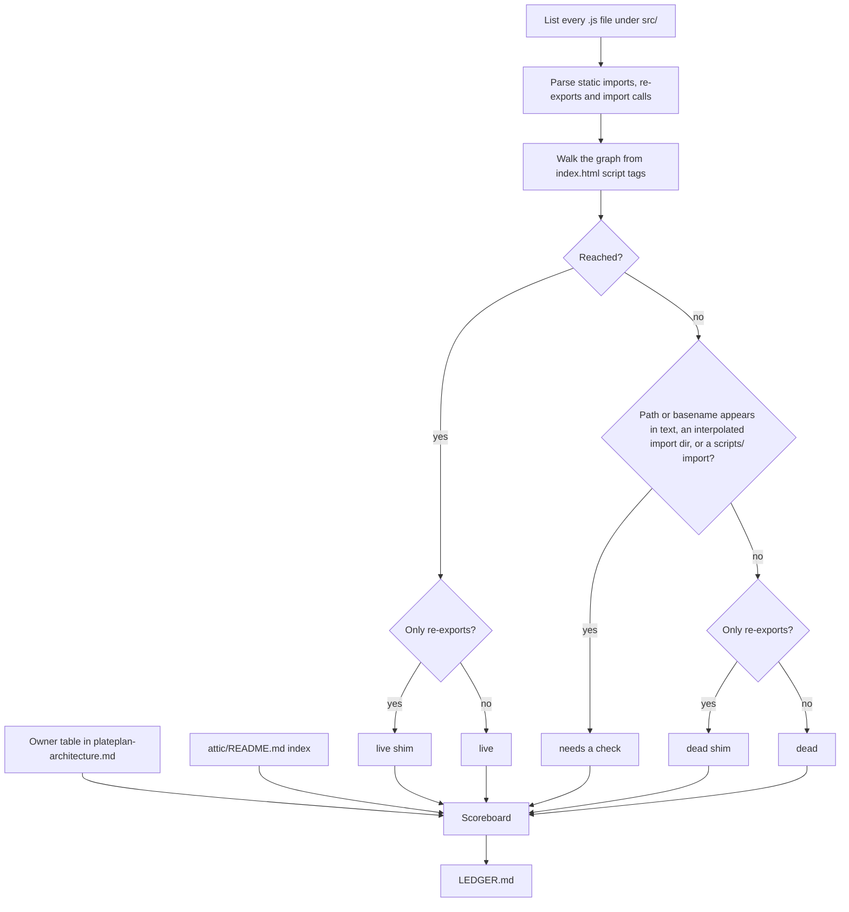

# Dead-Code Ledger and Attic Quarantine - Plan

## Goal Capsule

- **Objective:** Elliott takes over PlatePlan from a clean baseline, with an honest count of its remaining dead weight and duplicated modules that he can refresh himself, and with a quarantine process his AI can follow safely.
- **Means:** A small custom ledger script (KTD1) writes a committed scoreboard, which reads a restructured owner table (KTD4). Proven-dead files go into a git-tracked `attic/` (KTD6).
- **Product authority:** Barrie, who is finishing the rescue and handing it to Elliott. Elliott is the main reader of the result. Merging the parallel live versions and deleting the attic after its waiting period are not active scope.
- **Stop conditions:**
  - Stop if the first ledger run labels any of the seven candidates in R9 as anything other than dead or dead shim. Report the reason; do not move that file.
  - Stop before un-ignoring `attic/` if `scripts/generate-golden-master.js` still writes household-derived output there.
  - Stop if the Pages build or the syntax check fails after the move.
- **Execution profile:** Work happens on `dev/review-state`. Barrie approves every push. `development` and `main` move only by fast-forward, with his approval. A push to `main` redeploys Pages.
- **Finishing:** `ce-work` implements U1–U5 and verifies them locally. Barrie checks the app on a phone after the deploy, and the two-week clock starts on the move date.
- **Open blockers:** None.

---

## Product Contract

Product Contract preservation: unchanged. Its three questions deferred to planning are answered by KTD1, KTD3 and KTD6 and removed from Outstanding Questions.

### Summary

One `npm` command regenerates a ledger file in the repo. It labels every module as live, live shim, dead shim, dead or "needs a check", and opens with a scoreboard that also counts the parallel versions recorded in the owner table. Everything the ledger proves dead moves into a tracked `attic/` that the build ignores. It waits there through two weeks of normal use before a later deletion. Elliott's AI rules and `CLAUDE.md` point at the ledger.

### Problem Frame

Idea 2 of the 2026-10-25 rescue ideation asked for an evidence-checked map of live, shim and dead code, followed by a quarantine. Part of it is done:
- Elliott's studio changes deleted `PlatePlan.html`, the old `scripts/` runtime and the duplicate plan generator.
- The Shopping screen and the service worker were removed.
- `plateplan-architecture.md` gained an owner table.

The map itself was never generated. What we know about dead and duplicated code comes from hand searches, and those have already been wrong in both directions:
- `store/state.js` looked dead but five store modules import it.
- `components/pantry/ActionSheetUI.js` looks unused but is loaded through a template-string import.

The rules Elliott's AI follows also point at things that don't work:
- `workflow-enforcer.md` says to move dead files to `attic/` before deleting them, but `.gitignore` ignores `attic/`, so a move there silently removes the file from git.
- The owner table still names the deleted `PlanGeneratorService.js`, and it names the pantry `ActionSheetUI` as the only overlay owner even though the navigation one is also live.

Barrie is about to hand the rescue to Elliott, who would rather see how much dead weight is left and clear it himself than take it on trust.

### Key Decisions

- **This plan covers the map and the quarantine, not merging the parallel versions.** Merging changes the behaviour of live code, and each area needs its own brainstorm informed by the map. (session-settled: user-approved — chosen over map only, all three areas together, and consolidation without a map: the map has to come first, and merging is riskier work that deserves separate scoping.)
- **The ledger is a scoreboard for Elliott.** Its job is to show him how much is left and let him watch the count fall, not to block anyone. (session-settled: user-directed — chosen over a one-off report for Barrie and a guard that stops new parallel modules: the rescue ends in a handover, and Elliott will want to clean up himself.) Governs R1, R4.
- **The ledger is a committed report plus one command, with no CI step.** (session-settled: user-approved — chosen over GitHub Actions refreshing the counts on every push, and over a build check that fails when dead weight grows: a red build could confuse Elliott early on, and he is close to using a terminal already.) Governs R1, R5.
- **The scoreboard counts parallel versions from the owner table.** Static analysis can't tell that three unit converters do the same job, so the owner table is the source for that count. (session-settled: user-approved — chosen over counting only what the tool finds: most of the dead weight left after this plan is parallel live versions, so leaving them out would make the scoreboard look finished when it isn't.) Governs R4, R6, R7.
- **Barrie clears the proven-dead files now.** Elliott inherits a clean baseline, and the scoreboard shows the hard part that is left. (session-settled: user-approved — chosen over leaving the dead files for Elliott and over clearing only one as a demonstration: a clean starting point is easier to hand over, and the move itself serves as the worked example.) Governs R9, R11.
- **The quarantine is a tracked attic, emptied after a set wait.** (session-settled: user-approved — chosen over deleting now with git as the undo, and over a tracked attic with no deadline: Elliott can see what is waiting, the rule his AI follows becomes true, and the wait keeps the attic from filling up for good.) Governs R8, R10.
- **Anything the tool can't prove dead is labelled "needs a check", not quarantined.** Static analysis can't see `window.*` globals, the component registry, `data-action` strings or template-string imports, and two hand searches have already been wrong. Governs R3.

### Requirements

**The ledger**

- R1. One `npm` command regenerates a ledger file that is committed to the repo and readable on GitHub and in AI Studio without running anything.
- R2. The ledger follows the app's real entry points (`index.html` loading `src/main.js`) and gives every module under `src/` one label: live, live shim (a re-export something still imports), dead shim (a re-export nothing imports), dead, or "needs a check".
- R3. A module is labelled dead or dead shim only when nothing reaches it, including through `window.*` globals, the component registry, `data-action` strings and template-string imports. If the tool can't settle that, the label is "needs a check".
- R4. The ledger opens with a scoreboard in plain words. It shows the count for each label, the number of parallel modules and the jobs they cover (per R7), the number of unused exports in live files, and what is waiting in `attic/` and since when. The lists follow the scoreboard.
- R5. Regenerating the ledger without any code change leaves the file byte-for-byte unchanged, so a diff shows only real changes.

**The owner table**

- R6. The owner table in `plateplan-architecture.md` matches the code. It names one owner per job and lists by name the extra modules for each job that has parallel versions: unit conversion, Data Quality, state and ActionSheetUI. Its stale plan-generator line is gone, and its quarantine section reflects the attic.
- R7. The scoreboard's parallel count is read from the owner table. When a version is merged and the table is updated, the next refresh shows a lower count.

**The quarantine**

- R8. `attic/` is tracked by git, is not copied into `dist/` by the build, and is never loaded by the app.
- R9. Every module the ledger labels dead or dead shim moves into `attic/` under its original path, so moving it back restores it. The verified candidates are:
  - `src/services/firebase.js`
  - `src/components/RecipeWizardModal.js`
  - `src/components/recipe/VaultRecipeCard.js`
  - `src/components/recipe/ViewRecipeModal.js`
  - `src/views/ProfileAllocationCard.js`
  - `src/services/FitScoreEngine.js`
  - `src/views/PantryBankModalService.js`

  A file the ledger labels "needs a check" stays where it is. Any other dead file the ledger finds moves too.
- R10. The attic records when each file went in. It also says the file may be deleted after two weeks of normal use on both phones with no related problem.
- R11. After the move, the Pages build passes, the app works on both phones, and the scoreboard shows no dead or dead-shim modules outside `attic/`.

**Rules and docs**

- R12. `workflow-enforcer.md` describes the tracked attic and its two-week wait, and it names the ledger and the command that refreshes it. It also requires that any new module doing a job the owner table already assigns is added to the table as a parallel version, so the scoreboard counts it.
- R13. The Commands section of `CLAUDE.md` lists the ledger command. Its Architecture section refers to the ledger for shims and parallel versions instead of listing them again by hand.

### Acceptance Examples

- AE1. **Covers R3.** **Given** `components/pantry/ActionSheetUI.js` is reached only through a template-string import in `PantryBankView.js`, **when** the ledger runs, **then** the file is labelled live or "needs a check" and never dead.
- AE2. **Covers R4, R7.** **Given** the owner table lists three unit-conversion modules, **when** Elliott merges `RecipeUnitConverter` into another module, updates the table and refreshes the ledger, **then** the parallel count drops by one.
- AE3. **Covers R12, R7.** **Given** Elliott's AI adds a new module next to an existing one that does the same job, **when** it follows `workflow-enforcer.md`, **then** it adds the new module to the owner table as a parallel version, and the next refresh shows a higher count.
- AE4. **Covers R9, R10.** **Given** a quarantined file turns out to be needed during the two weeks, **when** it is moved back to its original path, **then** the app works as before and the attic no longer lists it.
- AE5. **Covers R5.** **Given** no code has changed, **when** the ledger command runs, **then** `git status` shows no change to the ledger file.

### Success Criteria

- Elliott can read the scoreboard and say what is left to clear, and why, without asking Barrie.
- The first refresh after this work shows zero dead modules outside the attic. A nonzero parallel count appears next to the jobs it covers.

### Scope Boundaries

- Merging the parallel live versions of unit conversion, Data Quality, state and ActionSheetUI. Each merge gets its own brainstorm.
- Deleting the attic contents after two weeks. That is a later step, and whether Barrie or Elliott does it is still open.
- A CI check or build ratchet on the ledger, and printing the counts in GitHub Actions.
- Removing unused exports inside live files. They are only counted.
- The broken `data-pp-*` handlers and the `data-action` values that name missing functions, already recorded in `CLAUDE.md`.
- A runtime census of modules that load but never run (Idea 6 of the ideation).
- **Considered, not built:**
  - A `--check` mode that fails when the committed ledger is stale. Nothing would run it without CI, which is out of scope. Add it if a CI step is added later.
  - Keeping `scripts/ledger.js` out of the published `dist/`. The build already publishes every script, including the tests. The script holds no data, so nothing is exposed.
  - Checking that every file in `attic/` has an entry in the attic index. A file without one shows "no date" in the ledger, which is visible enough.

<!-- ce-section: work-relationships -->
### How This Work Fits Together

This plan covers the map and quarantine part of Idea 2. The breakdown below is the current understanding, not a committed roadmap.

- Merging parallel versions, one area at a time: unit conversion, Data Quality, state, and ActionSheetUI.
  - Depends on this plan's owner table and scoreboard, which name the owner and count the extras.
  - Still to decide: the order, and whether Elliott leads each merge.
- Emptying the attic after the two-week wait.
  - Depends on this plan's dated attic.
  - Can proceed independently of the merges.
- Idea 7 of the ideation ("One door per Firestore collection; Data Quality becomes a report").
  - Shares the Data Quality merge with the work above.

### Dependencies / Assumptions

- Elliott can run one `npm` command in a terminal. He has already used the Firebase console login, so this is assumed rather than confirmed.
- Elliott and Chloe use the app normally during the two weeks, so a problem with a quarantined file would show up.
- The Pages workflow syntax-checks only `src/`, so files moved into `attic/` leave that check. Its special case for `PantryBankModalService.js` is then no longer needed.

### Sources / Research

- `docs/ideation/2026-10-25-plateplan-rescue-ideation.html`: Idea 2, including its warning that static analysis can't see `window.*` globals or inline handlers.
- `plateplan-architecture.md`: the owner table and the quarantine targets.
- `workflow-enforcer.md:12`: the "Quarantine Before Delete" rule.
- `.gitignore:22`: `attic/` is ignored as a local scratch folder.
- `scripts/build.js:33`: the build copies only `src`, `styles`, `vendor` and `scripts`.
- `.github/workflows/pages.yml:28-29`: the syntax check over `src/`.
- `src/views/PantryBankView.js:187,214`: the template-string imports of the pantry `ActionSheetUI`.
- `src/main.js:11` and `src/services/ActionBridge.js:148`: the dynamic imports of the navigation `ActionSheetUI`.
- `src/store/store.js:12`: an example of the relative imports that keep `store/state.js` live.

---

## Planning Contract

### Key Technical Decisions

- KTD1. **The ledger is a small custom Node script with no new dependency.** It is `scripts/ledger.js`, and `npm run ledger` runs it.
  - Knip and dependency-cruiser would report modules reached through `window`, the registry or `data-action` as unused, which is the mislabel R3 forbids.
  - Knip can't use `index.html` as an entry without a plugin.
  - dependency-cruiser is a large dependency, and it doesn't count unused exports.
  - All 41 dynamic imports in `src/` today use fixed strings: 22 quoted and 19 template strings with no `${}`. A short script can therefore resolve every import exactly. KTD2 covers any future import that does use `${}`.
  - The repo has no other tooling of this kind.
- KTD2. **Liveness means "the browser can load this file", and labels follow from that.** A module's code runs only if something loads it by path: a script tag, a static import or re-export, or a dynamic import. Globals on `window` and `data-action` strings reach only modules that are already loaded, which is how the registry's components are reached (`componentRegistry.js` is imported by `main.js`). So:
  - **Live:** reachable from the `index.html` script tags through imports.
  - **Shim:** a file whose only statements are re-exports, whether live or dead.
  - **Needs a check:** an unreachable file whose parent-folder-plus-name path appears in another file's code in `index.html` or `src/`, for example `services/firebase.js` for `src/services/firebase.js`. Comments are removed first, and the file's own text never counts. An import or re-export specifier that resolves to a different existing file doesn't count either: `../config/firebase.js` names `config/firebase.js`, not the shim. The same applies to every file in a directory used by an import with `${}`, and to any file a `scripts/` file imports.
  - **Dead:** everything else that is unreachable.

  This satisfies R3 by reasoning about what the browser loads, not by matching names. Export names of `export *` shims are the real module's names, so a name-based check would wrongly keep every shim alive.
- KTD3. **The ledger is `LEDGER.md` at the repo root.** It's the first thing Elliott sees on GitHub and in AI Studio. The build copies only a fixed list of root files, so it never ships.
  - It opens with the scoreboard in plain sentences and a small table (R4).
  - Then come lists grouped by label, each sorted by path.
  - Then the parallel versions grouped by job, then the attic with move dates and the earliest deletion date for each file.
  - The file contains no timestamps or commit IDs, so it satisfies R5.
- KTD4. **The owner table becomes a markdown table with three columns: Job, Owner and Parallel versions.** Parallel versions are comma-separated repo paths, or `—` when there are none. The script reads the table under its heading in `plateplan-architecture.md`. The ledger run stops with a clear error, rather than counting zero, if any of these happens:
  - the heading or table is missing
  - a row is malformed
  - a listed path no longer exists

  A silent zero would make the scoreboard look finished.
- KTD5. **Unused exports are counted only for live modules that aren't shims, and conservatively.** An export counts as unused only if all of these hold:
  - no module imports it by name
  - no module imports the file with `import *`, or re-exports it with `export *`
  - the name doesn't appear as a word in `index.html` or any other `src/` file

  Exports of registry modules are imported with `import *`, so they never count. The figure appears as a single count (R4), with no per-export list.
- KTD6. **The attic mirrors original paths and holds a dated index.** For example, `src/views/X.js` moves to `attic/src/views/X.js` with `git mv`.
  - `attic/README.md` explains the attic and the two-week rule. It also holds a table with columns File, Moved and Delete after, where Delete after is the moved date plus 14 days.
  - The ledger reads that table for its attic section. A file in the attic with no row shows "no date".
- KTD7. **Golden-master output moves out of the repo before `attic/` is tracked.** `scripts/generate-golden-master.js` writes output derived from the household backup to `attic/golden_master_post_refactor.json`. Once the attic is tracked, that output could be committed to the public repo.
  - Its default output moves to `~/PlatePlan-backups/`, the backup location in `CLAUDE.md`.
  - A `.gitignore` rule for `golden_master*.json` stays as a backstop.
  - This lands in the same commit that removes the `attic/` ignore, or an earlier one.

### High-Level Technical Design

How the ledger reaches a label. This is directional; the KTDs own the rules.

### Assumptions

- Comments are removed before import parsing, so a commented-out import doesn't keep a file live.
- Imports that a script can't resolve, because the target file is missing, are listed in the ledger as "broken imports". They are not counted as labels. If there are none, the section is omitted.
- Node 22 is the floor because the CI workflow pins it. The script uses only APIs available in Node 22, as `scripts/build.js` does.

### Sequencing

U1 builds and tests the script. U2 sets up the owner table and commits the first ledger, which shows the seven dead files. U3 makes the attic safe to track. U4 moves the files and refreshes the ledger to zero dead. U5 updates the docs. U1 and U3 are independent of each other. U4 needs U2 and U3. U5 needs U4.

---

## Implementation Units

### U1. Ledger script and its test

**Goal:** `npm run ledger` writes a deterministic `LEDGER.md` from the module graph, the owner table and the attic index.

**Requirements:** R1, R2, R3, R4, R5, R7. KTD1, KTD2, KTD3, KTD4, KTD5, KTD6.

**Dependencies:** None.

**Files:**
- create `scripts/ledger.js`
- create `scripts/test_ledger.js`
- modify `package.json` (add `"ledger": "node scripts/ledger.js"`)

**Approach:**
1. The script takes an optional root directory argument and defaults to the repo root. The test uses that argument to run it against a temporary fixture tree.
2. It finds the entries from the `src/` script tags in `index.html`, ignoring the `?v=` suffix. It then parses and walks the graph and labels each file per KTD2.
3. It reads the owner table per KTD4 and the attic index per KTD6, and counts unused exports per KTD5.
4. It renders `LEDGER.md` per KTD3. Every list is sorted, and the scoreboard sentences use plain words, for example "7 dead files, 9 parallel modules across 4 jobs".
5. It exits non-zero with a one-line reason when the owner table fails KTD4's checks.

**Patterns to follow:**
- `scripts/build.js` for the ESM header comment, finding the repo root with `fileURLToPath`, the `fs` style and the `main().catch` exit.
- `scripts/test_firestore_rules.js` for the check counter, failure-only output and the final pass line.
- The test builds its fixtures under `os.tmpdir()`, so no fixture files ship in `dist/`.

**Test scenarios** (all in `scripts/test_ledger.js` against temporary fixture trees):
- A file reached by a static import from `main.js` is labelled live.
- Covers AE1. A file reached only by a template-string `import()` with no `${}` is labelled live.
- A file that only re-exports and is imported by a live file is a live shim. The same file with no importer is a dead shim.
- An unreachable file with no mention anywhere is dead.
- An unreachable file whose parent-folder-plus-name path appears in an `index.html` attribute string is "needs a check".
- An unreachable shim `a/X.js` whose name appears only in a live import of `b/X.js` and in its own header comment is a dead shim.
- An unreachable file in a directory used by an `import(\`./views/${name}.js\`)` is "needs a check".
- An unreachable file imported by a `scripts/` file is "needs a check".
- A commented-out import doesn't make its target live.
- A file in a cycle with no path from an entry is dead.
- Covers AE2. An owner table with two jobs listing three and one parallel paths produces "4 parallel modules across 2 jobs". Removing one path lowers the count to 3.
- An owner table listing a path that doesn't exist makes the script exit non-zero and name the path.
- A missing owner-table heading makes the script exit non-zero.
- An export imported by name is not unused, an export of a module imported with `import *` is not unused, and an export no one names is counted as unused.
- An attic index row produces the move date and the date 14 days later. An attic file with no row shows "no date".
- Covers AE5. Running the script twice on the same tree produces byte-identical output.

**Verification:** `node scripts/test_ledger.js` passes. `npm run ledger` writes `LEDGER.md` in the real repo without error once U2 has restructured the table.

### U2. Owner table and first ledger

**Goal:** The owner table matches the code in the shape KTD4 defines. The first committed ledger shows the dead weight before anything moves.

**Requirements:** R6, R7, R1, R4. KTD3, KTD4.

**Dependencies:** U1.

**Files:**
- modify `plateplan-architecture.md` (section 2)
- create `LEDGER.md` (generated)

**Approach:**
1. Rewrite section 2 as the KTD4 table. The plan-generator line goes, because `MealPlanGeneratorService` is now the only generator.
2. Add rows with their parallel versions:
   - unit conversion: `UnitConversionService`, `RecipeUnitConverter`, `UnitConverter`
   - Data Quality: `DataQualityScanner`, `DataQualityEngine`, `DataQualityScannerService`, `DataQualityService`
   - state: `store/coreState.js`, `store/state.js`, `state/AppState.js`, `models/StateModel.js`
   - action sheets: the navigation and pantry `ActionSheetUI`
3. Keep each existing collection-owner row and its note, moving the note into the table, for example the duplicate products write. Correct the Meal Plans owner to `src/repositories/PlanRepository.js`, because `src/services/PlanRepository.js` doesn't exist. KTD4's path check covers the Owner and Parallel versions columns.
4. Pick each owner from the table as it is now, or from `CLAUDE.md` where the table is silent:
   - the owner of state is `store/coreState.js`
   - the owner of Data Quality is `DataQualityScanner.js`
   - the owner of action sheets is the navigation `ActionSheetUI`, which `main.js` and `ActionBridge.js` load; the pantry copy is its parallel version, loaded only by `PantryBankView.js`
5. Run `npm run ledger` and commit `LEDGER.md`.

**Test expectation:** none. This unit only edits a document and adds generated output. U1's tests cover the parsing.

**Verification:**
- The ledger run succeeds.
- The seven candidates in R9 appear as dead or dead shim. If any doesn't, stop, as the Goal Capsule's first stop condition says.
- Every path in the table exists.
- The parallel count matches the table.

### U3. Make the attic safe to track

**Goal:** `attic/` can be tracked without any risk of committing household data.

**Requirements:** R8. KTD7.

**Dependencies:** None.

**Files:**
- modify `scripts/generate-golden-master.js`
- modify `.gitignore`

**Approach:**
1. Change the default output path to the backups folder in `CLAUDE.md` (`~/PlatePlan-backups/`), using the user's home directory, and create the folder if it's missing. An explicit argument still overrides the default.
2. In `.gitignore`, remove the `# Local scratch folder` / `attic/` pair, and add `golden_master*.json` under the existing backups comment.

**Test expectation:** none. This changes a default path and a config file. Proof comes from the checks below.

**Verification:**
- `git check-ignore attic/x.md` reports nothing, so the attic is no longer ignored.
- `git check-ignore golden_master_post_refactor.json` and `git check-ignore attic/golden_master_post_refactor.json` both report the file as ignored.
- `node --check scripts/generate-golden-master.js` passes.

### U4. Move the dead files into the attic

**Goal:** Every dead and dead-shim module sits in a dated, tracked attic. The scoreboard shows none outside it.

**Requirements:** R8, R9, R10, R11. KTD6. Settled Key Decisions governing R9 and R11 (Barrie clears now) and R8 and R10 (tracked attic with a wait).

**Dependencies:** U2, U3.

**Files:**
- create `attic/README.md`
- move the seven files in R9 to `attic/src/...`, plus any other file U2's ledger labelled dead or dead shim
- modify `.github/workflows/pages.yml`
- modify `plateplan-architecture.md` (section 3)
- regenerate `LEDGER.md`

**Approach:**
1. Move each file with `git mv` to its mirrored path, per KTD6.
2. Write `attic/README.md` with:
   - one paragraph on what the attic is and how to restore a file
   - the two-week rule from R10
   - the index table, with Moved set to the move date
3. In `pages.yml`, drop the `! -name PantryBankModalService.js` exclusion and its comment line.
4. Rewrite section 3 of `plateplan-architecture.md` to point at `attic/README.md` and `LEDGER.md`. It currently lists stale candidates such as `scripts/core` and `src/utils/ActionBridge.js`.
5. Regenerate `LEDGER.md`.

**Execution note:** Prove each file has no importers from U2's ledger before moving it. Don't rely on the list in R9 alone.

**Test expectation:** none. This unit moves files and edits docs and config. The verification below is the proof, along with U1's tests of the labelling.

**Verification:**
- `npm run build` passes, and `dist/` contains no `attic/`.
- The `pages.yml` syntax check passes across all of `src/` with no exclusion.
- Apart from the three failures `CLAUDE.md` already lists, every `scripts/test_*.js` and `test_vault_fit_score.js` passes.
- The regenerated scoreboard shows 0 dead and 0 dead shim, and it lists seven or more files in the attic with dates.
- Covers AE4. Moving one file back with `git mv` and regenerating the ledger drops it from the attic list. Discard that trial before committing.

### U5. Rules and docs point at the ledger

**Goal:** Elliott's AI and future sessions follow the tracked-attic process and keep the owner table current.

**Requirements:** R12, R13. Covers AE3.

**Dependencies:** U4.

**Files:**
- modify `workflow-enforcer.md`
- modify `CLAUDE.md`

**Approach:**
1. In `workflow-enforcer.md`:
   - Rewrite "Quarantine Before Delete": a file moves to `attic/` only when `LEDGER.md` labels it dead or dead shim. It moves with its path mirrored and gets a dated row in `attic/README.md`, and it is deleted only after two weeks of normal use. Run `npm run ledger` after any such change.
   - Add a rule: a new module doing a job the owner table already assigns is added to that job's Parallel versions cell in the same change. A module that is merged away or moved to the attic comes out of the table in the same change, or the next ledger run stops with KTD4's error.
2. In `CLAUDE.md`:
   - Add `npm run ledger` to Commands.
   - Replace the hand-kept list of shims and parallel implementations in Architecture with a pointer to `LEDGER.md` and the owner table. Keep the explanation of why the parallels exist, but not the file lists.
   - Remove the `PantryBankModalService` mentions in "Branches and hosting" and Architecture.
   - Add `attic/` to Backups or Architecture in one line.
   - Note that `test_ledger.js` runs like the other tests.

**Test expectation:** none. This unit changes documentation only.

**Verification:**
- `CLAUDE.md` no longer names any file now in the attic, except by pointing to the attic.
- `workflow-enforcer.md` names `npm run ledger`, `LEDGER.md` and `attic/README.md`.
- A cold reader can answer "what do I do when I add a second unit converter?" from `workflow-enforcer.md` alone.

---

## Verification Contract

| Check | Command or action | Proves | Units |
|---|---|---|---|
| Ledger behaviour | `node scripts/test_ledger.js` | Labels, owner-table count, attic dates, determinism, error exits | U1 |
| Ledger is current and stable | `npm run ledger`, then `git diff --exit-code LEDGER.md` after a second run | R5, and that the committed ledger matches the code | U2, U4 |
| Syntax across `src/` | `find src -name '*.js' -print0 \| xargs -0 -n1 node --check` (the Pages step, with no exclusion) | Nothing broken is left in `src/` | U4 |
| Build | `npm run build`, then confirm there is no `dist/attic` | R8, and that the deploy still works | U4 |
| Existing tests | each `scripts/test_*.js` (except `test_firestore_rules.js`) and `test_vault_fit_score.js` | No test depended on a moved file; only the three known failures remain | U4 |
| Attic not ignored, data still ignored | the `git check-ignore` checks in U3 | KTD7 | U3 |
| Live app | After Barrie fast-forwards `main` and Pages deploys, open the app on a phone: sign in, Today, the vault, a recipe, the pantry bank and its action sheet | R11 on a real device; Elliott and Chloe's normal use covers the two weeks | after U4 |

---

## Definition of Done

- U1–U5 are committed on `dev/review-state`, each touching only its own files.
- `LEDGER.md` is committed, regenerating it produces no diff, and its scoreboard shows 0 dead and 0 dead shim outside the attic.
- The attic holds the moved files under mirrored paths, with dates in `attic/README.md`.
- All Verification Contract rows pass, apart from the live-app row, which waits for Barrie's push.
- `plateplan-architecture.md`, `workflow-enforcer.md` and `CLAUDE.md` agree with the ledger and the attic.
- The diff contains no leftover experiments, trial moves or scratch files.
