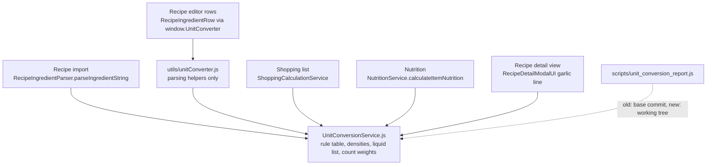

# One Unit Converter - Plan

## Goal Capsule

- **Objective:** Every part of PlatePlan turns a recipe measurement into the same grams or millilitres. Elliott can see and approve every number that changes before it reaches the household's shopping lists.
- **Means:** `src/services/UnitConversionService.js` becomes the single owner of one ingredient-aware rule set (KTD1, KTD2), proved by a committed regression test and a before/after change report on real recipes (KTD6).
- **Product authority:** Barrie, who is running the rescue, decides scope. Elliott signs off the change report. The other Idea 2 merges (action sheets, Data Quality, app state) are not active scope.
- **Open blockers:** None.
- **Stop conditions:** Stop and ask Barrie if a caller needs a conversion the owner cannot express without a second rule set, or if the change report shows stored recipe quantities changing (that would break R6).
- **Execution profile:** Code and tests on a `dev/*` branch, then the change report, then Elliott's review. Barrie runs the report, because the backups and the service-account key are on his machine.
- **Who finishes and ships:** Barrie merges to `development` for phone testing. Merging to `main` waits for Elliott's sign-off (R10, U6).

---

## Product Contract

### Summary

Recipe import, the shopping list and nutrition all convert units through one module with one rule set: per-ingredient densities, the widest unit list, and one list of liquids. The other converters and the unused wrapper go. Before it ships, a change report shows every ingredient line whose converted amount changes. It runs on the latest backup's recipes plus a committed set of made-up lines, and Elliott reviews it.

The shopping list's converter, `UnitConversionService`, becomes the owner. The ingredient-line helpers in `src/utils/unitConverter.js` stay where they are and take their numbers from it. The recipe editor's ingredient rows reach conversion through those helpers, so the editor is covered too.

Product Contract preservation: Product Contract unchanged. The Deferred to Planning questions are answered in the Planning Contract.

### Problem Frame

PlatePlan converts measurements in four places, and each has its own rules:

| Converter | Used by | 1 tbsp flour | 1 cup rice | 1 tbsp honey | 2 pinches salt |
|---|---|---|---|---|---|
| `src/services/UnitConversionService.js` | shopping list (`ShoppingCalculationService`) | 7.5 g | 192 g | 15 ml | 1 g |
| `src/services/RecipeUnitConverter.js` | recipe import (`RecipeIngredientParser`) | 14 g | 125 g | 14 g | 1 g |
| `src/utils/unitConverter.js` | nutrition, recipe detail view, `window` | 15 g | 240 g | 15 g | 2 g |
| `src/services/UnitConverter.js` | imported by `ProductSwapModal` but never called | (wraps the nutrition converter) | | | |

A recipe imported as "1 cup rice" is stored as 125 g, counted as 240 g of rice for nutrition, and converted to 192 g on the shopping list wherever the raw unit survives. Nobody can say which number is right. The owner table in `plateplan-architecture.md` lists only three of the four converters, so the ledger undercounts this job.

It is unknown whether Elliott or Chloe have noticed a wrong quantity. They weren't available to ask on 2026-10-28.

### Key Decisions

- **One set of numbers everywhere, with the changes reviewed.** (session-settled: user-approved — chosen over merging the code while keeping every caller's numbers, and over only removing the dead wrapper now: three disagreeing rule sets inside one file would still leave nobody able to say which number is right.) Governs R1, R2, R7, R8.
- **The rule set starts ingredient-aware, taking the best of each converter.** (session-settled: user-approved — chosen over simple flat rates per unit and over keeping the recipe-import rules: densities per ingredient give the most accurate grams for dry goods measured by volume.) Governs R3, R4.
- **Saved recipes keep their stored quantities.** (session-settled: user-approved — chosen over re-converting saved recipes: no data migration, so no backup or migration review is needed.) Governs R6.
- **The change report runs on real recipes and on fixed test cases.** (session-settled: user-approved — chosen over fixed cases only, which could miss units the household uses, and over real recipes only, which leaves nothing in the repo to catch later drift.) Governs R7, R8, R9.
- **Elliott signs off the change report.** It's his app, and this first merge shows him how merges are proved. Governs R10.
- **Only the conversion numbers merge.** The ingredient-line parsing helpers in `src/utils/unitConverter.js` keep their job. Governs R5.

### Requirements

**One converter**

- R1. Recipe import, the shopping list, nutrition and the recipe detail view all convert quantities through one owner module.
- R2. After the merge, no other module in `src/` holds a unit-conversion table or conversion function. `src/services/UnitConverter.js` and whichever converters are not the owner are removed.
- R3. The rule set uses per-ingredient densities for dry goods measured by volume, starting from the shopping list's density table.
- R4. The rule set accepts every unit any of the four converters accepts today. Every name any of them treats as a liquid is in one merged liquid list, unless the change report shows that a name is wrong to treat as liquid.
- R5. The ingredient-line parsing helpers in `src/utils/unitConverter.js` keep working for their current callers.
- R6. Quantities already stored on saved recipes are not rewritten.

**Proving the change**

- R7. A change report runs every ingredient line from the latest backup in `~/PlatePlan-backups/` through the old and new conversions for each caller. It lists every line whose result changes, with the old and new values side by side. Lines that don't change are only counted.
- R8. The report flags lines from saved recipes that still hold a raw unit, such as "2 tbsp". Those lines' shopping quantities change once this ships even though the stored recipe doesn't.
- R9. The report is written outside the repo, because it holds household data. A committed set of made-up ingredient lines, covering every unit and both liquid and dry ingredients, is checked against the new rules as a regression test.
- R10. Nothing ships until Elliott has reviewed the change report and accepted its changes, or asked for a rule to be adjusted. An adjustment means regenerating the report.

**Ledger and docs**

- R11. The owner table lists `src/utils/unitConverter.js` as a parallel unit-conversion version until the merge, and lists the single owner with no parallel versions afterwards. `LEDGER.md` reflects both states.
- R12. Anything that reached a converter through a `window` global, such as `window.UnitConverter` or `window.UnitConversionService`, still works or is shown to have no users.

### Acceptance Examples

- AE1. **Covers R1, R3.** **Given** a pasted recipe line "1 cup rice", **when** it is imported, added to a shopping list and shown with nutrition, **then** all three use the same grams.
- AE2. **Covers R7, R8.** **Given** a saved recipe whose ingredient still reads "2 tbsp honey", **when** the change report runs, **then** that line is listed with its old and new shopping quantities and flagged as one the household will see change.
- AE3. **Covers R6.** **Given** a saved recipe stored as "125 g rice", **when** the merge ships, **then** its stored quantity is still 125 g.
- AE4. **Covers R9.** **Given** a later edit that changes the tbsp-to-grams rule for flour, **when** the tests run, **then** the committed regression test fails.

### Success Criteria

- Elliott can read the change report and say, line by line, why each changed number is better. Where he can't, he asks for a rule change.
- After the merge, the ledger's parallel count for unit conversion is zero.

### Scope Boundaries

- Re-converting saved recipes. That is deferred and would need its own backup, migration and review.
- Merging the action sheets, Data Quality or app state. Each gets its own brainstorm.
- Moving or rewriting the ingredient-line parsing helpers.
- Changing how the shopping list rounds quantities or picks products.
- Nutrition values beyond what the gram changes produce.
- Removing tsp, tbsp, cup and pinch from the recipe editor's unit picker (`src/components/recipe-editor/IngredientEditorRows.js`). Considered and not built: the owner converts these units correctly, and the picker is the only way a saved recipe gets a raw unit, which R8 and the report track. Revisit if the report starts flagging many raw-unit lines.
- The fallback pack-size table in `ShoppingCalculationService` (`butter: 250, ...`) and the unit-name alias map `UNIT_MAP` in `RecipeIngredientParser`. They are product data and spelling normalisation, not unit conversion, so they stay.
- A per-line "why" field on the owner's result for the report. Considered and not built: the report explains each change from the owner's existing density and liquid lookups (KTD6), so production code gains no report-only field.

#### Deferred to Follow-Up Work

- The recipe wizard reads `isFallbackWeight` from `parseIngredientString`, which never sets it, so the "fallback weight" badge in `src/components/recipe/RecipeWizardStep2View.js` never shows. This plan's owner reports the flag, but connecting it to the wizard is a separate change.

<!-- ce-section: work-relationships -->
### How This Work Fits Together

This plan is the first of the Idea 2 consolidation merges. The breakdown below is the current understanding, not a committed roadmap.

- Action sheets, then Data Quality (together with Idea 7), then app state.
  - Each depends on the ledger and owner table from `docs/plans/2026-10-28-2037-chore-dead-code-ledger-and-attic-plan.md`.
  - The proving method set here (before/after report, owner sign-off, committed regression test) is the candidate pattern for the later merges. Still to decide whether each one reuses it.

### Dependencies / Assumptions

- A recent backup exists in `~/PlatePlan-backups/` (the latest was taken 2026-10-28). The report reads it and never live Firestore, which keeps it off the household's daily read quota (`docs/solutions/workflow-issues/localhost-testing-uses-the-household-firestore-read-quota.md`).
- It is unknown whether the household has noticed a wrong quantity. Elliott can add any he has seen as named lines in the report.
- Elliott is available to review the report before release.

### Outstanding Questions

**Resolved in planning**

- Which file survives as the owner: `UnitConversionService` (KTD1).
- How conflicting density, unit and liquid entries merge: the rule table in KTD2 and the liquid rule in KTD3.
- The report's format and how it is generated: KTD6 and U5.

**Deferred to implementation**

- Whether any existing test's expected numbers change. `scripts/test_recipe_importer.js` passes today and parses tsp and cup lines, so U3 checks it and updates only the values KTD2 is meant to change.

### Sources / Research

- `src/services/UnitConversionService.js`, `src/services/RecipeUnitConverter.js`, `src/utils/unitConverter.js` and `src/services/UnitConverter.js`: the four rule sets.
- `src/services/RecipeIngredientParser.js:168,185,206`: recipe import calls `normaliseUnitAndQty`. It also imports `convertToStrictUnit` but never calls it.
- `src/services/ShoppingCalculationService.js:217`: the shopping list calls `convertToStrictUnit` on each raw quantity and unit.
- `src/services/NutritionService.js:6` and `src/components/recipe/RecipeDetailModalUI.js:9`: nutrition and the detail view use `utils/unitConverter.js`.
- `src/main.js:49,137`: `utils/unitConverter.js` is spread onto `window` as `UnitConverter`.
- `src/components/ProductSwapModal.js:5`: it imports `UnitConverter` but never uses it.
- `scripts/test_shopping_list.js`: the existing shopping-list test.
- `src/components/recipe-editor/RecipeIngredientRow.js`: the editor's review rows call `window.UnitConverter.parseIngredientLine`, `normaliseRecipeAmountForUi` and `inferParsedUnitForIngredient`, which convert with the flat `UNIT_TO_GRAMS` table.
- `src/components/recipe-editor/IngredientEditorRows.js`: the editor's unit picker offers tsp, tbsp, cup, clove, item and pinch, so raw units can still be saved.
- Backup `plateplan-backup-2026-10-28T08-49-12-144Z.json` (read 2026-10-29): 147 recipes, 1,687 ingredient lines, all stored as `g` (968), `ml` (316) or `qty` (403). Every line keeps its original text in `raw`. Only 11 `raw` texts use tbsp or tsp, and one mentions a pinch.

---

## Planning Contract

### Key Technical Decisions

- KTD1. **`src/services/UnitConversionService.js` is the owner.** The owner table already names it, it is the only converter that is ingredient-aware, and it imports nothing. `src/utils/unitConverter.js` is mostly line parsing, which R5 keeps in place, so it imports from the owner rather than becoming the owner. The dependency runs one way only: the owner never imports from `src/utils/unitConverter.js`. Governs R1, R2, R5.
- KTD2. **The merged rule table.** The owner's `convertToStrictUnit(qty, unit, name)` returns `g`, `ml` or `qty` with `isEstimated` and `isFallbackWeight` flags. Its rules are in the table below. This settles the conflicts the brainstorm deferred, and the change report shows their effect. Governs R3, R4.

  Correction, 2026-10-29: as first written, this table weighed exact ml and litre amounts of non-liquids by density too. That came over unchanged from the shopping list's converter and was never put to Barrie or Elliott as a choice; the recipe import converter had always kept ml as ml. The change report exposed it ("60 ml vodka" imported as 42 g). Elliott chose to keep exact ml and litre amounts in ml for every ingredient (decided by Elliott 2026-10-29 — chosen over weighing them by density: the recipe measured them by volume, so a gram figure is only a guess). Density now applies only to spoons, cups and fl oz.

| Unit group | Accepted spellings | Result |
|---|---|---|
| Weight | g, gram(s); kg, kilogram(s), kilo(s); oz, ounce(s); lb, lbs, pound(s) | g at 1, 1000, 28.35, 453.6 g each |
| Metric volume | ml, millilitre(s), milliliter(s); l, litre(s), liter(s) | ml at 1 and 1000 ml each, for every ingredient. An exact metric volume is never turned into grams. |
| Spoons, cups and fl oz | tsp, teaspoon(s); tbsp, tablespoon(s); cup(s); fl oz, fl. oz, fl. oz., fluid oz, floz | ml at 5, 15, 240, 29.57 ml each. A liquid (KTD3) stays in ml. Anything else becomes g at ml × density, flagged `isEstimated`. |
| Density | the shopping list's `DENSITY_TABLE` as it stands (flour 0.5, sugar 0.85, rice 0.8, ...) | Unmatched dry goods use 0.7 g/ml and also set `isFallbackWeight` |
| Pinch | pinch(es), dash(es) | 0.5 g each, multiplied by the quantity, flagged `isEstimated` |
| Handful and bunch | handful(s); bunch(es); small bunch(es); large bunch(es) | 30, 20, 15, 30 g each, flagged `isEstimated` |
| Count | clove, tin, can, block, head, bulb, stalk, slice, sprig, piece, pack, packet, package, pot, jar, bottle, leaf, cube, pod, item, count, qty, empty, and their plurals | qty, quantity unchanged |
| Anything else | | qty, quantity unchanged, as all three converters do today |

  Results in g and ml round to 0.1. A missing or non-numeric quantity counts as 1, as it does in all three converters today. The owner also exposes `toGrams(qty, unit, name, itemWeight)` for nutrition and the detail view. `convertToStrictUnit` returns clove, tin, head and the other count units as plain `qty`, so `toGrams` reads the original unit first. It applies these rules in order, as `utils/unitConverter.js` `toGrams` does today:
  - Count units with a fixed weight use it even when `itemWeight` is set: clove 6, head and bulb 65, tin and can 400, slice 30, piece 100, stalk 50, sprig 2, leaf 1, cube 10 and pod 5 g.
  - ml and litres count 1:1 as grams, which is what nutrition did before the merge.
  - Everything else goes through `convertToStrictUnit`, and a g result stays g.
  - A remaining `qty` (qty, item, count, no unit, or an unknown unit) uses `itemWeight` when it is above 0.
  - Otherwise it uses the per-name weights now in `COMMON_DISCRETE_WEIGHTS`, and 100 g as the last fallback.
- KTD3. **One liquid list, matched on whole words.** The list joins the three converters' lists: water, milk, coconut milk, oil, broth, stock, soy, tamari, vinegar, juice, cream, maple, syrup, honey, wine, beer, sherry, sauce, dressing, yoghurt, yogurt, passata, mustard, ketchup, mayo, mayonnaise, oatmilk, soymilk and buttermilk. Buttermilk is listed because the old substring match counted it as liquid through "milk", and whole-word matching would otherwise send it to butter's density. A name counts as liquid when one of these, or its plural, appears as a whole word, so "watercress" and "boiled" no longer match. Mayonnaise, oatmilk, soymilk and the plurals were added after code review found that whole-word matching had dropped names the old substring match treated as liquid. The existing paste and purée exclusion from `isLikelyLiquidIngredientName` stays. Any entry the report shows is wrong comes out (R4). Governs R4.
- KTD4. **`src/utils/unitConverter.js` keeps its parsing helpers and loses its conversion.** `UNIT_TO_GRAMS`, `COMMON_DISCRETE_WEIGHTS`, `inferIngredientWeightByName` and `toGrams` move into the owner (KTD2). `parseIngredientLine` keeps its grammar and converts its result through the owner. Its inline handful, bunch and pinch special cases go, because KTD2 covers them. `normaliseRecipeAmountForUi` sends only other units through the owner. Stored `g`, `ml` and `qty` values come back unchanged and unrounded, exactly as they do today, because a recipe opened and saved in the editor would otherwise have its stored values rounded (R6). `isLikelyLiquidIngredientName` keeps its exported name, because `window.UnitConverter` and `inferParsedUnitForIngredient` use it, but it calls the owner's liquid check. The removed exports have no users outside the modules this plan rewires: the only `window.UnitConverter` callers are the three helpers in `RecipeIngredientRow.js`, and nothing reads `window.UnitConversionService`. That satisfies R12. Governs R2, R5, R12.
- KTD5. **The retired converters go to the attic.** `src/services/RecipeUnitConverter.js` and `src/services/UnitConverter.js` move to `attic/` at their original paths once the ledger labels them dead, each with a dated row, as section 3 of `plateplan-architecture.md` requires. Governs R2.
- KTD6. **The change report is a local script that compares the base commit with the branch.** `scripts/unit_conversion_report.js` takes the "old" code from the base commit (the merge-base with `development`), extracted to a temporary directory outside the repo. The "new" code is the working tree. It reads the newest backup in `~/PlatePlan-backups/` (a flag can choose another) and the committed fixture, and never reads Firestore (`docs/solutions/workflow-issues/localhost-testing-uses-the-household-firestore-read-quota.md`). It writes a Markdown report to `~/PlatePlan-backups/reports/`, readable only by its owner. The report explains each change from the owner's density and liquid lookups. It compares callers this way:
  - **Import:** `parseIngredientString` on each line's `raw` text.
  - **Editor paste:** `parseIngredientLine` on `raw`.
  - **Editor open:** `normaliseRecipeAmountForUi` on the stored line.
  - **Shopping:** `convertToStrictUnit` on the stored qty and unit.
  - **Nutrition:** `calculateItemNutrition` with a stand-in item of 100 kcal per 100 g, so kcal equals grams. The stand-in keeps the matched pantry ingredient's `itemWeight`.
  - **Detail view:** the garlic formatting, on garlic lines only.

  Governs R7, R8, R9.
- KTD7. **Elliott's sign-off gates `main`, not `development`.** The branch can go to `development` for phone testing first. Any rule change after the review means regenerating the report and asking Elliott again. The pull request to `main` records the report's timestamp, its counts and who signed off when. It never includes household lines, because the repo is public. Governs R10.

### High-Level Technical Design

After the merge, every path that changes a quantity's unit goes through the owner:

### Research that shapes the plan

- The backup shows every stored line is already in `g`, `ml` or `qty`. Nutrition reads them directly, so saved recipes' nutrition should not change. The shopping list is different. Before the merge, `convertToStrictUnit` turned a stored `ml` line into grams at 0.7 g/ml whenever the name was missing from its short liquid list, so "200 ml passata" shopped as 140 g. Under KTD2 every stored `ml` line now stays in ml. The 316 stored `ml` lines are therefore the main real-data change on the shopping list, along with any rounding changes. The report lists each of them. The other real-data finding is what re-importing each recipe's `raw` text would give. The raw-unit flag (R8) is likely to be empty today. It stays, because the editor's unit picker can still save tsp, tbsp, cup or pinch.
- Opening a saved recipe in the editor and saving it runs `normaliseRecipeAmountForUi` over the stored lines. For `g`, `ml` and `qty` that is a no-op today and stays one after the merge (KTD4), which is why R6 holds. The report's "editor open" column checks it on every stored line.
- `isEstimated` drives the "Est. Weight" note on imported lines (`RecipeIngredientParser.js`). `isFallbackWeight` is read by the wizard but never set by the import path (see Deferred to Follow-Up Work).

### Risks

| Risk | Mitigation |
|---|---|
| Code on Elliott's AI Studio branches (`dev/main-studio`, `practice/studio-in-steps`) uses `UNIT_TO_GRAMS`, `toGrams`, `normaliseUnitAndQty` or `window.UnitConverter.toGrams`, which this plan removes | U4 searches those branches for the removed names and lists any hits in the pull request, so Elliott's AI can move to the owner |
| Millilitre rounding changes from whole ml to 0.1 ml on the shopping list | The report lists every line where it happens. If Elliott prefers whole ml, that becomes a rule change and the report is regenerated |
| The pre-merge modules can't be extracted, for example because the base ref is missing | The report stops with an error naming the ref, rather than comparing the new code with itself |
| A liquid word misclassifies an ingredient, for example "stock cube" or "cream cheese" as liquid | KTD3 lets the report remove an entry. The fixture pins today's KTD3 result for both names (U2). Elliott's review of the report, not the fixture, decides whether those entries come out |

---

## Implementation Units

### U1. Record the fourth converter as a parallel version

- **Goal:** The owner table and `LEDGER.md` show `src/utils/unitConverter.js` as a unit-conversion parallel version before any merge work, which is R11's before-state.
- **Requirements:** R11
- **Dependencies:** none
- **Files:** `plateplan-architecture.md`, `LEDGER.md` (regenerated by `npm run ledger`)
- **Approach:** Add `src/utils/unitConverter.js` to the Unit conversion row's Parallel versions cell, keeping the cell's path format exactly, because `scripts/ledger.js` parses it.
- **Test expectation:** none -- documentation only. `scripts/test_ledger.js` must still pass, and the regenerated ledger shows three unit-conversion parallel versions.
- **Verification:** `LEDGER.md` lists three unit-conversion parallel versions.

### U2. Build the merged rule set in the owner

- **Goal:** `UnitConversionService.js` implements KTD2 and KTD3, and a committed regression test pins every rule.
- **Requirements:** R3, R4, R9, AE4. Implements KTD2 and KTD3.
- **Dependencies:** U1
- **Files:** `src/services/UnitConversionService.js`, `scripts/fixtures/unit-conversion-lines.json` (new), `scripts/test_unit_conversion.js` (new)
- **Approach:**
  1. The fixture holds made-up lines only, as quantity, unit, name and the expected owner result. It covers every spelling group in KTD2, liquid and dry examples for each volume unit, and each liquid word in KTD3. It also includes the boundary names "watercress", "boiled potatoes", "tomato paste", "stock cube" and "cream cheese".
  2. Extend `convertToStrictUnit` and add `toGrams` and the count weights. Keep `isLiquidIngredient` and `getIngredientDensity` as exports, because the report uses them for its explanations.
  3. Keep the `window.UnitConversionService` global and add `toGrams` to it.
- **Execution note:** Test-first. Write the fixture's expected values from KTD2 by hand before changing the owner, so the test pins the agreed rules rather than whatever the code produces.
- **Patterns to follow:** `scripts/test_shopping_list.js` (standalone `node:assert` script that stubs `global.window`)
- **Test scenarios:**
  - 1 tbsp flour → 7.5 g, `isEstimated` true.
  - 1 cup rice → 192 g.
  - 1 tbsp honey → 15 ml, not estimated.
  - 2 pinches salt → 1 g. 1 dash → 0.5 g.
  - 1 tsp unknown spice ("sumac") → 3.5 g at the 0.7 default, `isFallbackWeight` true.
  - 2 tbsp olive oil → 30 ml. 2 tbsp tomato paste → grams, because of the paste exclusion.
  - 1 cup watercress → grams, because the whole-word match no longer sees "water".
  - 1 cup boiled potatoes → 168 g at the 0.7 default. 1 tbsp stock cube → 15 ml. 1 cup cream cheese → 240 ml. 1 cup buttermilk → 240 ml.
  - 1 small bunch coriander → 15 g. 1 bunch → 20 g. 2 handfuls spinach → 60 g.
  - 2 cloves garlic → 2 qty. 1 tin tomatoes → 1 qty. 1 widget → 1 qty, as an unknown unit.
  - 1.5 kg potatoes → 1500 g. 8 oz cheese → 226.8 g. 1 lb beef → 453.6 g. 4 fl oz milk → 118.3 ml.
  - A missing or "abc" quantity with 1 tbsp sugar → treated as 1 tbsp, giving 12.8 g.
  - `toGrams`: 2 cloves → 12 g, also when `itemWeight` is 50. 1 qty with `itemWeight` 240 → 240 g. 1 qty "onion" → 150 g. 1 qty "mystery" → 100 g. 100 ml milk → 100 g.
  - Covers AE4. Changing flour's density in the owner makes the test fail on the flour fixture line.
- **Verification:** `node scripts/test_unit_conversion.js` passes, and every fixture line is asserted.

### U3. Route every caller through the owner

- **Goal:** Import, the editor helpers, nutrition and the detail view convert only through the owner, and `src/utils/unitConverter.js` holds no conversion table.
- **Requirements:** R1, R2, R5, R6, R12, AE1, AE3. Implements KTD4.
- **Dependencies:** U2
- **Files:** `src/services/RecipeIngredientParser.js`, `src/utils/unitConverter.js`, `src/services/NutritionService.js`, `src/components/recipe/RecipeDetailModalUI.js`, `src/components/ProductSwapModal.js`, `scripts/test_unit_conversion.js`, `scripts/test_recipe_importer.js` (only if its expected numbers change)
- **Approach:**
  1. `RecipeIngredientParser`: its three `normaliseUnitAndQty` calls become `convertToStrictUnit`, which it already imports. The returned `isEstimated` keeps driving the "Est. Weight" note.
  2. `src/utils/unitConverter.js`: apply KTD4 and import from `../services/UnitConversionService.js`.
  3. `NutritionService.calculateItemNutrition`: keep its own item-weight branch for count units, which reads item data rather than converting. Replace the `UNIT_TO_GRAMS` and `toGrams` branches with the owner's `toGrams`, passing the item's name.
  4. `RecipeDetailModalUI`: the garlic line's grams come from the owner's `toGrams` with the name "garlic", which keeps 6 g a clove.
  5. `ProductSwapModal`: drop the unused `UnitConverter` import.
- **Patterns to follow:** existing relative imports between `src/services/` and `src/utils/`
- **Test scenarios:**
  - Covers AE1. "1 cup rice" through `parseIngredientString`, `parseIngredientLine`, the shopping conversion and `calculateItemNutrition` with a 100 kcal/100 g item all give 192 g.
  - Covers AE3. A stored line `{ qty: 125, unit: 'g', name: 'rice' }` through `normaliseRecipeAmountForUi` and `convertToStrictUnit` stays 125 g.
  - A stored `ml` and a stored `qty` line also pass through both unchanged.
  - A stored `{ qty: 12.345, unit: 'g' }` line through `normaliseRecipeAmountForUi` comes back as 12.345 g, not rounded.
  - `parseIngredientLine("2 x 400g tins chickpeas")` keeps its parsed name and 800 g.
  - `parseIngredientLine("pinch of salt")` → 0.5 g.
  - `isLikelyLiquidIngredientName("tomato paste")` stays false, and `("soy sauce")` stays true.
  - Every name `RecipeIngredientRow.js` reads from `window.UnitConverter` (`parseIngredientLine`, `normaliseRecipeAmountForUi`, `inferParsedUnitForIngredient`) is still exported from `src/utils/unitConverter.js`.
- **Verification:** The shopping, importer, inventory and today-view tests pass. No module in `src/` other than the owner defines a unit-to-grams or unit-to-ml table.

### U4. Retire the old converters and update the owner records

- **Goal:** The two unused converters are in the attic, and the owner table and ledger show unit conversion with no parallel versions.
- **Requirements:** R2, R11. Implements KTD5.
- **Dependencies:** U3
- **Files:** `attic/src/services/RecipeUnitConverter.js` (moved), `attic/src/services/UnitConverter.js` (moved), `attic/README.md`, `plateplan-architecture.md`, `LEDGER.md`, `CLAUDE.md`
- **Approach:**
  1. Run the ledger and confirm both files are labelled dead. Move them, adding rows dated the move day with a delete-after date two weeks later.
  2. Set the Unit conversion row's Parallel versions to `—`.
  3. Take unit conversion out of `CLAUDE.md`'s list of jobs that still have live parallel versions.
  4. Search `dev/main-studio` and `practice/studio-in-steps` for the removed names (see Risks), to be listed in the pull request.
- **Test expectation:** none -- file moves and documentation. `scripts/test_ledger.js` and the syntax check of every `src/` module must still pass.
- **Verification:** The ledger's unit-conversion parallel count is zero, and neither moved file is imported from `src/`.

### U5. Build the change report

- **Goal:** Barrie can produce, from a backup, a report listing every changed converted amount per caller with old and new values side by side.
- **Requirements:** R7, R8, R9, AE2. Implements KTD6.
- **Dependencies:** U2 for the fixture. Run it after U3, so the report shows every caller's final numbers.
- **Files:** `scripts/unit_conversion_report.js` (new), `scripts/test_unit_conversion_report.js` (new)
- **Approach:**
  1. Keep the comparison logic exported as a pure function over an already-loaded backup object and two module sets. The command-line part handles finding the backup, extracting the base commit, and writing the file.
  2. Report layout:
     - Header: backup file name, base commit, branch commit.
     - Per-caller counts of lines checked, changed and unchanged.
     - The R8 list: stored lines whose unit is not `g`, `ml` or `qty`, with their old and new shopping amounts.
     - Changed lines grouped by caller, with recipe title, line text, old, new, and why.
     - The fixture lines in their own section.
  3. The header comment carries the usage, as in `scripts/backup_firestore.js`. It should also say that the output holds household data and must stay outside the repo.
- **Patterns to follow:** `scripts/backup_firestore.js` (argument parsing, default `~/PlatePlan-backups`, refusing to write inside the repo)
- **Test scenarios:**
  - Covers AE2. A made-up backup object with a recipe line `{ qty: 2, unit: 'tbsp', name: 'honey' }` lists it in the R8 section with its old and new shopping amounts, 30 ml both times, because honey was already liquid on the shopping list. It is counted as changed under editor open (30 g old, 30 ml new).
  - A made-up stored line `{ qty: 2, unit: 'handful', name: 'spinach' }` is listed in the R8 section and counted as changed under shopping (2 qty old, 60 g new).
  - A made-up stored line `{ qty: 200, unit: 'ml', name: 'passata' }` is counted as changed under shopping (140 g old, 200 ml new), with the liquid lookup as the reason.
  - A made-up line stored as 125 g rice is counted as unchanged for shopping, nutrition and editor open, and does not appear in the changed lists.
  - A `raw` text "1 tbsp flour" is listed under import as 14 g old and 7.5 g new, with "density flour 0.5" as the reason.
  - When the output path is inside the repo, the report refuses to write.
  - When the old and new module sets are the same, every line is unchanged. This guards against comparing a set with itself by mistake.
- **Verification:** `node scripts/test_unit_conversion_report.js` passes. Barrie runs the report against the 2026-10-28 backup, it writes under `~/PlatePlan-backups/reports/`, and `git status` shows no new files.

### U6. Review, sign-off and release

- **Goal:** Elliott has accepted the report's changes, and the release carries a version bump.
- **Requirements:** R10, success criteria. Implements KTD7.
- **Dependencies:** U4, U5
- **Files:** `package.json` (version 3.46.0 → 3.47.0, unless another release lands first)
- **Approach:**
  1. Barrie shares the report with Elliott privately.
  2. Each rule Elliott wants changed goes back through U2: fixture first, then the owner. The report is then regenerated and shared again.
  3. Merging to `development` and testing on both phones can happen before or during the review (KTD7). After Elliott signs off the final report, open the pull request to `main` with the KTD7 record and the U4 studio-branch search result.
- **Test expectation:** none -- review process and a version bump.
- **Verification:** The pull request to `main` names the signed-off report's timestamp and Elliott's acceptance, and the header shows the new version after release.

---

## Verification Contract

| Check | Command or action | Applies to |
|---|---|---|
| New regression test | `node scripts/test_unit_conversion.js` | U2, U3 |
| Report logic test | `node scripts/test_unit_conversion_report.js` | U5 |
| Existing callers' tests | `node scripts/test_shopping_list.js`, `node scripts/test_recipe_importer.js`, `node scripts/test_inventory_service.js`, `node scripts/test_today_view.js` | U3 |
| Ledger | `npm run ledger`, then `node scripts/test_ledger.js` | U1, U4 |
| Syntax of every module | `node --check` on each touched file. CI checks all of `src/` on push. | all |
| Build | `npm run build` | U4, U6 |
| Known failures unchanged | `test_accessibility_dom.js`, `test_plan_generator.js` and `test_recipe_wizard.js` fail as before, with the same assertions and no new ones | all |
| Change report | Barrie runs `node scripts/unit_conversion_report.js` against the newest backup | U5, U6 |
| Phones | Import a pasted recipe with spoon measures, open a saved recipe in the editor and save it, and check a shopping list and the nutrition totals on both phones from `development` | U6 |

## Definition of Done

- Every unit's Verification holds, and the checks above pass apart from the three known failures.
- No module in `src/` other than `src/services/UnitConversionService.js` defines a unit-conversion table or conversion function. The owner table and `LEDGER.md` show zero unit-conversion parallel versions.
- No stored recipe quantity was rewritten. The report's editor-open column shows no change for any stored `g`, `ml` or `qty` line. Its shopping column shows changes only where the rounding or liquid-classification changes Elliott accepted apply.
- Elliott has signed off the final regenerated report, and the pull request to `main` records it without household lines.
- No report output, backup data or abandoned experimental code is in the diff.
