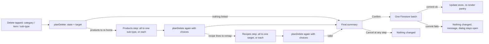

# Pantry Guided Delete - Plan

## Goal Capsule

- **Objective:** Elliott can remove a pantry category, root item or sub-type he no longer wants, such as test items, duplicates or retired items, in one guided action. Afterwards no recipe line or product is left pointing at something that no longer exists.
- **Means:** One guided delete flow shared by all three levels. It makes the person deleting re-home linked products and recipe lines before the final Confirm, then saves everything in one write (KTD1, KTD2).
- **Product authority:** Elliott owns the app's behaviour. Barrie relayed his answers in the 2026-10-29 brainstorm and confirmed the plan-time scope the same day. The dead Pantry and Products controls (category chips, Tesco import, Add ingredient, search inputs) are related Pantry work but not active scope here.
- **Authority order:** the Product Contract, then this plan's Key Technical Decisions, then `CLAUDE.md`, `plateplan-architecture.md` and `workflow-enforcer.md`.
- **Stop conditions:** stop and ask if a requirement can't be met without changing recipe or product data beyond what the person chose in the dialog, or if Firestore rules refuse a batched write that `firestore.rules` should allow.
- **Execution profile:** browser ES modules with no bundler. The logic is tested as standalone Node scripts using a fake Firestore; the dialogs are checked by hand on both phones.
- **Who ships:** Barrie merges to `development` for the phone test, then releases to `main` as 3.48.0.
- **Open blockers:** None.

## Product Contract

### Summary

Deleting a category, root item or sub-type opens one guided dialog. It shows everything that will be removed. It then requires every affected product to move to a sub-type elsewhere and every affected recipe line to be remapped. A final summary confirms the delete. When nothing is linked, the delete is a single confirm. Default products never block a delete.

Product Contract preservation: unchanged apart from the Outstanding Questions, which planning answered in place.

### Problem Frame

Release 3.47.0 made delete work again, but it refuses whenever anything is linked. In the 2026-10-28 backup, 288 of 292 root items have sub-types, 394 of 402 products sit on sub-types, and 232 root items with sub-types are used in recipes. So nearly every real delete is refused. A single sub-type can't be deleted at all: its Delete option opens the Reorganise dialog, which offers only Move, Merge and Promote. A category can only be emptied by moving its items to another category. Elliott ends up deleting nothing, or tidying piece by piece with no guarantee that recipes stay mapped.

### Key Decisions

- **Re-home first, then delete; never orphan.** A delete can't complete while any affected product or recipe line is unaccounted for. (session-settled: user-directed — chosen over refusing while linked, and over deleting linked products and leaving recipe lines unmapped: Elliott wants every dependent re-homed before the delete is confirmed.) Governs R6, R7, R8, R9, R10.
- **All three levels use the flow.** (session-settled: user-directed — chosen over root item plus sub-type only, and over root item only.) Governs R1, R2.
- **Category delete offers move or delete.** (session-settled: user-approved — chosen over always deleting the items and over always moving them.) Governs R3.
- **One guided dialog, "move everything to one target" first.** (session-settled: user-approved — chosen over sending the user to the existing Reorganise and Reallocate tools, each fix saving separately, and over one-by-one remapping only.) Governs R7, R9, R11.
- **Products belong only on sub-types.** Elliott's data rule: root items and categories don't hold products directly. Governs R6.
- **Defaults are calculated, never a blocker.** The default product for each level comes from the preference metric across the sub-types in that hierarchy, so deleting a default product doesn't need protecting. (session-settled: user-approved — chosen over blocking while a product is a saved default, and over making defaults purely calculated first.) Governs R13, R14.

### Requirements

**Starting a delete**

- R1. Deleting a category, a root item or a single sub-type starts the same guided delete flow.
- R2. The sub-type menu's Delete option starts this flow; today it opens a dialog with no delete choice.
- R3. Deleting a category that still holds root items first asks whether to move those items to another category (today's behaviour) or delete them along with their sub-types through this flow.
- R4. The first step lists everything the delete will remove: the target, its sub-types and, for a category being emptied by deletion, its root items. It also shows how many products and recipes are affected.
- R5. When nothing is linked (no products under the target and no recipe line using any part of it), the flow skips the re-home steps and ends in a single confirm.

**Re-homing products**

- R6. Every product under the deleted target must be moved onto a sub-type that survives the delete. This includes legacy products attached directly to a root item, and products whose sub-type no longer exists.
- R7. The products step offers "move all to one sub-type" first and moving products one by one second. Either way the destination can be an existing sub-type or a new sub-type created in the step.

**Remapping recipe lines**

- R8. Every recipe line that uses the deleted target, or any of its sub-types or root items, must be remapped to a category, root item or sub-type that survives the delete. This covers lines in both the original and the enhanced version of each recipe.
- R9. The recipes step offers "remap all to one target" first and remapping each line one by one second.
- R10. A remap or move destination can't be anything the same delete removes.

**Confirming**

- R11. A final summary lists what will be deleted, where the products go and where the recipe lines go. The delete happens only on its Confirm.
- R12. Nothing is saved before that final Confirm. Cancelling at any step leaves products, recipes and the pantry exactly as they were.

**Defaults**

- R13. A product being a saved default never blocks a delete. When a default product goes, its hierarchy's default falls back to the preference-metric calculation.
- R14. Product delete on the Products screen stops refusing for saved defaults. It keeps refusing while a recipe uses the product.

### Key Flows

- F1. Junk item, nothing linked (covers R1, R5, R11). Elliott opens a root item's menu and taps Delete. The first step shows the item and its sub-types and says no products or recipes are affected. He confirms once and the item and its sub-types are gone.
- F2. Retiring a root item with products and recipes (covers R4, R6–R12). Elliott deletes a root item with sub-types, 3 products and 5 recipe lines. The flow lists what will go. In the products step he chooses "move all to one sub-type" and picks another item's sub-type. In the recipes step he remaps 4 lines to one root item, then switches one line to a different sub-type. The summary shows all three outcomes, and on Confirm everything is applied together.
- F3. Category with items (covers R3, then F1 or F2). Elliott deletes a category that holds items. He's asked to move the items or delete them. Moving works as it does today. Deleting continues into the guided flow for every item and sub-type in the category.
- F4. Abandoning part-way (covers R12). Elliott moves products and remaps some lines, then cancels. Nothing has changed.

### Acceptance Examples

- AE1. Covers R5. Deleting "Test 1" (Bakery, no sub-types, no products, no recipes) shows one confirm, and after Confirm the item is gone.
- AE2. Covers R6, R7. Deleting a sub-type with two products, Elliott picks "move all to one sub-type" and creates a new sub-type under a different root item. After Confirm both products are on that new sub-type.
- AE3. Covers R10. While deleting a root item, its own sub-types aren't offered as destinations for its products or recipe lines.
- AE4. Covers R8. A recipe whose enhanced version uses the deleted sub-type but whose original doesn't has its enhanced line remapped. Its original lines are untouched.
- AE5. Covers R13, R14. A product that's a root item's saved default but isn't used in any recipe can be deleted from the Products screen. That item's default afterwards follows the preference metric.
- AE6. Covers R12. Cancelling at the final summary after re-homing leaves every product and recipe line where it was.

### Scope Boundaries

- Product delete from the Products screen isn't run through the guided remap. It still refuses while a recipe uses the product (R14).
- Active Stock entries and saved shopping lists that point at deleted things aren't remapped. They fall back as they do today.
- Cleaning up the 8 products in the backup that break the products-only-on-sub-types rule (1 on a root item, 2 on a missing sub-type, 5 unlinked) belongs to data quality. This flow only handles the ones a delete reaches (R6).
- Defaults stay as they are stored today; making them purely calculated is separate work.
- No undo and no automatic backup step. Forced re-homing is the safety net.
- The dead Pantry and Products controls are the next Pantry brainstorm.
- Considered and not built: chunking the batch to allow deletes over 450 writes. It would break R12's all-or-nothing save; a delete that big is unlikely in this household, and the refusal message tells Elliott to delete in smaller pieces. Revisit only if a real delete hits the limit.

#### Deferred to Follow-Up Work

- The Data Quality unlinked sweeper (`src/components/data-quality/UnlinkedSweeperUI.js`) has the same stale-`subtypeId` and missing-enhanced gaps KTD4 fixes here. It could switch to the U2 helper in a later change.

### Dependencies / Assumptions

- Default calculation already exists. `resolveDefaultProduct` in `src/services/PantryHierarchyService.js:109` uses a stored default when one is present. Otherwise it sorts by the `autoDefaultStrategy` preference, which defaults to `lowest_absolute_price`. R13 relies on this fallback.
- Recipe lines can already map to a category, root item or sub-type. Saved recipe lines carry `categoryId`, `ingredientId`, `groupId` and `subtypeId` fields.

### Outstanding Questions

All three planning questions are resolved in the Planning Contract:
- R12 is met with one Firestore batch (KTD2).
- R3's move-or-delete choice extends the existing category Reorganise dialog (KTD6).
- R9's one-by-one list is grouped by recipe and scrolls inside the dialog (U4).

### Sources / Research

- `src/views/PantryBankView.js`: `handleDeleteIngredient` and the item and sub-type action sheets (3.47.0)
- `src/views/ProductBankView.js`: `handleDeleteProduct` (3.47.0)
- `src/components/pantry/ReorganiseModalUI.js`: the sub-type options (Move, Merge, Promote) and the category delete with reallocation
- `src/services/PantryTaxonomyService.js`: category delete moves items to a target category
- `~/PlatePlan-backups/dead-ui-actions-2026-10-29.md` (outside the repo): the Pantry entries deferred to the next brainstorm

## Planning Contract

### Key Technical Decisions

- KTD1. **Plan first, write last.** A pure function works out the whole delete from the in-memory state and the choices made in the dialog. It returns what will be removed, what still needs re-homing, any validation errors, and the exact list of document writes. The dialog only collects choices and shows that result. Nothing touches Firestore until Confirm, which gives R12 for free and lets every rule be tested in Node. Governs R4–R12.
- KTD2. **One Firestore batch, no splitting.** On Confirm, every write goes into a single `db.batch()`: products moved, recipes remapped, the parent item updated when a sub-type is removed, item documents deleted, and the category list updated. If the batch would exceed 450 writes, the dialog refuses before Confirm and tells Elliott to delete a smaller piece. Confirm is refused while the phone is offline (`navigator.onLine` false), with "You're offline. Nothing was deleted." This is because Firestore's local cache (`src/config/firebase.js`) doesn't reject an offline commit: it queues the writes, applies them locally through the realtime listeners in `HydrationService.js`, and commits them on reconnect. A commit the server rejects, for example by rules, changes nothing; the dialog stays open with a "not deleted" message. The store is updated from the batch result only after the commit resolves. Follows `batchUpdateRecipesInDb` (`src/services/RecipeFirestoreRepository.js:245`), but with one batch rather than chunks of 400, so a partial save can't happen. Governs R11, R12.
- KTD3. **The logic lives with the pantry owner.** The planner and the batch apply go in `src/services/PantryTaxonomyService.js`, the owner of "Ingredients and pantry" in `plateplan-architecture.md`. No new service is added. `PantryTaxonomyService` opens and commits the one batch and adds its own ingredient and category writes. Product and recipe writes go through helpers their owners export: `ProductRepository` adds a product to a given batch with the same `enforceCategorySSOT`, `schemaVersion` and `updatedAt` handling as `saveProduct`, and `RecipeFirestoreRepository` adds a recipe the same way `batchUpdateRecipesInDb` does. That keeps `ProductRepository` the only writer of `products` (`CLAUDE.md`). The dialog is a new component, `src/components/pantry/GuidedDeleteModalUI.js`. It's a new screen rather than a parallel version of an existing one.
- KTD4. **One recipe-line remap rule.** A single helper rewrites a recipe line to a new target and clears whatever the old mapping left behind:
  - to a category: set `categoryId`; clear `ingredientId`, `pantryItemId`, `bankId`, `groupId`, `subtypeId`, `subtypeName`, `productId` and `productName`;
  - to a root item: set `ingredientId`, `pantryItemId` and `bankId` to the item, `groupId` to `grp_<itemId>`, and `categoryId` to the item's category; clear `subtypeId`, `subtypeName`, `productId` and `productName`;
  - to a sub-type: as for its parent item, plus `subtypeId` and `subtypeName`.

  Clearing `productId` and `productName` lets the line follow its new target's default product; otherwise shopping, which reads `productId` and `bankId` first, would still resolve the old product. A line counts as using a root item when `groupId` is the item's id or `grp_<itemId>`, matching `getCanonicalIngredientId` (`src/services/ShoppingCalculationService.js:90`).

  It applies to `ingredients`, `ingredientSections[].ingredients`, and both of these under `enhanced`. Recipes are written with merge, the whole recipe object, as `batchUpdateRecipesInDb` does. Governs R8, R9, R10.
- KTD5. **Moved products follow the metric in their new home.** A moved product gets the target sub-type's id in both `subtypeId` and the legacy `subTypeId` (`src/components/ProductSwapModal.js:23` reads `subTypeId` first), the target item's `ingredientId` and the target category, and `isAutoDefault: false` written explicitly. Leaving a field out of a merge write keeps its stored value. Stored `defaultProductId` values that point at a deleted product are left alone, because `resolveDefaultProduct` (`src/services/PantryHierarchyService.js:109`) already falls back to the `autoDefaultStrategy` metric when the product is missing. Governs R6, R7, R13.
- KTD6. **Category delete keeps its dialog.** The existing category delete in `src/components/pantry/ReorganiseModalUI.js` gains a second choice next to "move the items to another category". The new choice, "delete the items too", hands the category over to the guided delete. Governs R3.
- KTD7. **Product delete drops the default check.** `handleDeleteProduct` in `src/views/ProductBankView.js` keeps only the recipe check. Governs R14.

### High-Level Technical Design



The planner's result, as a directional shape:

```text
planDelete(state, target, choices) ->
  removed:    { categories, items, subtypes }
  products:   [{ product, needsHome, destination? }]     // destination: existing sub-type, or { newSubtype: name, parentItemId }
  lines:      [{ recipeId, location, line, needsHome, destination? }]
  errors:     [ "destination is being deleted" | "too many writes" | "new sub-type name missing or duplicate" ... ]
  writes:     [ set product | set recipe (merge) | set item (sub-type added) | set item (subtypes trimmed) | delete item | set categories ]
  // anything still needsHome keeps Next/Confirm disabled; it is not an error
```

### Assumptions

- Firestore rules allow the batch: `firestore.rules` allows read and write anywhere under `households/elliott-chloe/{document=**}` for the household accounts, which covers `products`, `recipes`, `ingredients` and `settings/categories`.
- The categories list lives in `households/elliott-chloe/settings/categories`, written by `saveCategories` (`src/services/CategoryRepository.js:55`) as `{ categories, updatedAt }` with merge. The batch writes that document in the same shape.

### Research

- The recipe-line remap in `src/components/data-quality/UnlinkedSweeperUI.js:274` is the pattern for KTD4. It leaves a stale `subtypeId` when remapping to a plain item, and it ignores `enhanced`; KTD4 fixes both for this flow only.
- `reallocateProduct` (`src/models/PantryHierarchyModel.js:157`) saves each product immediately, so the dialog can't use it as-is; KTD1's planner produces the same field changes as writes instead.
- `docs/solutions/database-issues/plan-whole-document-save-erases-unlisted-fields.md`: whole-document writes erase unlisted fields. Recipes are written with merge and as whole objects from the store, so no field is dropped.

### Risks

- **Edits on the other phone while the dialog is open.** The write list comes from the in-memory state when the last choice was made. If Chloe edits an affected recipe, or maps a new line to the target, between then and Confirm, Confirm can overwrite her edit or leave her new line unmapped. U4 re-runs the planner just before Confirm, so a line she added shows up as needing a home. An edit to a recipe already in the write list can still be overwritten; that's accepted, because these deletes are rare and both phones are in one household.
- **The 3.47.0 pantry delete misses `grp_` links.** `handleDeleteIngredient` compares `groupId` with the item id directly, so an item used by recipes only through `grp_<itemId>` (473 such lines in the 2026-10-28 backup) can be deleted while still in use. U4 replaces that handler with the guided delete, which uses KTD4's matching.

## Implementation Units

### U1. Delete planner

- **Goal:** a pure function that, given the state, a target (category, item or sub-type) and the dialog's choices so far, returns the removed set, the products and recipe lines that need a home, validation errors and the write list (KTD1).
- **Requirements:** R4, R5, R6, R8, R10, R11, R13; KTD1, KTD5.
- **Dependencies:** U2 (remap helper).
- **Files:** `src/services/PantryTaxonomyService.js`, `scripts/test_pantry_guided_delete.js` (new).
- **Approach:**
  1. Work out the removed set: a sub-type; an item and all its sub-types; or, for a category being deleted with its items, every item in it and their sub-types.
  2. Collect affected products. These are products whose `subtypeId` or `subTypeId` is a removed sub-type, products whose `ingredientId` is a removed item, and legacy products pointing at a sub-type that no longer exists under a removed item.
  3. Collect affected recipe lines in `ingredients`, `ingredientSections[].ingredients` and the `enhanced` equivalents. A line is affected when its `ingredientId`, `pantryItemId`, `bankId` or `subtypeId` names something removed, when its `groupId` is a removed item's id or `grp_<itemId>` (KTD4), or when its `categoryId` names a deleted category.
  4. Apply the choices. Destinations inside the removed set are errors (R10). Any affected product or line without a destination is listed as still needing a home.
  5. Build the write list. Moved products follow KTD5. Remapped recipes use the helper from U2. A "new sub-type under item X, named N" destination adds a sub-type (new id, name N, parent X) to X's document in the same write list, and the moved products point at its id; N must be non-empty after trimming and must not match a sibling's name, and X can't be in the removed set. A deleted sub-type means a merge write of its parent item with the sub-type removed. A deleted item means a document delete. A deleted category means writing the categories list without it.
  6. Report a "too many writes" error past 450 (KTD2).
- **Patterns to follow:** `executeCategoryReallocation` in the same file for category handling; `handleDeleteIngredient` in `src/views/PantryBankView.js` for the link checks it replaces.
- **Test scenarios:**
  - Covers AE1. "Test 1" with no sub-types, products or recipes: nothing needs a home, and the write list is one item delete.
  - An item with two sub-types and no links: the removed set lists both sub-types, and the only write is the item delete.
  - A sub-type with two products: both are listed as needing a home; with "all to sub-type X", both get X's `subtypeId`, X's parent `ingredientId` and the parent's category.
  - A moved product that had `isAutoDefault: true` and a legacy `subTypeId` is written with `isAutoDefault: false` and `subTypeId` equal to the new `subtypeId` (KTD5).
  - Covers AE2. Two products moved to a new sub-type under a different root item give one item write adding that sub-type and two product writes pointing at its id, all in the same write list.
  - A new sub-type with a blank name, or the same name as a sibling, is an error.
  - A recipe line linked only by `groupId: 'grp_<deletedItemId>'` is listed as needing a home.
  - A legacy product with `ingredientId` set to the deleted item and no `subtypeId` is listed as needing a home (R6).
  - Covers AE3. Choosing one of the item's own sub-types as a destination is an error.
  - A recipe line using the deleted sub-type in `ingredientSections` is found.
  - Covers AE4. A recipe whose enhanced version uses the sub-type but whose original doesn't gets only its enhanced line listed.
  - A recipe line mapped to a deleted category is listed when that category is deleted with its items.
  - A product still without a destination leaves "needs a home" in the result, and there's no Confirm-ready state.
  - More than 450 writes gives the "too many writes" error.
  - Covers AE5. A product saved as an item's `defaultProductId` doesn't block, and no write touches that `defaultProductId`.
- **Verification:** the planner test passes without any DOM or Firestore.

### U2. Recipe-line remap helper

- **Goal:** one helper that rewrites a recipe line to a category, root item or sub-type and clears stale mapping fields (KTD4).
- **Requirements:** R8, R9; KTD4.
- **Dependencies:** none.
- **Files:** `src/services/PantryTaxonomyService.js`, `scripts/test_pantry_guided_delete.js`.
- **Approach:** set and clear fields per KTD4 and update the line's display `name` the way `UnlinkedSweeperUI.js` does. Keep every other field on the line, such as `qty`, `unit` and `raw`.
- **Patterns to follow:** `updateTarget` in `src/components/data-quality/UnlinkedSweeperUI.js:278`.
- **Test scenarios:**
  - A line on sub-type S remapped to root item I has `ingredientId`, `pantryItemId` and `bankId` set to I, `groupId` set to `grp_I`, `categoryId` set to I's category, and no `subtypeId`, `productId` or `productName`.
  - A line remapped to a category has `categoryId` set and no `ingredientId`, `pantryItemId`, `bankId`, `groupId`, `subtypeId`, `productId` or `productName`.
  - A line remapped to a sub-type has `subtypeId` and `subtypeName` set, `ingredientId` set to the sub-type's parent, and `categoryId` set to the parent's category.
  - No field on a remapped line still names the old item, sub-type or product.
  - `qty`, `unit` and `raw` are unchanged in every case.
- **Verification:** the helper tests pass.

### U3. Atomic apply

- **Goal:** commit a planner write list in one Firestore batch, then update the store (KTD2).
- **Requirements:** R11, R12; KTD2.
- **Dependencies:** U1.
- **Files:** `src/services/PantryTaxonomyService.js`, `src/services/ProductRepository.js`, `src/services/RecipeFirestoreRepository.js`, `scripts/test_pantry_guided_delete.js`.
- **Approach:**
  1. Refuse a write list that still has errors or items needing a home, and refuse while offline (KTD2).
  2. Open one `db.batch()`. Add ingredient and category writes directly, product writes through the new `ProductRepository` batch helper, and recipe writes through the new `RecipeFirestoreRepository` batch helper (KTD3). Commit.
  3. After the commit resolves, update the store's ingredients, products, recipes and categories through the existing setters, and invalidate the hierarchy cache.
  4. Return `{ success: false }` on a rejected commit without touching the store.
- **Test scenarios:**
  - Covers F2. A write list with product moves, recipe remaps and an item delete commits as one batch with every write in it.
  - After a commit, the store no longer has the item, and the moved products and remapped recipes show their new values.
  - A batch whose commit rejects leaves the store exactly as it was and returns `success: false`.
  - A write list with errors is refused without opening a batch.
- **Verification:** the apply tests pass against a fake `window.firebase` batch.

### U4. Guided delete dialog for items and sub-types

- **Goal:** the step-by-step dialog, wired to a root item's Delete Item and a sub-type's Delete Sub-type.
- **Requirements:** R1, R2, R4, R5, R7, R9, R11, R12; F1, F2, F4.
- **Dependencies:** U1, U2, U3.
- **Files:** `src/components/pantry/GuidedDeleteModalUI.js` (new), `src/views/PantryBankView.js`, `scripts/test_pantry_deletes.js`.
- **Approach:**
  1. Steps in order: what will be removed, products, recipes, final summary. A step with nothing to re-home is skipped (R5). If the planner's first run, before any choices, already reports "too many writes", step 1 shows "Too big to delete in one go. Delete a smaller piece first." with only Close.
  2. The products and recipes steps open on "move all to one …" with a destination picker. A "choose one by one" switch shows each product, or each recipe line grouped by recipe, with its own picker. The list scrolls inside the dialog. A one-by-one choice is an override: "all to one" fills only lines without one, and switching modes keeps overrides.
  3. Each change of choice re-runs the planner (U1) and redraws the step from its result. It runs once more just before Confirm, against the latest store state. Next and Confirm stay disabled while anything still needs a home or there's an error, with a line saying why ("3 products still need a home").
  4. Every step has Back and Cancel, and choices survive Back and Next.
  5. Confirm checks the phone is online (KTD2), then shows "Deleting…" and stays disabled until U3 settles, so a double tap can't commit twice. On success, close the dialog and re-render the pantry. On a rejected commit, keep it open with "Nothing was deleted. Try again." Offline shows "You're offline. Nothing was deleted."
  6. Cancel closes without saving (R12).
  7. In `PantryBankView.js`, "Delete Item" opens the dialog for the item, replacing `handleDeleteIngredient`'s refusal, and "Delete Sub-type" opens it for the sub-type.
  8. The destination picker is one component: a type-to-filter search over category › item › sub-type rows, with the removed set left out (R10). Products may pick only sub-types, plus "New sub-type under…", which asks for a name and a parent item through the same picker (R7, U1). Recipe lines may pick any level.
- **Patterns to follow:** `showModal` and `closeModal` in `src/components/pantry/ReorganiseModalUI.js`; escape every name with `escapeHtml` and `escapeAttr`; no native dialogs (`CLAUDE.md`).
- **Test scenarios:**
  - `scripts/test_pantry_deletes.js` changes from "refused while linked" to "opens the guided delete". Its source check asserts that Delete Item and Delete Sub-type call the guided delete and not `window` lookups.
  - Covers AE1. With the stub DOM, deleting "Test 1" shows a single confirm, and Confirm leads to one item delete in the fake batch.
  - Covers AE6. Cancelling at the summary after choosing destinations leaves the fake batch empty and the store unchanged.
  - With `navigator.onLine` false, Confirm opens no batch and shows the offline message.
  - A second Confirm tap while the first commit is pending opens no second batch.
- **Verification:** the tests pass, plus the phone checks in the Verification Contract.

### U5. Category delete: move or delete

- **Goal:** a category with items offers "move the items to another category" (as today) or "delete the items too", which opens the guided delete for the whole category (KTD6).
- **Requirements:** R1, R3; F3.
- **Dependencies:** U4.
- **Files:** `src/components/pantry/ReorganiseModalUI.js`, `src/services/PantryTaxonomyService.js`, `scripts/test_category_deletion.js`.
- **Approach:** add the second choice to the existing delete mode. The move path stays on `executeCategoryReallocation` unchanged. The delete path calls the guided delete with the category as target, and U1 includes removing the category from the categories list in the write list.
- **Test scenarios:**
  - Covers F3. Planning a category delete with "delete the items too" lists every item and sub-type in it as removed, and removes the category from the categories write.
  - An empty category deletes with a single confirm and one categories write.
  - The move path's existing behaviour is unchanged: `scripts/test_category_deletion.js` still passes.
- **Verification:** the tests pass, plus the phone check.

### U6. Product delete without the default check

- **Goal:** product delete refuses only while a recipe uses the product (KTD7).
- **Requirements:** R13, R14; AE5.
- **Dependencies:** none.
- **Files:** `src/views/ProductBankView.js`, `scripts/test_pantry_deletes.js`.
- **Approach:** remove the `defaultFor` check and its message; keep the recipe check and the confirm.
- **Test scenarios:**
  - Covers AE5. A product saved as an item's or sub-type's default, and used in no recipe, asks to confirm and is deleted.
  - A product used in a recipe is still refused.
  - The existing "refused while a default uses it" cases in `scripts/test_pantry_deletes.js` change to "deletes after confirm".
- **Verification:** the tests pass.

### U7. Release

- **Goal:** version 3.48.0, ledger and owner table checked, ready for the phone test.
- **Requirements:** success of the whole plan.
- **Dependencies:** U1–U6.
- **Files:** `package.json`, `package-lock.json`, `LEDGER.md` (regenerated).
- **Approach:** bump the version; run `npm run ledger`, which picks up the new dialog module as live; no owner-table change, because there's no parallel version.
- **Test expectation:** none -- version bump and regenerated ledger.
- **Verification:** the build stamps 3.48.0, and `LEDGER.md` lists `GuidedDeleteModalUI.js` as live.

## Verification Contract

| Check | Command or action | Applies to |
|---|---|---|
| Planner, remap and apply | `node scripts/test_pantry_guided_delete.js` | U1, U2, U3, U5 |
| Delete wiring and product delete | `node scripts/test_pantry_deletes.js` | U4, U6 |
| Category move path unchanged | `node scripts/test_category_deletion.js` | U5 |
| Everything else unchanged | every `scripts/test_*.js` plus `test_vault_fit_score.js`; only `test_accessibility_dom`, `test_plan_generator` and `test_recipe_wizard` fail, as before | all |
| Syntax | `node --check` on each touched file; CI checks all of `src/` | all |
| Build and ledger | `npm run build`, `npm run ledger`, `node scripts/test_ledger.js` | U7 |
| Phones, from `development` | on both phones: delete Test 1 (one confirm); delete a sub-type with products (move all to one sub-type); delete a root item used in recipes (remap all, then switch one line); cancel part-way (nothing changes); delete a category, both choices; delete a product that's a default but in no recipe | U4, U5, U6 |

## Definition of Done

- Every unit's Verification holds, and the checks above pass apart from the three known failures.
- No delete path leaves a product or recipe line pointing at a removed category, item or sub-type, and none saves anything before Confirm.
- Both phones pass the checks in the Verification Contract on `development` before the release goes to `main`.
- No abandoned experimental code, debug logging or household data is in the diff.
