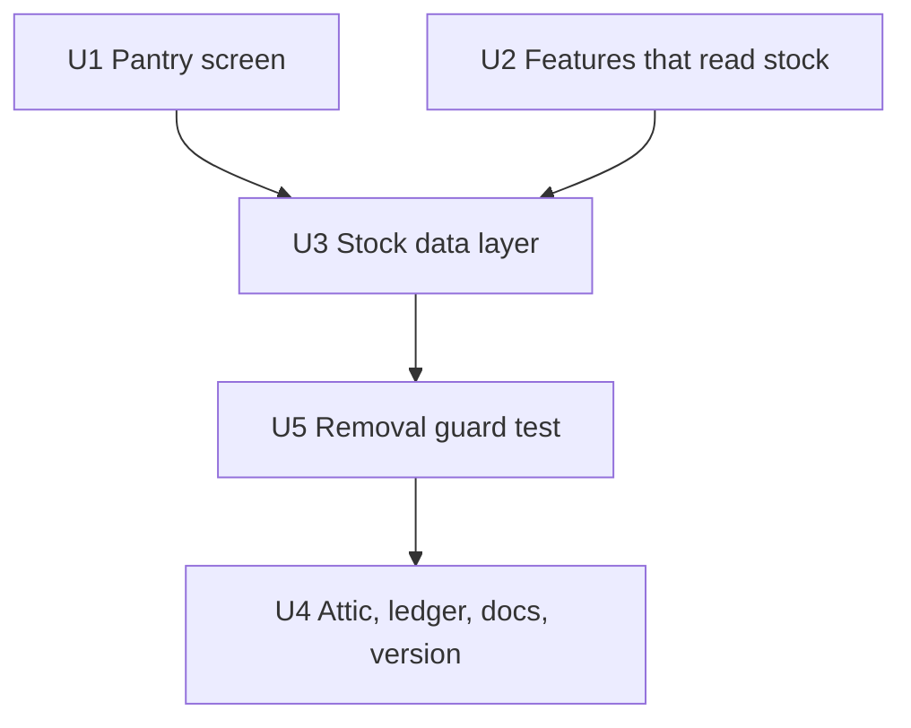

# Remove Active Stock - Plan

## Goal Capsule

- **Objective:** PlatePlan no longer has any idea of household stock. Nothing on screen offers stock tracking, and nothing in the app reads, writes or caches stock records. Everything else behaves exactly as it does now.
- **Means:** Unwire every stock reader and writer, then move the modules left with no job to `attic/` (KTD1, KTD2).
- **Product authority:** Elliott owns the app's behaviour. On 2026-10-30 he asked, through Barrie, to "remove any reference to Active Stock, the AI added that as a feature that would be impossible to maintain". Barrie settled the remaining scope questions in the 2026-10-30 brainstorm and plan. The product-based use-up finder and the Firestore rules are not active scope.
- **Authority order:** the Product Contract, then this plan's Key Technical Decisions, then `CLAUDE.md`, `plateplan-architecture.md` and `workflow-enforcer.md`.
- **Stop conditions:** stop and ask if any kept feature (use-up finder, generator wizard, Today, planner step 3 shopping) turns out to read stock or `InventoryService`, or if the fresh pre-release backup holds an `inventory` collection.
- **Execution profile:** browser ES modules with no bundler. Behaviour is tested as standalone Node scripts with stubbed `window` and fake Firestore; the Pantry screen and a load with an old cache are checked by hand on localhost and both phones.
- **Who ships:** work on a new `dev/remove-active-stock` branch from `development`. Barrie merges to `development` for the phone test, then releases to `main` as 3.50.0.
- **Open blockers:** None.

---

## Product Contract

### Summary

Product Contract preservation: changed AE3 (the Vault sort is read from the screen and never saved, so there is no saved stock sort to fall back from; AE3 now covers a request for a removed sort, user-approved during planning, 2026-10-30). R9 clarified: tests that only covered removed code are deleted, not moved (user-approved during planning, 2026-10-30). Problem Frame corrected to say which stock paths are reachable. Outstanding Questions and the saved-settings assumption answered in place.

Remove Active Stock and everything that only makes sense with stock records:
- the hidden Pantry tab and its controls;
- stock loading, store state, cache and persistence;
- the Vault's stock-based sorts and recipe-card tag;
- the generator's pantry weighting and summary tag;
- the restock that runs when a shopping item is ticked.

The "Use up ingredients" feature, which works from products picked at the time, stays as it is. So do the Firestore rules.

### Problem Frame

An earlier AI pass added Active Stock: a hand-kept list of what's in the cupboard, with use-up flags. Elliott and Chloe don't keep it, and Elliott says it can't be maintained. Its Pantry tab is already hidden. The 2026-10-29 backup has no `inventory` collection, so no stock record exists in Firestore.

The code is still loaded, though. The app asks Firestore for stock on every load and keeps a stock list in each phone's local cache. A store function writes a stock record when a shopping item is ticked, though nothing in the app calls it today. Two Vault sorts, a recipe-card tag and the weekly generator's weighting and summary all score recipes by stock. The live Vault sort list doesn't offer the stock sorts, and the stock-weighted generator only runs from a script, so with stock empty none of this shows. It still costs a Firestore read on every load, makes the generator and Vault harder to reason about, and forces the dead-controls guard test to skip the stock files. The 2026-10-29 dead-controls plan (`docs/plans/2026-10-29-2038-fix-pantry-products-dead-controls-plan.md`) left the restore-or-delete question open. Elliott has now answered it.

### Key Decisions

- **Remove Active Stock entirely.** (session-settled: user-directed — chosen over restoring the hidden tab, which the dead-controls plan left open: Elliott says it would be impossible to maintain.) Governs R1–R10.
- **Keep the product-based use-up feature.** (session-settled: user-approved — chosen over treating every "use-up" feature as part of Active Stock: it works from products picked at the time, not stock records.) Governs R11.
- **Leave the Firestore rules unchanged.** (session-settled: user-approved — chosen over switching the household wildcard to a list of allowed collections: one deny rule can't override the wildcard, and an allowlist would change rules for the whole household.) See Scope Boundaries.
- **Move unused modules to the attic rather than deleting them.** This follows the repo's ledger-and-attic practice: a module is moved there with a delete-after date once the ledger shows it dead. Governs R9.
- **Features that only work with stock go with it.** A sort, tag or weighting that reads stock records can never show anything once stock is gone, so keeping it would leave a dead option on screen. Governs R6, R7, R8.

### Requirements

**Pantry screen**
- R1. The Pantry has no Active Stock tab, panel, badge, add-stock modal, stock toolbar or use-up toggle. The master catalogue shows the same way as it does now.
- R2. No toast, label, empty state or tooltip anywhere mentions "Active Stock" or stock records.

**Data and loading**
- R3. The app neither reads nor writes household stock records in Firestore, during startup, a shopping tick or anywhere else.
- R4. The app no longer keeps a stock list in its store or local cache. A stock list already cached on a phone is cleared and never comes back into the app.
- R5. Ticking a shopping item behaves as it does now, minus the stock write.

**Features that read stock**
- R6. The Vault no longer offers "Use-Up First" or "Pantry Match" sorts and no longer shows the stock-based use-up tag on recipe cards. The other sorts work as before.
- R7. The plan generator no longer weights recipes by stock and no longer shows the pantry summary tag. For the same inputs it produces the same plans as it does today with empty stock.
- R8. Building a shopping list no longer takes stock into account. For the same plan it produces the same list as it does today with empty stock.

**Code and checks**
- R9. Modules with no remaining job go to `attic/` with move and delete-after dates in `attic/README.md`. The ledger shows them as dead before the move. Tests that only covered removed behaviour are deleted, since the attic holds `src/` modules only. Tests for kept behaviour are updated, not dropped.
- R10. The dead-controls guard test covers the Pantry with no Active Stock exclusions.

**What stays**
- R11. The "Use up ingredients" finder in the Vault, the generator's Pantry Use-Up panel and Today's use-up coverage keep their current behaviour.

### Acceptance Examples

- AE1. **Covers R4.** Given a phone whose local cache holds a stock list from before this release, when the app loads, then the stock list is gone from the cache and nothing on any screen reflects it.
- AE2. **Covers R5, R3.** Given a shopping list on planner step 3, when Chloe ticks an item, then the tick saves as it does today and no stock record is written to Firestore.
- AE3. **Covers R6.** Given code asks the Vault sorter for "Use-Up First" or "Pantry Match", when it sorts, then it returns recipes in the default fit-score order and doesn't fail.
- AE4. **Covers R7, R8.** Given fixed recipes and empty stock, when the generator runs with fixed inputs and the shopping list is built from the result, then the plan and the list match what the current code produces.

### Success Criteria

- A search of `src/` and `index.html` for "Active Stock", `inventory` and stock use-up flags finds nothing beyond the attic and kept use-up code. Any remaining match is named in this plan with a reason (KTD4).
- `npm run ledger` shows no live module whose only job was stock.
- All tests pass except the known pre-existing failures, which drop from three to two (KTD5).
- Both phones load the release with no console errors, and Elliott confirms the Pantry no longer suggests stock tracking.

### Scope Boundaries

- The Firestore rules and their test stay as they are. A list of allowed collections for the household could be its own rules change later.
- Whether "Use up ingredients" works end to end today is not checked or fixed here.
- No Firestore clean-up is needed, because the 2026-10-29 backup holds no `inventory` collection. If one appears before release, deleting it is a separate, approved data step after a backup.
- Other dead controls outside the Pantry are not active scope.
- The never-called Vault filter toolbar template stays. Only its two stock sort options go; whether the template itself is dead is a ledger question for another day.
- Considered and not built: a migration or warning for an old cached stock list beyond clearing it (R4). Nobody keeps stock, so there is nothing to tell them. Evidence of real stock data on a phone would change this.

### Dependencies / Assumptions

- The production `inventory` collection was confirmed empty only from the 2026-10-29 backup. Take a fresh backup before release to confirm it is still empty (stop condition).
- The 2026-10-29 backup holds no saved stock-linked settings: no `pantryPriorityWeight`, `pantrySummary`, `isUseUp`, `useup-desc` or `pantry-desc`. The only `useUpProducts` is the kept product-based feature (R11).

### Sources / Research

- Active Stock UI: `src/components/pantry/PantryInventoryUI.js`, `PantryInventoryRenderService.js`, `PantryStockToolbar.js`, `PantryToolbar.js`, `PantryCategoryGroup.js`, `PantryItemRow.js` (use-up toggle), `src/views/PantryBankView.js`, the `pantry-tab-master-catalog` tabpanel in `index.html`.
- Stock data: `src/store/inventorySlice.js`, `src/repositories/InventoryRepository.js`, the inventory functions in `src/services/ShoppingFirestoreRepository.js` and their re-exports in `src/services/HouseholdRepository.js`, `src/services/HydrationService.js` (startup read), `src/store/cacheSlice.js` (`plateplan_inventory` key, the v2 blob, the cache payload), `src/store/coreState.js`, `src/store/store.js`.
- Stock readers: `src/services/InventoryService.js`, `src/services/FitScoreService.js` (`useup-desc`, `pantry-desc`), `src/components/vault/VaultFilterToolbar.js`, `src/components/vault/VaultRecipeCard.js`, `src/services/MealPlanGeneratorService.js` (`generateWeeklyPlan`), `src/components/planner/PlannerGridToolbar.js`, `src/services/ShoppingListService.js` (`generateShoppingListFromPlan`), `src/store/shoppingSlice.js` (`toggleShoppingItem` restock).
- Kept use-up feature: `src/components/pantry/UseUpFinderModalUI.js`, `UseUpEditorUI.js`, `src/components/generator/GeneratorConstraintsForm.js`, `src/services/TodayViewService.js`, `src/views/PlannerView.js`.
- Guard test exclusion: `scripts/test_dead_controls.js` (`OUT_OF_SCOPE`).
- Rules: `firestore.rules` (one household wildcard) and `scripts/test_firestore_rules.js` (lists `inventory` among the checked collections).

---

## Planning Contract

### Key Technical Decisions

- KTD1. **Unwire readers first, then the data layer, then move files.** Each step leaves the app loading. Removing the store slice before its readers would break imports; moving files before the ledger shows them dead would break the attic rule (R9).
- KTD2. **Attic set: every module whose only job was stock.** `PantryInventoryUI.js`, `PantryInventoryRenderService.js`, `PantryStockToolbar.js`, `PantryToolbar.js`, `PantryCategoryGroup.js`, `PantryItemRow.js`, `InventoryService.js`, `inventorySlice.js` and `InventoryRepository.js`. Research found no kept caller for any of them. `ShoppingFirestoreRepository.js` stays and only loses its inventory functions, because it also owns shopping lists and products. Governs R9.
- KTD3. **Clear the old cache key on every load, and stop carrying stock in the cache.** `loadStateCache` removes `plateplan_inventory` in its own try/catch at the top, before the IndexedDB read. The IndexedDB path returns early whenever it holds recipes, so a removal inside the localStorage fallback would never run on a phone with a working cache. `initStoreCache` stops copying `inventory` into state, the fallback stops building it, and `saveStateCache` stops writing it, so a stale `inventory` field in the IndexedDB blob is ignored and dropped at the next save. `CACHE_KEY` is not bumped, because that would throw away every phone's recipe cache for a field that is simply ignored. Governs R4.
- KTD4. **A new guard test enforces the removal.** `scripts/test_no_active_stock.js` scans `src/` and `index.html` (not `attic/`). It fails on "Active Stock", any case-insensitive `inventory`, an `isUseUp` flag, the stock store action names, and the `useup-desc`/`pantry-desc` sort values. An explicit allowlist in the test names each permitted `inventory` match with its reason. It starts with the one `plateplan_inventory` clearing line in `src/store/cacheSlice.js`, and any other entry is added to this KTD with its reason. Product-based `useUp` names stay allowed. This turns the first Success Criterion into a test that runs like the others. Governs R2, R3, R4, R6.
- KTD5. **Rewrite `scripts/test_plan_generator.js` instead of leaving it broken.** It imports the deleted `PlanGeneratorService.js`, asserts stock use-up, has no `node:assert` (it logs a failure and still exits 0), and its Test 3 calls the real `savePlan`. Point it at `MealPlanGeneratorService.js` and rewrite it with `node:assert` so it exits non-zero on failure. Drop the `savePlan` check, assert the recorded empty-stock characterization AE4 needs, and add a `detectPrimaryProteinKeyword` assertion for the fixture recipes. `CLAUDE.md`'s list of known failures drops it. Governs R7, R9.
- KTD6. **Shopping list items keep `inStockQty: 0`.** `ShoppingCalculationService` and `addManualShoppingItem` already emit `inStockQty: 0`. Keeping the field at zero keeps one item shape across builders, and `isChecked` becomes `false` for every built item, exactly as it is today with empty stock. Governs R8.
- KTD7. **A removed or unknown sort value falls back to fit-score order.** Delete the `useup-desc` and `pantry-desc` branches in `getSortedRecipes` and change its final `return 0` to the fit-desc comparison. Today an unknown sort returns 0 for every pair and keeps the caller's input order, which would fail AE3. The live callers only pass values that have their own branches (fit, name, best-fit, needs-work), so nothing they see changes. Governs R6, AE3.

### Sequencing

U1 and U2 can land in either order, and both come before U3, because each still reads the store's stock state. U5 fails until U1–U3 are in, so it lands after them.

---

## Implementation Units

### U1. Remove the Active Stock UI from the Pantry

- **Goal:** The Pantry screen carries no stock tab, panel, toolbar, modal, badge or toggle.
- **Requirements:** R1, R2, R10.
- **Dependencies:** none.
- **Files:**
  - `src/views/PantryBankView.js` (drop the `PantryInventoryUI` imports, re-exports and `window` assignments, the `openAddPantryStockModal` wrapper, the `inventory` subscription and event listener, the `inventory` argument to `buildIngredientBankHTML`, and the header comment's "Active Stock")
  - `src/components/componentRegistry.js` (drop `PantryInventoryUI`, `PantryToolbar`, `PantryItemRow`, `PantryCategoryGroup`)
  - `index.html` (drop `role="tabpanel"` and `aria-labelledby` on `pantry-tab-master-catalog`, which point at a tab button that no longer exists)
- **Approach:**
  1. Remove the imports and `window` entries in `PantryBankView.js`. The master-catalogue render, search and delegation stay as they are.
  2. Remove the four component imports from the registry. Grep `data-action`, `onclick` and `window.` uses of `switchPantryTab`, `renderActiveStockTab`, `addCatalogItemToActiveStock`, `adjustPantryStock`, `removePantryStock`, `togglePantryUseUp`, `togglePantryUseUpFilter`, `handlePantrySearchFilter`, `handlePantryZoneChange` and `openAddPantryStockModal`. Research found callers only inside the stock files.
  3. Keep the `pantry-tab-master-catalog` id, because the master-catalogue panel is what shows.
  4. Leave the guard's `OUT_OF_SCOPE` exclusion as it is in this unit. The stock files stay in `src/components/pantry/` until U4 moves them, and once their `window` wrappers are gone their own inline handlers would be reported as dead. U4 narrows the exclusion.
- **Patterns to follow:** the 2026-10-29 dead-controls removals (`747464c`, removing the unwired Product Bank filters).
- **Test scenarios:**
  - `scripts/test_dead_controls.js` still passes with its current exclusion after the stock files leave the registry and `PantryBankView.js`.
  - The guard still fails when a deliberate dead `window.X` call is added to a kept Pantry file (its existing self-check).
- **Verification:** on localhost the Pantry shows the master catalogue as before, with no stock wording and no console errors.

### U2. Remove the features that read stock

- **Goal:** No sort, tag, weighting or shopping-list step consults stock.
- **Requirements:** R6, R7, R8, R11.
- **Dependencies:** none.
- **Files:**
  - `src/services/FitScoreService.js` (drop the two stock sort branches and the `InventoryService` import, and make the final fallback the fit-desc comparison, KTD7)
  - `src/components/vault/VaultFilterToolbar.js` (drop the two stock `<option>`s)
  - `src/components/vault/VaultRecipeCard.js` (drop the use-up tag and the `InventoryService` import)
  - `src/services/MealPlanGeneratorService.js` (`generateWeeklyPlan`: drop `inventory`, `pantryPriorityWeight`, `_pantryMatch`, the use-up and match-percentage scoring and `pantrySummary`)
  - `src/components/planner/PlannerGridToolbar.js` (drop the `pantrySummary` tag)
  - `src/services/ShoppingListService.js` (`generateShoppingListFromPlan`: drop the `inventory` parameter and the subtraction, KTD6)
  - `scripts/test_shopping_list.js`, `scripts/generate-golden-master.js` (new call signature)
  - `scripts/test_plan_generator.js` (KTD5)
  - `scripts/test_vault_sort.js` (new)
- **Approach:**
  1. Removing the `inventory` parameter shifts the positional arguments of `generateShoppingListFromPlan`. Update both callers in the same change. Its only callers are these two scripts; planner step 3 uses `ShoppingCalculationService`.
  2. In `generateWeeklyPlan`, with empty stock the pantry terms add exactly 0 to every score (`matchPercentage` 0, no use-up matches), so taking them out keeps every choice the same.
  3. Leave `generateMealPlan`, the generator wizard's Pantry Use-Up panel, `TodayViewService` use-up coverage and the use-up finder untouched (R11).
- **Execution note:** before editing `generateWeeklyPlan` and `generateShoppingListFromPlan`, record their output for the test fixtures with an empty stock list, and assert the new code matches it (AE4).
- **Patterns to follow:** the fixture and assertion style of `scripts/test_shopping_list.js`.
- **Test scenarios:**
  - Covers AE4. `generateWeeklyPlan` with the `test_plan_generator.js` fixture recipes, fixed targets and start date gives the same day-by-day recipe IDs, servings and macros as the pre-change run with `inventory: []`, and the result has no `pantrySummary`.
  - `detectPrimaryProteinKeyword` returns the recorded keyword for each fixture recipe (new assertion, KTD5).
  - `scripts/test_plan_generator.js` exits non-zero when a recorded recipe ID is changed (proves the rewrite can fail).
  - Covers AE4. `generateShoppingListFromPlan(plan, recipes, ingredientsBank)` for the existing fixture gives tofu 400 g to buy, garlic 5, olive oil 45 ml and lentils 300 g, each with `inStockQty` 0 and `isChecked` false.
  - Aisle grouping assertions in `test_shopping_list.js` still pass unchanged.
  - Covers AE3. `getSortedRecipes(recipes, 'useup-desc')` and `'pantry-desc'` return the same order as `'fit-desc'` and don't throw (`scripts/test_vault_sort.js`).
  - `getSortedRecipes` with `'name-asc'` and `'fit-asc'` keeps its current order for a three-recipe fixture.
- **Verification:** no file outside `src/services/InventoryService.js` and `src/store/` imports `InventoryService.js`. The Vault and planner render on localhost with no console errors.

### U3. Remove the stock data layer

- **Goal:** Nothing loads, stores, caches or writes stock.
- **Requirements:** R3, R4, R5.
- **Dependencies:** U1 and U2 (the Pantry subscription and the other readers of `state.inventory` and `InventoryService` are gone first, KTD1).
- **Files:**
  - `src/services/HydrationService.js` (drop `getInventory` from the parallel load and the `setInventory` call)
  - `src/store/store.js`, `src/store/coreState.js` (drop the inventory slice, its actions and `inventory: []`)
  - `src/store/cacheSlice.js` (KTD3)
  - `src/store/shoppingSlice.js` (`toggleShoppingItem`: drop the restock block, keep the tick, cache save and event)
  - `src/services/ShoppingFirestoreRepository.js` (drop `getInventory`, `savePantryItem`, `deletePantryItem`, `saveInventory` and "Inventory" from the header)
  - `src/services/HouseholdRepository.js` (drop the three sets of re-exports)
  - `scripts/test_ui_performance.js` (drop the stock items from the hydration fixture and the use-up mutation in Test 2; keep the timing checks on another field)
  - `scripts/test_inventory_service.js` (delete: it only tests removed code)
  - `scripts/test_stock_data_removed.js` (new)
- **Approach:**
  1. Hydration loses one entry from its `Promise.all` destructuring. Keep the remaining positions aligned, because a shifted index would hand categories or the plan to the wrong setter.
  2. Clear `plateplan_inventory` at the top of `loadStateCache`, before the IndexedDB read, and drop `inventory` from `initStoreCache`, the fallback cache and the saved payload (KTD3). The clearing line is the U5 guard's allowlisted `inventory` match.
  3. `toggleShoppingItem` has no caller today. It is kept, minus the restock, because removing a store export is out of scope.
- **Patterns to follow:** the stubbed `window` and fake `firebase` set-up in `scripts/test_pantry_deletes.js`.
- **Test scenarios:**
  - Covers AE1. With a stubbed localStorage holding `plateplan_inventory` and a stubbed IndexedDB returning a blob with recipes and an `inventory` array, loading the cache removes the `plateplan_inventory` key, and `initStoreCache` leaves no `inventory` in the resulting state.
  - Covers AE1. The same holds when IndexedDB is empty and the localStorage fallback runs.
  - Saving the cache writes a payload with no `inventory` field.
  - Covers AE2. `toggleShoppingItem` on a list item with an `ingredientId` flips `isChecked`, saves the cache, dispatches `plateplan:state:shoppingList`, and makes no Firestore call (fake `db.collection` records calls; none are made).
  - Hydration with a fake Firestore requests no `inventory` collection, and recipes, ingredients, products, categories, preferences and the plan still reach their setters.
  - `scripts/test_ui_performance.js` still passes its timing checks.
- **Verification:** on localhost, a load with an old `plateplan_inventory` key planted in localStorage clears it, the Network panel shows no `inventory` request, and the Today, Vault, Pantry and planner step 3 screens work.

### U5. Guard against Active Stock coming back

- **Goal:** A test fails if stock wording, storage or sorts reappear in the app.
- **Requirements:** R2, R3, R4, R6.
- **Dependencies:** none to write it. It passes only after U1–U3.
- **Files:** `scripts/test_no_active_stock.js` (new).
- **Approach:** a plain file scan per KTD4, with its reasoned allowlist of `inventory` matches. Report each hit with file and line, like `test_dead_controls.js`.
- **Patterns to follow:** the scanning and reporting style of `scripts/test_dead_controls.js`.
- **Test scenarios:**
  - Passes on the finished tree.
  - Fails, naming the file and line, when "Active Stock" is added to a string in `src/`.
  - Fails on a Firestore path ending `.collection('inventory')` in `src/`.
  - Fails on a new `state.inventory` read in `src/` that isn't on the allowlist.
  - Fails on `useup-desc` in `src/` or `index.html`.
  - Doesn't flag `useUpProducts` or `UseUpFinderModalUI.js` (R11).
  - Ignores `attic/`.
- **Verification:** runs green in the CI syntax step's tree and locally.

### U4. Move dead modules to the attic, update docs and version

- **Goal:** Stock modules sit in the attic with dates, the ledger agrees, and the docs no longer name stock.
- **Requirements:** R9.
- **Dependencies:** U1, U2, U3, U5.
- **Files:**
  - the nine modules in KTD2, moved to the same paths under `attic/`
  - `attic/README.md` (nine rows: moved 2026-10-30, delete after 2026-11-13)
  - `scripts/test_dead_controls.js` (narrow `OUT_OF_SCOPE` to `UseUp*` only and update the header comment, after the move; R10)
  - `LEDGER.md` (regenerated by `npm run ledger`)
  - `CLAUDE.md` (drop `inventorySlice` from the store line, drop `test_plan_generator.js` from the known failures)
  - `package.json` (3.50.0)
- **Approach:**
  1. Run the ledger first and confirm all nine show as dead.
  2. Move them, add the rows, and rerun the ledger.
  3. Narrow the dead-controls guard's exclusion. The use-up exclusion stays, because R10 asks only that the Active Stock files are no longer excluded, and the use-up files are kept but unchecked (Scope Boundaries).
  4. Check that `scripts/test_ledger.js` still passes.
- **Test scenarios:**
  - `scripts/test_dead_controls.js` passes with only `UseUp*` excluded (R10).
  - `scripts/test_ledger.js` passes, and the ledger lists the nine modules as in the attic.
- **Verification:** `LEDGER.md` lists the nine under "In the attic", and no live module imports any of them.

---

## Verification Contract

| Check | Command | Proves |
|---|---|---|
| Syntax | `node --check` on every changed `src/` file (CI does all of `src/`) | modules still parse |
| Removal guard | `node scripts/test_no_active_stock.js` | R2, R3, R4, R6 |
| Pantry guard | `node scripts/test_dead_controls.js` | R1, R10 |
| Data layer | `node scripts/test_stock_data_removed.js` | R3, R4, R5, AE1, AE2 |
| Generator | `node scripts/test_plan_generator.js` | R7, AE4 |
| Shopping list | `node scripts/test_shopping_list.js` | R8, AE4 |
| Vault sort | `node scripts/test_vault_sort.js` | R6, AE3 |
| Regressions | every other `scripts/test_*.js` and `test_vault_fit_score.js` | nothing else moved; only `test_accessibility_dom.js` and `test_recipe_wizard.js` may fail, as before |
| Ledger | `npm run ledger`, `node scripts/test_ledger.js` | R9 |
| Build | `npm run build` | the release stamps 3.50.0 |
| Pre-release data | `scripts/backup_firestore.js` to `~/PlatePlan-backups/` | `inventory` still absent (stop condition) |
| Manual | localhost, then both phones from `development` | Pantry, Vault, planner step 3 and Today work, no console errors; Elliott confirms no stock wording |

## Definition of Done

- U1–U5 are merged into `development`, and CI is green.
- Every check in the Verification Contract passes, with only the two known failures.
- The fresh backup shows no `inventory` collection.
- Both phones pass the manual check, and Elliott confirms the Pantry no longer suggests stock tracking.
- `development` is released to `main` as 3.50.0, and the live header shows `3.50.0 (<commit>)`.
- No abandoned-attempt code or stray stock references remain in the diff. The removal guard is the check.
