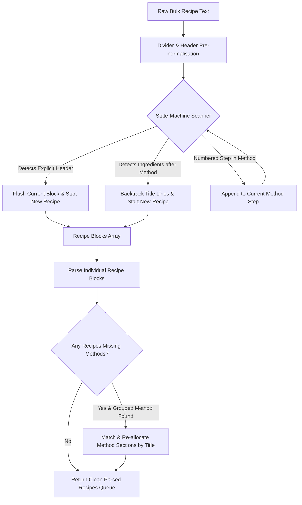

# Implementation Plan: Fix Multi-Recipe Paste & Parse Instruction Allocation

## Goal Description
When users paste multiple recipes into the "Paste & Parse Recipes" tool (`RecipeWizardModal` bulk import), all method instructions across the entire text dump are frequently swallowed into a single recipe's instructions, while subsequent recipes are either dropped, merged, or left with 0 instructions. 

This change replaces the brittle regular expression block splitter in [`RecipeParserService.js`](file:///Users/elliottcallender/Downloads/PlatePlan-main/src/services/RecipeParserService.js) with a robust 2-Stage Semantic State-Machine Splitter and Method Re-allocation Engine. It guarantees that every individual recipe receives its own corresponding method steps, supporting unnumbered recipes, markdown headers, dividers, and "ingredients-first, methods-bottom" layouts.

---

## User Review Required

> [!IMPORTANT]
> **Zero Breaking Changes to Existing Single-Recipe Imports:**
> Single-recipe text parsing and JSON-LD HTML imports will continue to function identically. The changes strictly enhance multi-recipe block chunking, boundary detection, and method re-association.

> [!NOTE]
> All modified modules will strictly maintain PlatePlan's `<400-line` limit. `RecipeParserService.js` is currently 327 lines and will remain ~370 lines.

---

## Open Questions
*None at this time.* The problem was comprehensively explored and verified across all standard recipe text patterns in the exploration phase.

---

## Proposed Changes

### Component: Recipe Ingestion Engine (`src/services/`)

#### [MODIFY] [`src/services/RecipeParserService.js`](file:///Users/elliottcallender/Downloads/PlatePlan-main/src/services/RecipeParserService.js)

1. **Replace Brittle Regex Splitter with Semantic State-Machine (`unpackAndSplitRecipeBlocks`):**
   * Pre-normalize horizontal dividers (`---`, `===`, `***`) into explicit recipe boundaries.
   * Expand unspaced headers (`Recipe 1:`, `Recipe:`, `Title:`, `# Title`).
   * Stream lines sequentially through a state machine that tracks:
     * `seenIngredientsInCurrent`
     * `seenMethodInCurrent`
   * **Semantic Transition Detection:** If `seenMethodInCurrent` is true and a new `Ingredients:` header is encountered, backtrack the preceding 1–2 title candidate lines to cleanly start a new recipe block.
   * **Step Protection:** Ensure numbered method steps (`1.`, `2.`) inside an active method section are never mistaken for recipe title headers.

2. **Contain Method Slicing in `parseSingleRecipeText`:**
   * Prevent greedy slicing to the end of the text if an un-split secondary recipe boundary exists in the block.
   * Ensure method extraction terminates if a subsequent recipe header or ingredients header is encountered.

3. **Disjoint Layout Re-allocation (`reallocateOrphanedMethods`):**
   * If a text dump groups ingredients at the top and methods at the bottom (e.g. `Instructions:\nDish 1:\n1. ...\nDish 2:\n1. ...`), parse the named method sections and re-associate them to their corresponding recipes by title matching before queueing.



---

### Component: Verification & Test Suite (`scripts/`)

#### [NEW] [`scripts/test_multi_recipe_parser.js`](file:///Users/elliottcallender/Downloads/PlatePlan-main/scripts/test_multi_recipe_parser.js)
Comprehensive standalone verification script testing:
1. **Unnumbered Recipes:** Multiple recipes with just titles, ingredients, and methods without `Recipe 1:` prefixes.
2. **Dividers:** Recipes separated by `---` or `===`.
3. **Markdown Headings:** Recipes formatted with `# Recipe 1` and `## Method`.
4. **Blank Lines Between Steps:** Recipes where method steps are separated by double newlines (`1. Step\n\n2. Step`), verifying no steps are dropped or split into ghost recipes.
5. **Grouped Layouts:** Multi-recipe dumps where ingredients are listed at the top and all methods are grouped at the bottom.

---

## Verification Plan

### Automated Tests
Run the new verification suite and existing test suites:
```bash
node scripts/test_multi_recipe_parser.js
node scripts/test_recipe_importer.js
node scripts/test_category_manager.js
node scripts/test_shopping_list.js
npm run build
```

### Manual Verification
1. Launch app (`http://localhost:3000`).
2. Navigate to **Recipe Vault** and click **"Paste & Parse Recipes"**.
3. Paste a multi-recipe dump containing 3 recipes with diverse formats (e.g. one with markdown `#`, one unnumbered, one with `---` dividers).
4. Click **Parse Recipes**.
5. Verify in **Step 1.5 (Queue Review)** that:
   - Exactly 3 recipe cards appear.
   - Each recipe displays its own correct ingredients count and step count.
   - Clicking into Step 2 / Step 3 for each recipe verifies that instructions are isolated and not conjoined.
