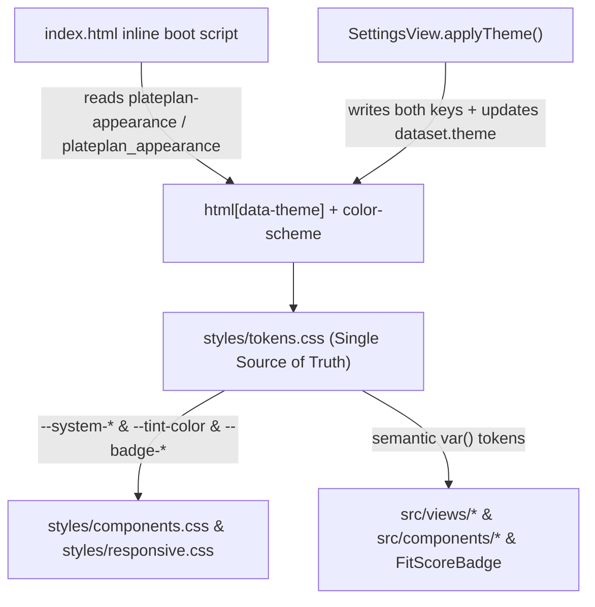

# Apple HIG Light and Dark Mode Unification - Plan

## Goal Capsule

- **Objective:** Household members can read every screen, modal, form control, and status badge with full contrast in Light, Dark, and System modes, and reach Data Quality directly from the fifth tab of the bottom navigation bar.
- **Means:** Consolidate Light and Dark Mode CSS variables in `styles/tokens.css`, align theme persistence keys between `index.html` and `src/views/SettingsView.js`, replace hardcoded light/dark hex values across `src/` views and modals with semantic Apple HIG tokens, and swap the fifth bottom-bar tab from `shopping` to `data` (KTD1, KTD2, KTD3, KTD4).
- **Authority hierarchy:** Product Contract `R1`–`R6` govern product behavior; Planning Contract `KTD1`–`KTD4` govern technical mechanisms within those constraints; Implementation Units `U1`–`U5` execute without overriding either.
- **Execution profile:** Single pull request (`execution: code`), Standard depth, 5 implementation units (`U1`–`U5`).
- **Stop conditions:** Stop if any change requires altering Firestore document schemas or breaking existing store subscriptions.
- **Completion owner:** Implementing agent verifies all units, builds `dist/`, and runs the regression test suite.

---

## Product Contract

Product Contract preservation: changed: added R6 — user added replacing the `Shopping` shortcut tab in the bottom tab bar with `Data Quality` during scoping confirmation.

### Summary

Unify PlatePlan's Light and Dark Mode color tokens, theme persistence, button and sidebar contrast, and status pills under Apple's Human Interface Guidelines, replace the `Shopping` shortcut tab in the bottom tab bar with `Data Quality`, and verify contrast and routing with an automated regression test.

### Problem Frame

Switching PlatePlan to Dark Mode leaves text unreadable and surfaces mismatched across the application. On the `main` deployment (`3.51.0`), Today meal cards used an undefined `--card` variable that fell back to `#fff` while text turned white. On `development` (`3.54.0`), `styles/responsive.css` loads after `styles/tokens.css` and overwrites `:root`, `@media (prefers-color-scheme: dark)`, `html[data-theme="light"]`, and `html[data-theme="dark"]` with a legacy GitHub-dark palette (`#111214`, `#1b1c1f`, `#0969da`) without updating `--system-*` variables. In addition, `index.html` reads `localStorage.getItem('plateplan_appearance')` (underscore) while `src/views/SettingsView.js` writes `plateplan-appearance` (hyphen), `.btn.primary` and `.cf.active` set `background: var(--text); color: #ffffff` (which becomes white-on-white in Dark Mode), and over 25 modules in `src/` hardcode `#ffffff`, `#f8fafc`, `#0f172a`, and `#1e293b` in inline styles. Separately, the fifth tab of the mobile bottom navigation bar (`#mobile-nav`) acts as a shortcut into the Shopping List step of the Meal Planner rather than surfacing the top-level Data Quality view.

### Key Decisions

- **Apple HIG Emerald primary accent with System Blue secondary data accent** `(session-settled: user-approved — chosen over Apple System Blue for all controls or legacy GitHub blue: preserves PlatePlan's HIG Emerald brand identity on primary buttons, active tabs/pills, and toggles while reserving System Blue for secondary data accents like Protein progress bars)`. Governs R1, R3.
- **Adaptive HIG semantic status pills** `(session-settled: user-approved — chosen over static light-pastel badge backgrounds in both modes: prevents bright pastel stickers on dark cards by using soft tinted fills with dark text in Light Mode and 15–18% translucent fills with vibrant Apple system colors in Dark Mode)`. Governs R1, R4.
- **Data Quality tab in the bottom navigation bar** `(session-settled: user-directed — chosen over keeping the Shopping List shortcut tab: Shopping List belongs inside the Meal Planner flow, whereas Data Quality is a primary top-level view)`. Governs R6.

### Requirements

**Theme Tokens and Persistence**

- R1. `styles/tokens.css` serves as the single source of truth for Apple HIG Light and Dark Mode color variables (`--system-bg`, `--secondary-system-grouped-bg`, `--tertiary-system-grouped-bg`, `--label`, `--secondary-label`, `--tertiary-label`, `--separator`, `--tint-color`, `--system-blue`, `--card`, and `--badge-*-bg/text/border`), with conflicting palette blocks and `#0969da` `!important` overrides removed from `styles/responsive.css` and `index.html`.
- R2. Theme selection persists and applies identically across initial boot (`index.html`) and runtime switching (`src/views/SettingsView.js`) by reading and writing both `plateplan_appearance` and `plateplan-appearance` in `localStorage` and supporting `html[data-theme="light"]`, `html.theme-light`, `html[data-theme="dark"]`, `html.theme-dark`, and `@media (prefers-color-scheme: dark) { :root:not([data-theme="light"]):not(.theme-light) }`.

**Controls, Surfaces, and Semantic Badges**

- R3. Primary buttons (`.btn.primary`, `.btn-primary`), active filter pills (`.cf.active`, `.mt2.active`, `.pantry-tab.active`), and navigation items (`.desktop-sidebar .ntab` and `.ios-tab-item`) maintain Apple HIG contrast in both Light and Dark Mode using `--tint-color` (`#34C759` light / `#30D158` dark), with inactive desktop sidebar `.ntab` buttons rendering on a transparent background.
- R4. Views, modals, form inputs, and status badges across `src/` use semantic HIG surface, label, separator, and adaptive `--badge-*` CSS custom properties instead of hardcoded light/dark hex colors (`#fff`, `#ffffff`, `#f8fafc`, `#f1f5f9`, `#0f172a`, `#1e293b`, `#334155`, `#64748b`).
- R5. Automated regression coverage in `scripts/test_hig_dark_mode.js` verifies Light/Dark token parity, theme persistence key synchronization, absence of raw light-background/dark-text contrast collisions across `src/`, and bottom tab bar routing.

**Bottom Navigation Bar**

- R6. The fifth tab in `#mobile-nav` (`index.html` and `src/core/AppRouter.js`) displays `Data Quality` (`data-view="data"`, `data-action="showView('data')"`) instead of `Shopping`, and highlights when `data` or `quality` is active.

### Scope Boundaries

- No changes to Firestore security rules, collection schemas, or macro calculation formulas.
- No native browser `alert()`, `confirm()`, or `prompt()` calls; all dialogs remain routed through `src/components/ui/DialogHelpers.js`.
- All state reads and writes continue routing through `src/store/coreState.js` / `src/store/store.js`.

---

## Planning Contract

### Key Technical Decisions

- KTD1. **Single-owner CSS variable cascade in `styles/tokens.css`** `(session-settled: user-approved — chosen over patching duplicate theme blocks in styles/responsive.css: eliminates load-order overrides where responsive.css clobbered tokens.css)`. Define a shared dark-mode variable block in `styles/tokens.css` applied to both `@media (prefers-color-scheme: dark) { :root:not([data-theme="light"]):not(.theme-light) }` and `html[data-theme="dark"], html.theme-dark`, and remove the legacy `:root`, `@media(prefers-color-scheme:dark)`, `html[data-theme="light"]`, and `html[data-theme="dark"]` color re-declarations from `styles/responsive.css` (cites R1, R2).
- KTD2. **CSS-variable-backed Fit Score and status badge tokens** `(session-settled: user-approved — chosen over theme-branching in JavaScript render functions: allows badges to adapt immediately on theme toggle without re-rendering DOM trees)`. Define `--badge-green-bg/text/border`, `--badge-yellow-bg/text/border`, `--badge-orange-bg/text/border`, `--badge-red-bg/text/border`, `--badge-blue-bg/text/border`, and `--badge-neutral-bg/text/border` in `styles/tokens.css`, and return `var(--badge-*)` references from `getFitScoreTierMeta()` in `src/utils/fitScoreWeights.js`, `src/config/businessRules.js`, and `src/components/FitScoreBadge.js` (cites R1, R4).
- KTD3. **Dual-key theme storage synchronization.** Update the inline boot script in `index.html` to read `localStorage.getItem('plateplan-appearance') || localStorage.getItem('plateplan_appearance') || 'system'`, apply both `dataset.theme` and `theme-light`/`theme-dark` classes when not `'system'`, and update `applyTheme()` in `src/views/SettingsView.js` to write both `plateplan-appearance` and `plateplan_appearance` and set `document.documentElement.style.colorScheme` (cites R2).
- KTD4. **Bottom tab bar replacement for Data Quality** `(session-settled: user-directed — chosen over keeping Shopping as a 5th tab shortcut: Shopping is a step inside Meal Planner whereas Data Quality is a top-level destination)`. Replace the `data-view="shopping"` button in `#mobile-nav` in `index.html` with `data-view="data"` (`data-action="showView('data')"` and label `Data Quality`), and normalize `'quality'` to `'data'` inside `syncMobileNavigation()` and `showView()` in `src/core/AppRouter.js` (cites R6).

### High-Level Technical Design

---

## Implementation Units

### U1. Unify Apple HIG Light/Dark Tokens and Theme Persistence

- **Goal:** Make `styles/tokens.css` the sole owner of Light and Dark Mode variables, fix button/sidebar contrast rules in `styles/components.css`, `styles/responsive.css`, and `index.html`, and synchronize theme persistence with `src/views/SettingsView.js`.
- **Requirements:** R1, R2, R3, R6 (KTD1, KTD2, KTD3, KTD4)
- **Dependencies:** None
- **Files:**
  - `styles/tokens.css`
  - `styles/components.css`
  - `styles/responsive.css`
  - `index.html`
  - `src/views/SettingsView.js`
  - `src/core/AppRouter.js`
- **Approach:**
  1. In `styles/tokens.css`, define complete Light Mode defaults on `:root, html[data-theme="light"], html.theme-light` and Dark Mode overrides on `@media (prefers-color-scheme: dark) { :root:not([data-theme="light"]):not(.theme-light) }` and `html[data-theme="dark"], html.theme-dark`, including `--card`, `--surface3`, `--action`, `--action-hover`, `--action-bg`, `--action-fill`, `--action-fill-hover`, `--on-action`, `--focus`, `--overlay`, `--shadow`, and adaptive `--badge-{green,yellow,orange,red,blue,neutral}-{bg,text,border}` tokens.
  2. In `styles/responsive.css`, remove the legacy color palette re-declarations in `:root` (lines 297–307), `@media(prefers-color-scheme:dark)` (lines 382–412), and `html[data-theme="light"]` / `html[data-theme="dark"]` (lines 449–468), and point `.btn.primary`, `.cf.active`, `.mt2.active`, and `.plan-choice.selected` to `var(--tint-color)` with `#FFFFFF` text.
  3. In `styles/components.css` and `index.html`, update `.btn.primary`, `.btn-primary`, `.cf.active`, and `.pantry-tab.active` to use `background: var(--tint-color); color: #FFFFFF;`, ensure `.desktop-sidebar .ntab` defaults to `background: transparent; color: var(--secondary-label);` and `.desktop-sidebar .ntab.active` uses `background: var(--tint-bg); color: var(--tint-color);`, and ensure form controls (`input`, `select`, `textarea`) set `color: var(--label)` on `var(--tertiary-system-grouped-bg)`.
  4. In `index.html` and `src/views/SettingsView.js`, synchronize `plateplan-appearance` and `plateplan_appearance` storage keys and update `colorScheme` on theme changes per KTD3.
  5. In `index.html` (`#mobile-nav`) and `src/core/AppRouter.js`, replace the fifth mobile tab (`data-view="shopping"`) with `Data Quality` (`data-view="data"`, `data-action="showView('data')"`) and normalize `quality` to `data` in `syncMobileNavigation()` and `showView()` per KTD4.
- **Patterns to follow:** Existing Apple HIG token naming in `styles/tokens.css` and router view normalization in `src/core/AppRouter.js`.
- **Test scenarios:**
  - Light and Dark Mode blocks in `styles/tokens.css` define matching keys for surfaces, labels, separators, tint, and badge tokens, and `styles/responsive.css` contains no competing `--bg`, `--surface`, or `#0969da` overrides.
  - Calling `applyTheme('dark')`, `applyTheme('light')`, and `applyTheme('system')` updates `document.documentElement.dataset.theme`, `style.colorScheme`, and both `plateplan-appearance` and `plateplan_appearance` in `localStorage`.
  - `#mobile-nav` contains five tabs (`today`, `planner`, `vault`, `ingredients`, `data`) with no `data-view="shopping"` tab, and `showView('data')` marks the `data` tab active (`aria-selected="true"`).
- **Verification:** Token cascade, theme persistence, and mobile navigation tab state pass automated checks in `scripts/test_hig_dark_mode.js`.

### U2. Convert Fit Score Badges, Planner Grid, and Profile/Settings Components to Semantic HIG Tokens

- **Goal:** Replace hardcoded pastel badge colors and light-mode hex surfaces/text in Fit Score utilities, the Planner skeleton grid and slot configurator modal, and Profile/Settings cards with adaptive HIG tokens.
- **Requirements:** R4 (KTD2)
- **Dependencies:** U1
- **Files:**
  - `src/utils/fitScoreWeights.js`
  - `src/config/businessRules.js`
  - `src/components/FitScoreBadge.js`
  - `src/components/planner/PlannerGridRenderService.js`
  - `src/components/profile/ProfileMacroEditor.js`
  - `src/components/profile/ProfilePreferencesForm.js`
  - `src/components/profile/ProfileSettingsModal.js`
  - `src/components/settings/ProfileAllocationCard.js`
  - `src/components/settings/FitScoreTaperingCard.js`
  - `src/components/settings/DietaryExclusionManager.js`
- **Approach:**
  1. Update `getFitScoreTierMeta()` in `src/utils/fitScoreWeights.js`, `FIT_SCORE_TIERS` in `src/config/businessRules.js`, and neutral/gradient badges in `src/components/FitScoreBadge.js` to use `var(--badge-{green,yellow,orange,red,neutral}-{bg,text,border})`.
  2. In `src/components/planner/PlannerGridRenderService.js`, replace hardcoded `#ffffff`, `#f8fafc`, `#f1f5f9`, `#0f172a`, `#1e293b`, `#334155`, `#64748b`, and `#94a3b8` on candidate rows, Fit Score scope inputs, day cards, split/pinned/skipped slot cards, segmented dining toggle, and search inputs with `var(--secondary-system-grouped-bg)`, `var(--tertiary-system-grouped-bg)`, `var(--label)`, `var(--secondary-label)`, `var(--separator)`, and `var(--badge-*)`.
  3. In `src/components/profile/*` and `src/components/settings/*`, replace hardcoded light backgrounds, borders, and slate text hex values with semantic HIG variables.
- **Patterns to follow:** Semantic token usage in `src/views/TodayRenderService.js` (`var(--label)`, `var(--secondary-label)`, `var(--separator)`, `var(--tint-color)`).
- **Test scenarios:**
  - `renderFitScoreBadge()` for green (90), yellow (75), orange (60), red (40), and missing-macro inputs outputs `var(--badge-*)` styles with no hardcoded light-only `#dcfce7`, `#fef9c3`, `#ffedd5`, `#fee2e2`, or `#f1f5f9` backgrounds.
  - `renderSkeletonGridUI()`, `renderSlotConfiguratorModal()`, and `renderRecipeCandidateRows()` in `PlannerGridRenderService.js` contain no raw `background:#fff` or `background:#ffffff` styles or hardcoded `#0f172a`/`#1e293b` text colors.
- **Verification:** Existing planner and fit-score tests (`scripts/test_planner_controls.js`, `test_vault_fit_score.js`) and the new dark-mode regression test pass.

### U3. Convert Recipe Modals, Wizard Steps, and Product Swap Modal to Semantic HIG Tokens

- **Goal:** Eliminate hardcoded light-mode backgrounds and dark text colors across Recipe Detail, Recipe Wizard (Steps 1–3, taxonomy search, enhancement, and audit modals), and Product Swap modal.
- **Requirements:** R4 (KTD1, KTD2)
- **Dependencies:** U1
- **Files:**
  - `src/services/RecipeDetailModalService.js`
  - `src/components/recipe/RecipeEnhancementModalUI.js`
  - `src/components/recipe/RecipeAuditModal.js`
  - `src/components/recipe/RecipeAuditModalRenderService.js`
  - `src/components/recipe/RecipeWizardViews.js`
  - `src/components/recipe/RecipeWizardStep2View.js`
  - `src/components/recipe/RecipeWizardStep3View.js`
  - `src/components/recipe/RecipeWizardTaxonomySearch.js`
  - `src/services/RecipeWizardStep2RenderService.js`
  - `src/services/RecipeWizardStep2FieldsRenderService.js`
  - `src/services/RecipeWizardStep3RenderService.js`
  - `src/services/RecipeWizardFilterService.js`
  - `src/components/ProductSwapModal.js`
- **Approach:**
  1. Replace raw `#fff`/`#ffffff`/`#f8fafc`/`#f1f5f9` card, input, and dropdown backgrounds and `#0f172a`/`#1e293b`/`#334155`/`#475569`/`#64748b` text colors across the Recipe Detail sheet, Recipe Wizard steps, taxonomy autocomplete dropdowns, Recipe Enhancement modal, Recipe Audit modal, and Product Swap modal with `var(--secondary-system-grouped-bg)`, `var(--tertiary-system-grouped-bg)`, `var(--label)`, `var(--secondary-label)`, `var(--separator)`, and `var(--badge-*)`.
  2. Replace `onmouseover`/`onmouseout` inline background mutations that hardcode `#f8fafc` or `#ffffff` with `var(--tertiary-system-grouped-bg)` and `var(--secondary-system-grouped-bg)`.
- **Patterns to follow:** Searchable taxonomy dropdown helpers and HIG modal styling in `styles/components.css`.
- **Test scenarios:**
  - Rendering Step 2 and Step 3 of the Recipe Wizard (`scripts/test_recipe_wizard_enhanced_macros.js`, `scripts/test_recipe_wizard_edit.js`, `scripts/test_recipe_review_and_auto_enhance_flow.js`) preserves all existing macro, method-step, and mapping behavior while using semantic HIG color tokens.
  - Static scan of all modified recipe and product-swap modules finds zero raw `#fff`/`#ffffff` background declarations or un-tokenized `#0f172a`/`#1e293b` text declarations.
- **Verification:** Recipe wizard and enhancement test suites pass without regression.

### U4. Convert Pantry, Data Quality, and Navigation Modals to Semantic HIG Tokens

- **Goal:** Replace hardcoded light-mode hex values across Pantry modals/dropdowns, Data Quality tables and resolution wizards, Auth card, and Action Sheet components.
- **Requirements:** R4 (KTD1, KTD2)
- **Dependencies:** U1
- **Files:**
  - `src/views/DataQualityTableRenderService.js`
  - `src/components/data-quality/UnlinkedSweeperUI.js`
  - `src/components/data-quality/MealPlanSyncWarningModal.js`
  - `src/components/data-quality/SubtypeOrphanResolverModal.js`
  - `src/components/data-quality/MergeIngredientsModal.js`
  - `src/components/data-quality/ResolveUnlinkedModalRenderService.js`
  - `src/components/data-quality/MacroDriftPreviewModal.js`
  - `src/components/pantry/ReallocateProductModalRenderService.js`
  - `src/components/pantry/RecipeSearchDropdownHelper.js`
  - `src/components/pantry/SubtypeProductLinkerModalUI.js`
  - `src/components/pantry/CategoryManagerModalUI.js`
  - `src/components/pantry/ReorganiseModalUI.js`
  - `src/components/navigation/ActionSheetUI.js`
  - `src/services/AuthService.js`
- **Approach:**
  1. Replace hardcoded light-mode surface, border, and text hex values in `DataQualityTableRenderService.js` and `src/components/data-quality/*` modals with `var(--secondary-system-grouped-bg)`, `var(--tertiary-system-grouped-bg)`, `var(--label)`, `var(--secondary-label)`, `var(--separator)`, and `var(--badge-*)`.
  2. Replace hardcoded `#fff`/`#f8fafc`/`#0f172a`/`#1e293b` inline styles and hover handlers in `src/components/pantry/*` modals and `RecipeSearchDropdownHelper.js`, `ActionSheetUI.js`, and `AuthService.js` with semantic HIG tokens.
- **Patterns to follow:** Existing Data Quality wizard structure tested by `scripts/test_data_quality_wizards.js`.
- **Test scenarios:**
  - All Data Quality wizard flows (`scripts/test_data_quality_wizards.js`) and Pantry category/delete flows (`scripts/test_category_manager.js`, `scripts/test_pantry_guided_delete.js`) pass.
  - Static scan of Data Quality, Pantry, ActionSheet, and Auth modules confirms zero raw `#fff`/`#ffffff` backgrounds or hardcoded dark slate text (`#0f172a`, `#1e293b`).
- **Verification:** Data Quality and Pantry test suites pass without regression.

### U5. Add Apple HIG Light/Dark Mode & Navigation Regression Test and Rebuild Dist

- **Goal:** Create `scripts/test_hig_dark_mode.js` to enforce Light/Dark token parity, theme persistence synchronization, semantic badge/surface compliance, and bottom tab bar `Data Quality` routing, and rebuild `dist/`.
- **Requirements:** R1, R2, R3, R4, R5, R6
- **Dependencies:** U1, U2, U3, U4
- **Files:**
  - `scripts/test_hig_dark_mode.js`
- **Approach:**
  1. Create `scripts/test_hig_dark_mode.js` using `node:assert` to verify:
     - `styles/tokens.css` defines matching Light and Dark Mode token sets (surfaces, labels, separators, tint `#34C759`/`#30D158`, system blue `#007AFF`/`#0A84FF`, `--card`, and `--badge-*`), and `styles/responsive.css` has no competing `:root` or `@media(prefers-color-scheme:dark)` palette blocks or `#0969da` overrides.
     - `index.html` and `applyTheme()` in `src/views/SettingsView.js` both read/write `plateplan-appearance` and `plateplan_appearance` and synchronize `dataset.theme` and `style.colorScheme`.
     - `renderFitScoreBadge()` and `PlannerGridRenderService` render semantic `var(--badge-*)` and `var(--*-system-grouped-bg)` / `var(--label)` tokens with no raw `#fff`/`#ffffff` backgrounds.
     - None of the targeted `src/` view/component modules contain raw `background:#fff`, `background:#ffffff`, `background:#f8fafc`, `color:#0f172a`, or `color:#1e293b` outside `var(...)` fallbacks.
     - `#mobile-nav` in `index.html` renders `Data Quality` (`data-view="data"`, `data-action="showView('data')"`) as the fifth tab with no `data-view="shopping"` tab, and `AppRouter.showView('data')` activates the tab.
  2. Run `npm run build` so `dist/` is updated for `localhost:3000`.
- **Patterns to follow:** Standalone `node:assert` test scripts in `scripts/test_today_view.js` and `scripts/test_planner_controls.js`.
- **Test scenarios:**
  - `node scripts/test_hig_dark_mode.js` exits 0 when all Light/Dark token, contrast, theme persistence, and bottom tab bar assertions pass, and exits non-zero if a hardcoded `#ffffff` surface or `#0969da` override is reintroduced.
- **Verification:** `node scripts/test_hig_dark_mode.js` and `npm run build` both exit 0.

---

## Verification Contract

| Check | Command | Applies to | Pass signal |
|---|---|---|---|
| Syntax check modified modules | `node --check <file>` | U1–U5 | Exits 0 with no syntax errors |
| HIG Light/Dark Mode & Nav regression test | `node scripts/test_hig_dark_mode.js` | U1–U5 | Exits 0; all token, contrast, persistence, and tab bar assertions pass |
| Today view regression test | `node scripts/test_today_view.js` | U1, U2 | Exits 0 |
| Planner controls regression test | `node scripts/test_planner_controls.js` | U1, U2 | Exits 0 |
| Data Quality wizards regression test | `node scripts/test_data_quality_wizards.js` | U4 | Exits 0 |
| Recipe wizard & enhancement tests | `node scripts/test_recipe_wizard_enhanced_macros.js && node scripts/test_recipe_review_and_auto_enhance_flow.js` | U3 | Exits 0 |
| Static build & version stamping | `npm run build` | U1–U5 | Exits 0 and updates `dist/` |

---

## Definition of Done

- `styles/tokens.css` is the single source of truth for Light and Dark Mode color variables, with legacy conflicting palette blocks removed from `styles/responsive.css`.
- Theme selection persists across reloads using synchronized `localStorage` keys (`plateplan-appearance` and `plateplan_appearance`) and applies immediately across Light, Dark, and System modes.
- Primary buttons, active filter pills, and navigation tabs use Apple HIG Emerald (`--tint-color`), and status badges use adaptive `--badge-*` tokens in Light and Dark Mode.
- Hardcoded light-mode backgrounds (`#fff`, `#ffffff`, `#f8fafc`, `#f1f5f9`) and dark slate text colors (`#0f172a`, `#1e293b`, `#334155`) outside `var()` fallbacks are removed from all targeted `src/` views, modals, and components.
- The fifth tab in `#mobile-nav` routes to `Data Quality` (`showView('data')`) instead of `Shopping`.
- `node scripts/test_hig_dark_mode.js`, existing regression suites, and `npm run build` pass with no abandoned or experimental code left in the diff.
