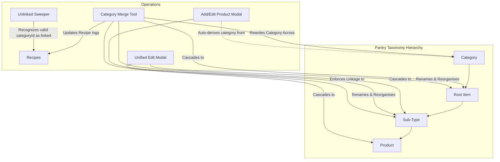

## Goal Capsule

- **Objective:** Establish an accurate and unified pantry taxonomy by providing an interactive category deduplication and merge tool, consolidating pantry item/sub-type editing and renaming into a single modal, eliminating redundant manual category selection on products in favor of strict sub-type linkage, and aligning the data quality sweeper to recognize category-mapped recipe ingredients as linked.
- **Means:** Interactive Category Merge UI in Category Manager & Data Quality, unified Edit Item/Sub-type modal in `PantryBankView.js`, removal of `#mi-cat-search` from `ProductBankView.js` with Sub-Type inheritance, and aligning `scanUnlinkedRecipeIngredients()` in `UnlinkedSweeperUI.js`.
- **Product Authority:** Pantry taxonomy and linkage hierarchy (`Category > Root Item > Sub-Type > Product`). The remaining 12 feedback items from weekend testing (Recipe Wizard step addition and renumbering, Recipe Vault visibility and duplicate recipes, TikTok recipe parsing, and Add Recipe defaults) are explicitly deferred to separate focused work units.
- **Open Blockers:** None.

## Product Contract

### Summary

Household pantry taxonomy currently suffers from duplicate category fragmentation, and users cannot rename root items or sub-types from the pantry view. Redundant manual category pickers on products cause taxonomy drift, while the data quality sweeper falsely flags valid category-mapped recipe ingredients as unlinked.

This feature introduces an interactive Category Merge Tool in Category Manager and Data Quality to safely consolidate duplicate categories across all downstream entities. It consolidates root item and sub-type options into a unified "Edit Item" / "Edit Sub-type" modal in the pantry view that enables full renaming and metadata editing. It eliminates the manual Category selector on Add/Edit Product so category and root item are strictly derived from parent sub-type linkage, and it aligns the Unlinked Sweeper to recognize valid category mappings.

### User Value & Context

In PlatePlan, household meal planning and shopping rely on a four-tier taxonomy: `Category > Root Item > Sub-Type > Product`. Over time, subtle variations in category naming (case differences, extra whitespace, or near-identical titles like "Tinned Goods" vs "Tinned & Canned") have fragmented lists. Furthermore:
1. When viewing the pantry bank, the 3-dots action sheet on items and sub-types permits reorganising, managing aliases, and deleting, but lacks any mechanism to rename the entity.
2. When creating or editing a product, an independent Category search input (`#mi-cat-search`) allows users to select a category directly, decoupling the product from its parent sub-type or assigning conflicting categories.
3. The Data Quality Unlinked Ingredient Sweeper inspects recipes for unlinked ingredients, but fails to check `item.categoryId`, flagging intentionally category-mapped items as unlinked errors.

### Requirements

#### R1: Interactive Category Deduplication & Merge Tool
- The system MUST detect duplicate or near-identical category names (exact case-insensitive matches, trimmed whitespace, and normalized alphanumeric strings) across the household's categories.
- An interactive Category Merge view MUST be accessible from both the Category Manager modal (`CategoryManagerModalUI.js`) and the Data Quality Centre (`DataQualityTableRenderService.js`).
- The user MUST be presented with candidate duplicate clusters and prompted to select one canonical target category name.
- Upon user confirmation, the merge operation MUST atomically cascade category reassignment across all associated Root Items, Sub-Types, Products, and Recipe Ingredients before deleting the redundant category records.

#### R2: Unified "Edit Item" & "Edit Sub-type" Modal
- The 3-dots action sheet on Root Items in `PantryBankView.js` MUST include a prominent "Edit Item" option.
- The 3-dots action sheet on Sub-Types in `PantryBankView.js` MUST include a prominent "Edit Sub-type" option.
- Selecting "Edit Item" MUST open a unified modal allowing the user to rename the root item, adjust its category assignment, and review aliases without jumping across multiple disjoint dialogs.
- Selecting "Edit Sub-type" MUST open a unified modal allowing the user to rename the sub-type, adjust its parent root item, and manage aliases.
- Renaming MUST enforce non-empty trimmed names and reject duplicate names within the same parent scope.

#### R3: Product Sub-Type Requirement & Category Field Removal
- The manual Category search input (`#mi-cat-search`) in `ProductBankView.js` (`openProductEditModal`) MUST be removed from the form.
- Creating or editing a product MUST enforce linkage to an existing Sub-Type (or require selecting a parent Root Item and Sub-Type upfront).
- The product's `category` and `cat` fields MUST be derived automatically from the linked Sub-Type's taxonomy hierarchy upon saving.

#### R4: Unlinked Sweeper Category Mapping Alignment
- In `UnlinkedSweeperUI.js` (`scanUnlinkedRecipeIngredients`), the link-checking logic MUST inspect `item.categoryId`.
- Ingredients with a valid assigned `categoryId` MUST be counted as linked, matching the validation logic in `RecipeWizardTaxonomySearch.js` (`isIngredientUnlinked`).
- Generic fallback categories (`'Store Cupboard'` and `'General'`) MUST continue to be treated as unlinked unless explicitly marked as a category default (`item.isCategoryDefault`).

### Key Decisions

- **KD1: Interactive Category Merge Tool** (`session-settled: interactive merge tool over silent auto-merge or one-off script`): Allows users to review affected items and intentionally choose the canonical target name, preventing accidental data loss or surprise reclassifications.
- **KD2: Consolidated Edit Modal** (`session-settled: unified modal over scattered action sheet buttons or inline title editing`): Groups title renaming, category assignment, and aliases into a cohesive, clean modal rather than adding a separate dialog for every attribute.
- **KD3: Strict Sub-Type Linkage on Products** (`session-settled: require sub-type linkage upfront over manual category search input or loose overrides`): Enforces structural integrity across the four-tier hierarchy, guaranteeing products can never have orphaned or mismatched categories.
- **KD4: Unlinked Sweeper Rule Parity** (`session-settled: count valid categoryId as linked over ignoring categoryId or counting all unconditionally`): Synchronizes Data Quality with the Recipe Wizard so ingredients approved during wizard authoring are not flagged as issues in Data Quality.

### Scope Boundaries

#### In Scope
- Interactive Category Merge UI in `CategoryManagerModalUI.js` and `DataQualityTableRenderService.js`.
- Category reassignment cascading in `CategoryMergeRepository.js`.
- "Edit Item" and "Edit Sub-type" modals in `PantryBankView.js` and `PantryTaxonomyService.js`.
- Elimination of `#mi-cat-search` and requirement of Sub-Type linkage in `ProductBankView.js`.
- `scanUnlinkedRecipeIngredients` category evaluation update in `UnlinkedSweeperUI.js`.

#### Out of Scope
- Recipe Wizard step creation glitch, renumbering X.5, and original/enhanced switching (deferred to Recipe Wizard work unit).
- Recipe Vault missing recipes and duplicate recipe detection (deferred to Recipe Vault work unit).
- TikTok Cinnamon Roll Baked Oats recipe parsing and seasoning omission (deferred to Parser work unit).
- Add Recipe prep/cook time blank defaults and source/URL fields (deferred to Recipe Form work unit).

### Acceptance Examples

- **Scenario 1 (Category Deduplication):** User has "Bakery" and "bakery" in categories. In Category Manager, user clicks "Merge Duplicates", selects "Bakery" as the canonical name. All products and ingredients under "bakery" are updated to "Bakery", and the lowercase "bakery" category is removed.
- **Scenario 2 (Renaming Root Item):** User opens the action sheet for "Tomatoes" in the pantry bank, clicks "Edit Item", changes name to "Plum Tomatoes", and saves. The pantry list updates immediately to display "Plum Tomatoes".
- **Scenario 3 (Product Category Derivation):** User adds a product, links it to Sub-Type "Brioche Buns" (which belongs to Root Item "Burger Buns" under Category "Bakery"). The product is saved with `category: "Bakery"` without displaying any manual category input field.
- **Scenario 4 (Unlinked Sweeper):** A recipe ingredient has `categoryId: "Fresh Produce"`. When the user runs the Unlinked Ingredient Sweeper, this ingredient is recognized as linked and does not appear in the unlinked phrases count.

---

## Planning Contract

### Architecture Overview



### Technical Design Decisions

1. **Category Merge Engine (`src/services/CategoryMergeRepository.js`)**:
   - Reuse existing `CategoryMergeRepository.js` functions `findCategoryDuplicates()` and `mergeCategories()`.
   - Ensure the merge updates both Firestore documents under `households/elliott-chloe/...` and the in-memory Store slices (`setCategories`, `setIngredients`, `setProducts`, `setRecipes`).
2. **Interactive Merge UI (`src/components/pantry/CategoryMergeModalUI.js`)**:
   - Expose a "Merge Duplicates" button in `CategoryManagerModalUI.js` and a dedicated banner/action in `DataQualityTableRenderService.js`.
   - Render duplicate candidate clusters with radio buttons to select the winner, showing total affected count.
3. **Pantry Item Renaming (`src/components/pantry/EditPantryTaxonomyModalUI.js`)**:
   - Create a clean modal supporting:
     - Name text input with inline trimming and validation.
     - Category selection (searchable dropdown) for Root Items.
     - Parent Root Item selection for Sub-Types.
     - Alias chip list with add/delete controls.
   - On save, invoke `PantryTaxonomyService.js` / `RootItemRepository.js` / `SubtypeRepository.js` to persist changes and re-render `PantryBankView.js`.
4. **Product Sub-Type Linkage (`src/views/ProductBankView.js`)**:
   - Strip `#mi-cat-search` from the markup.
   - If `openProductEditModal` is invoked without a draft or linked subtype, render a Sub-Type picker using `createTaxonomySearchInput` before showing nutrition inputs, or pre-populate from active subtype context.
   - On save, auto-fill `prod.category = subtype.category` and `prod.cat = slugifyToKebab(subtype.category)`.
5. **Unlinked Sweeper Filter Parity (`src/components/data-quality/UnlinkedSweeperUI.js`)**:
   - Update `scanUnlinkedRecipeIngredients()`:
     ```javascript
     const hasValidCategory = Boolean(
       item.categoryId &&
       (item.isCategoryDefault || (item.categoryId !== 'Store Cupboard' && item.categoryId !== 'General'))
     );
     const linked = Boolean(
       item.productId || item.bankId || item.pantryItemId || item.ingredientId || item.subtypeId || item.targetId || hasValidCategory
     );
     ```

---

## Implementation Units

### U1: Interactive Category Deduplication UI & Merge Execution
- **Goal:** Enable users to find and merge duplicate categories from Category Manager and Data Quality.
- **Files Modified/Created:**
  - `src/components/pantry/CategoryMergeModalUI.js` (create dedicated merge dialog)
  - `src/components/pantry/CategoryManagerModalUI.js` (add "Merge Duplicates" trigger)
  - `src/views/DataQualityTableRenderService.js` (add "Deduplicate Categories" action card/button)
  - `src/services/CategoryMergeRepository.js` (verify and harden cascading merge)
  - `scripts/test_category_merge_deduplication.js` (unit tests)
- **Scenarios to Test:**
  - Case-insensitive duplicates ("Meat" vs "meat") are identified as a single cluster.
  - User selects canonical category; products, ingredients, and recipes update to canonical name.
  - Non-canonical category document is removed from Firestore and store.

### U2: Consolidated "Edit Item" and "Edit Sub-type" Modal
- **Goal:** Provide renaming and metadata editing for Root Items and Sub-Types in the pantry bank.
- **Files Modified/Created:**
  - `src/components/pantry/EditPantryTaxonomyModalUI.js` (create unified edit modal)
  - `src/views/PantryBankView.js` (add "Edit Item" / "Edit Sub-type" to action sheet menus)
  - `src/services/PantryTaxonomyService.js` (ensure rename methods persist to Firestore and update in-memory state)
  - `scripts/test_pantry_item_rename.js` (unit tests)
- **Scenarios to Test:**
  - Opening action sheet on root item shows "Edit Item" and opens edit modal with current name.
  - Renaming root item to a new trimmed name updates Firestore and local store.
  - Renaming sub-type preserves linked products and updates name across bank view.
  - Empty name or collision with existing sibling item shows validation error.

### U3: Product Sub-Type Linkage Enforcement & Category Field Removal
- **Goal:** Remove manual category picker from Add/Edit Product and derive category strictly from Sub-Type.
- **Files Modified/Created:**
  - `src/views/ProductBankView.js` (remove `#mi-cat-search`, add/enforce Sub-Type picker)
  - `scripts/test_product_subtype_linkage.js` (unit tests)
- **Scenarios to Test:**
  - Add product modal renders without any `#mi-cat-search` category input.
  - Saving a product inherits `category` and `cat` matching its linked Sub-Type.
  - Attempting to save a product without a linked Sub-Type triggers a validation prompt.

### U4: Unlinked Sweeper Category Mapping Recognition
- **Goal:** Ensure recipe ingredients mapped to valid categories are recognized as linked.
- **Files Modified/Created:**
  - `src/components/data-quality/UnlinkedSweeperUI.js` (update `scanUnlinkedRecipeIngredients`)
  - `scripts/test_unlinked_sweeper_category_alignment.js` (unit tests)
- **Scenarios to Test:**
  - Recipe ingredient with `categoryId: "Fresh Produce"` is NOT flagged as unlinked.
  - Recipe ingredient with fallback `categoryId: "Store Cupboard"` and no default IS flagged as unlinked.
  - Sweeper badge count matches true unlinked ingredient phrases.

---

## Verification Contract

### Automated Verification
```bash
node scripts/test_category_merge_deduplication.js
node scripts/test_pantry_item_rename.js
node scripts/test_product_subtype_linkage.js
node scripts/test_unlinked_sweeper_category_alignment.js
npm run build
```

### Manual Verification Flow
1. **Category Merge**: Open Pantry > Categories > Click "Merge Duplicates". Select canonical name and click Merge. Check that duplicate category disappears and items update.
2. **Item Renaming**: Open Pantry > Root Items > 3-dots > "Edit Item". Change name and save. Check that pantry list updates.
3. **Product Add**: Open Pantry > Products > "+ Add Product". Verify Category input is absent and Sub-Type linkage is enforced.
4. **Unlinked Sweeper**: Open Data Quality > Sweeper. Verify category-mapped ingredients do not appear as unlinked.

---

## Definition of Done

1. All 4 implementation units (U1–U4) completed and covered by standalone Node test scripts.
2. `npm run build` succeeds cleanly without errors or placeholders.
3. No manual Category selector remains in `ProductBankView.js`.
4. Root items and sub-types can be renamed directly from the pantry UI.
5. All changes pass `git diff` inspection before pull request creation.
