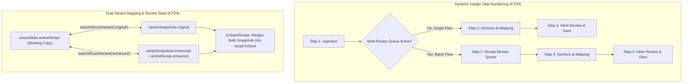

# Recipe Wizard and Add Recipe Form Enhancements - Plan

## Goal Capsule

- **Objective:** Users can add, parse, map, and edit recipes in the Recipe Wizard without losing learned aliases, getting stuck on empty method steps, seeing fractional step numbers, overwriting Original and Enhanced variant mappings, accepting pre-filled time or meal defaults they did not choose, or omitting recipe sources.
- **Means:** Extend alias matching and cleaned-phrase alias learning across `RecipeIngredientParser.js`, `RecipeWizardTaxonomySearch.js`, `RecipeWizardAliasesPrompt.js`, and `RecipeWizardStep3Handlers.js` (KTD1); preserve empty method step rows in `RecipeWizardStep2View.js` and `RecipeWizardState.js` (KTD2); compute dynamic integer step labels in `RecipeWizardViews.js`, `RecipeWizardStep2View.js`, and `RecipeWizardStep3View.js` (KTD3); maintain dual-variant working snapshots in `RecipeWizardState.js` with a shared variant switcher across Mapping and Review (KTD4); initialize blank time and meal suitability defaults for new recipes with mandatory meal tag validation in Step 1A and Step 3 (KTD5); and add structured Source inputs and display across Step 1A, Step 3, and `RecipeDetailModalService.js` (KTD6).
- **Product Authority:** Recipe Wizard and Add Recipe flow (Steps 1–4 across Manual Add, Raw Text Parse, Batch Review Queue, Sections & Mapping, Inline Review & Save, and Recipe Detail Source Display). Surrounding areas from weekend testing — Recipe Parser text formatting (`toTitleCase` accented characters, implied salt/pepper removal, TikTok baked oats paste) and Recipe Vault visibility and duplicate detection — are not active scope.
- **Execution Profile:** Single pull request from `dev/recipe-wizard-and-form-enhancements` targeting `development`.
- **Stop Conditions:** All 6 implementation units (`U1`–`U6`) implemented, `node scripts/test_recipe_wizard.js` and related recipe wizard suites pass, `npm run ledger` and `npm run build` succeed cleanly.
- **Open Blockers:** None.

---

## Product Contract

*Product Contract preservation: Product Contract unchanged.*

### Summary

A unified Recipe Wizard and Add Recipe update that matches and saves root-item and sub-type aliases across parsing, search, and save; renders an editable step box when adding a method step from zero; numbers wizard progress steps dynamically as whole integers (`1–3` for single recipes, `1–4` when the batch review queue is active); provides an independent `Original` / `✨ Enhanced` variant switcher in both Mapping and Review; starts Prep Time, Cook Time, and Meal Suitability blank on new recipes while requiring at least one Meal Suitability selection; and captures recipe sources (online URL or book name and page number) in both Manual Add and Inline Review.

### Problem Frame

When adding or editing recipes in the Recipe Wizard during weekend testing, six workflow breaks surfaced:
1. Learned aliases on root items and sub-types were not consistently checked during ingredient parsing, taxonomy search dropdown filtering, or save-time product resolution, and save-time alias learning passed raw uncleaned lines or overwrote `ingredientId` with `productId`.
2. Clicking `+ Add Step` when a recipe had zero method steps incremented the step counter (`Method Steps (1)`) without rendering a text box because empty strings were filtered out before rendering.
3. Pasting multiple recipes displayed a `Step 1.5: Recipe Review Queue` badge between `Step 1` and `Step 2`, exposing fractional step numbers in the wizard header.
4. Switching between Original and Enhanced recipe variants was only available in the final Review screen and did not swap the underlying editable ingredient mapping state, making it impossible to flick between variants in the Mapping step to adjust their ingredient mappings independently.
5. Opening Add Recipe pre-filled Prep Time (`0 hr 15 min`), Cook Time (`0 hr 30 min`), and Meal Suitability (`Dinner`), allowing recipes to advance with unchosen defaults.
6. Neither Add Recipe nor Inline Review provided fields to record whether a recipe came from an online URL or a physical cookbook (book name and page number).

### Key Decisions

- **KD1. Coherent Work Unit Scope** (`session-settled: user-approved — chosen over bundling all 16 weekend testing items into a single branch: keeps each change set small enough to verify and merge cleanly`): Ship the six Recipe Wizard and Add Recipe items together as Work Unit 2. Governs R1, R2, R3, R4, R5, R6, R7, R8, R9, R10.
- **KD2. Dynamic Whole-Integer Wizard Step Numbering** (`session-settled: user-directed — chosen over fixed 4-step numbering everywhere or renumbering only recipe method steps: matches the actual number of screens the user visits in single-recipe vs multi-recipe flows`): Number wizard progress badges dynamically as Steps 1 → 2 → 3 for single-recipe flows and Steps 1 → 2 (Review Queue) → 3 (Mapping) → 4 (Review & Save) when the multi-recipe queue is active. Governs R4.
- **KD3. Independent Variant Toggle in Mapping and Review** (`session-settled: user-directed — chosen over Review-only variant switching or requiring Auto-Enhance inside the Mapping step: lets users flick between Original and Enhanced in both Mapping and Review whenever an Enhanced variant exists`): Render the `Original` / `✨ Enhanced` toggle in both the Mapping step and the Review step whenever an Enhanced variant is present, preserving separate ingredient mappings per variant. Governs R5, R6.
- **KD4. Source Fields and Meal Type Gate in Both Manual Add and Inline Review** (`session-settled: user-directed — chosen over placing Source fields and Meal Type validation only in the initial Manual Add screen: ensures pasted raw-text recipes and edited Vault recipes also get Source fields and mandatory Meal Type validation`): Surface Source fields and mandatory Meal Suitability validation in both Manual Add and Inline Review & Save. Governs R7, R8, R9, R10.

<!-- ce-section: work-relationships -->
### How This Work Fits Together

This plan covers **Work Unit 2 (Recipe Wizard & Add Recipe Form)** from the weekend testing feedback breakdown. The broader breakdown below reflects the current understanding across four units:
- **Work Unit 1 (Pantry Taxonomy & Deduplication):** Completed and merged to `development` (`docs/plans/2026-11-09-0925-feat-pantry-taxonomy-and-deduplication-plan.md`). Enables clean root-item and sub-type alias editing used by R1 and R2.
- **Work Unit 2 (Recipe Wizard & Add Recipe Form — this plan):** Can proceed independently of Work Units 3 and 4.
  - **Work Unit 3 (Recipe Parser & Text Formatting):** Can proceed independently of Work Unit 2; covers accented character title-casing, implied salt/pepper omission, and the TikTok `CINNAMON ROLL BAKED OATS` paste issue.
  - **Work Unit 4 (Recipe Vault Visibility & Deduplication):** Can proceed independently of Work Units 2 and 3; covers displaying all recipes in the Vault and resolving duplicate recipes.

### Requirements

**Alias Matching & Learning**
- R1. The Recipe Wizard MUST check both Root Item `aliases` and Sub-Type `aliases` (including case-insensitive and stemmed matches against cleaned ingredient names and raw phrases stripped of quantity and unit) during initial ingredient parsing, Step 2 taxonomy search dropdown filtering, and Step 3 product fallback resolution.
- R2. When saving a recipe or confirming learned aliases in the Recipe Wizard, the system MUST preserve `ingredientId` (Root Item ID) distinct from `productId` and save cleaned ingredient phrases (stripped of leading quantities, units, and preparation notes) to the target Root Item or Sub-Type `aliases` list.

**Method Step Editing & Wizard Progress Numbering**
- R3. Clicking `+ Add Step` in the Mapping step when a recipe has zero method steps MUST immediately render an editable step text box (`1.`) synchronized with the method step counter.
- R4. The Recipe Wizard header badge and navigation buttons MUST number wizard progress steps as whole integers without any `.5` step: Steps 1 (Ingestion) → 2 (Sections & Mapping) → 3 (Inline Review & Save) for single-recipe flows, and Steps 1 (Ingestion) → 2 (Recipe Review Queue) → 3 (Sections & Mapping) → 4 (Inline Review & Save) when the multi-recipe queue is active.

**Original & Enhanced Variant Mapping**
- R5. Whenever a recipe in the Recipe Wizard has an Enhanced variant (loaded from an existing recipe or generated via Auto-Enhance during the session), both the Mapping step and the Inline Review step MUST display the `Original` / `✨ Enhanced` toggle.
- R6. Switching between `Original` and `✨ Enhanced` in either the Mapping step or the Inline Review step MUST stash the current variant's ingredient sections, quantities, taxonomy mappings, and method steps and load the selected variant's state so edits to one variant never overwrite the other on save.

**Blank Defaults, Mandatory Meal Type & Recipe Source Fields**
- R7. Starting a new recipe in the Recipe Wizard MUST initialize Prep Time (hours and minutes), Cook Time (hours and minutes), and Meal Suitability as blank/empty rather than pre-filling `0 hr 15 min`, `0 hr 30 min`, or `Dinner`, while opening an existing recipe for editing MUST preserve its saved values.
- R8. Advancing from the Manual Add form to Mapping, or saving a recipe in Inline Review & Save, MUST require at least one Meal Suitability tag to be selected and block progression with a clear warning notice if none is selected.
- R9. Both the Manual Add form and the Inline Review & Save screen MUST include a Source selector (`None`, `Online (URL)`, `Book`) that reveals a URL input when `Online (URL)` is selected or `Book Name` and `Page Number` inputs when `Book` is selected.
- R10. Saving a recipe MUST persist the structured source fields (`sourceType`, `sourceUrl`, `sourceBook`, `sourcePage`) and display the saved source on the Recipe Detail modal (as a clickable external link for an online URL, or formatted book title and page number for a book).

### Acceptance Examples

- AE1. **Covers R1, R2.** Given a sub-type "Spring Onion" has alias `"scallions"`, when a user pastes `"2 scallions, finely sliced"` or types `"scallions"` into the Step 2 taxonomy search input, then the parser and dropdown match "Spring Onion", and saving the recipe preserves `ingredientId` as the root item ID rather than overwriting it with `productId`.
- AE2. **Covers R3.** Given a recipe in the Mapping step has `0` method steps (`Method Steps (0)`), when the user clicks `+ Add Step`, then the header updates to `Method Steps (1)` and an editable `<textarea>` for step `1.` appears immediately.
- AE3. **Covers R4.** Given a user pastes a single recipe in Step 1, when it parses, then the wizard advances to `Step 2: Sections & Mapping` and `Step 3: Inline Review & Save`; given a user pastes 3 recipes at once in Step 1, when it parses, then the wizard advances to `Step 2: Recipe Review Queue (3 Detected)`, then `Step 3: Sections & Mapping`, and `Step 4: Inline Review & Save`.
- AE4. **Covers R5, R6.** Given a recipe has both `Original` and `✨ Enhanced` variants, when the user toggles to `✨ Enhanced` in the Mapping step, links an enhanced swap ingredient to a specific sub-type, and switches back to `Original`, then `Original` retains its original ingredient list and mappings, and saving the recipe persists both variants with their respective mappings intact.
- AE5. **Covers R7, R8.** Given a user opens `Add Recipe (Manual)` for a new recipe, when the form renders, then Prep Time, Cook Time, and Meal Suitability are blank; when the user clicks `Next: Parse & Map →` without selecting a Meal Suitability tag, then progression is blocked with a warning notice until at least one tag is selected.
- AE6. **Covers R9, R10.** Given a user selects `Book` as the Source in Manual Add or Inline Review and enters Book Name `"Ottolenghi Simple"` and Page Number `"142"`, when the recipe is saved and opened in the Recipe Detail modal, then `"📖 Ottolenghi Simple (p. 142)"` is displayed in the recipe header.

### Scope Boundaries

**In Scope**
- Alias matching and learning across `src/services/RecipeIngredientParser.js`, `src/components/recipe/RecipeWizardTaxonomySearch.js`, `src/components/recipe/RecipeWizardAliasesPrompt.js`, and `src/components/recipe/RecipeWizardStep3Handlers.js`.
- Zero-step `+ Add Step` rendering fix in `src/components/recipe/RecipeWizardStep2View.js` and `src/components/recipe/RecipeWizardState.js`.
- Dynamic integer step numbering (`1–3` single, `1–4` batch queue) in `src/components/recipe/RecipeWizardViews.js`, `src/components/recipe/RecipeWizardStep2View.js`, and `src/components/recipe/RecipeWizardStep3View.js`.
- Bidirectional `Original` ↔ `✨ Enhanced` state stashing and toggle UI in Step 2 and Step 3.
- Blank initial Prep/Cook Time and Meal Suitability for new recipes, plus mandatory Meal Suitability validation in Step 1A and Step 3.
- Source fields (`None`, `Online (URL)`, `Book` with Book Name + Page Number) in Step 1A, Step 3, recipe persistence, and `src/services/RecipeDetailModalService.js`.

**Deferred to Follow-Up Work**
- Accented character capitalization in `toTitleCase`, implied `salt` / `black pepper` removal without quantities, and the TikTok `CINNAMON ROLL BAKED OATS` recipe parser fix (Work Unit 3).
- Recipe Vault missing recipes visibility fix and duplicate recipe detection/resolution (Work Unit 4).

---

## Planning Contract

### Key Technical Decisions

- KTD1. **End-to-End Alias Resolution & Non-Destructive `ingredientId` Persistence** — Extend `matchIngredientTaxonomy` in `src/services/RecipeIngredientParser.js` to compare both `parsedItem.name` and cleaned `parsedItem.raw` (plus their stemmed forms via `stemIngredientName`) against `ing.aliases` and `sub.aliases`. Extend `filterAndRenderDropdown` in `src/components/recipe/RecipeWizardTaxonomySearch.js` and `resolveProductForIngredient` in `src/components/recipe/RecipeWizardStep3Handlers.js` to check `ing.aliases` and `sub.aliases`. In `onSaveRecipe` (`src/components/recipe/RecipeWizardStep3Handlers.js`), stop overwriting `i.ingredientId` with `resolvedId` (which prioritized `i.productId`), and pass a cleaned ingredient phrase plus `ing.subtypeId` to `learnIngredientAlias`. Governs R1, R2.
- KTD2. **Preserve Empty String Method Steps During Step 2 Normalization** — In `src/components/recipe/RecipeWizardStep2View.js`, normalize `rawMethodSteps` when it is an array by mapping elements to strings and filtering out only `null` or `undefined` rather than calling `.filter(Boolean)`, so newly pushed `''` items from `#wiz-add-step-btn` render an editable `<textarea class="wiz-step-input">`. In `syncStep2InputsToState` (`src/components/recipe/RecipeWizardState.js`), always assign `wizardState.activeRecipe.methodSteps = stepInputs` even when `stepInputs` is empty so deleting the last step updates state cleanly. Governs R3.
- KTD3. **Display-Layer Dynamic Step Numbering (`getWizardStepDisplayInfo`)** (`session-settled: user-directed — chosen over fixed 4-step numbering everywhere or mutating internal currentStep numbers across 15+ files: keeps internal step keys stable while presenting sequential whole numbers 1–3 or 1–4 based on whether the multi-recipe queue is active`) — Add a helper `getWizardStepDisplayInfo()` in `src/components/recipe/RecipeWizardState.js` that checks whether the multi-recipe batch flow is active (`wizardState.initialQueueTotal > 1 || wizardState.processingQueue.length > 0 || wizardState.currentStep === 1.5`) and returns whole-integer step numbers and labels (`1..3` for single recipe, `1..4` for multi-recipe queue) used by `renderStepBadge()`, Step 2/3 action buttons, and step headers. Governs R4.
- KTD4. **Dual-Variant Snapshot Stashing (`switchWizardVariant` & `syncActiveVariantToSnapshots`)** (`session-settled: user-directed — chosen over Review-only tab switching without state swapping: allows switching between Original and Enhanced in both Mapping and Review while saving edits to both variants on Save`) — Add `variantSnapshots: { original: null, enhanced: null }` and `switchWizardVariant(targetVariant, modalWrap)` in `src/components/recipe/RecipeWizardState.js`. Switching tabs in either Step 2 or Step 3 flushes current DOM inputs, stashes a deep copy of `ingredientSections`, `ingredients`, `methodSteps`, `servings`, `macros`, and `fitScore` into `variantSnapshots[currentVariant]`, and loads `variantSnapshots[targetVariant]` into `wizardState.activeRecipe` (and `wizardState.activeRecipe.enhanced`). In `onSaveRecipe`, flush the active variant into `variantSnapshots` first so saving from either tab persists the latest state of both `Original` and `enhanced`. Governs R5, R6.
- KTD5. **Nullable Time Inputs & Mandatory Meal Suitability Gate** — Initialize `prepTime: { hours: '', minutes: '' }`, `cookTime: { hours: '', minutes: '' }`, and `mealSuitability: []` in `resetWizardState()`. When numeric calculations read `prepTime` or `cookTime`, coerce blank strings with `Number(val) || 0`. Remove the `['Dinner']` fallback when unchecking meal suitability checkboxes in Step 1A and Step 3, and block `#btn-next-step1a` and `#btn-save-wizard-recipe` with `showWizardNotice('Please select at least one Meal Suitability type before proceeding.', 'warning')` if `mealSuitability` is empty. Governs R7, R8.
- KTD6. **Structured Recipe Source Schema (`sourceType`, `sourceUrl`, `sourceBook`, `sourcePage`)** (`session-settled: user-directed — chosen over placing Source inputs only in Step 1A Manual Add: surfaces Source selection in both Manual Add and Inline Review and renders it in RecipeDetailModalService.js`) — Store `sourceType` (`'' | 'online' | 'book'`), `sourceUrl`, `sourceBook`, and `sourcePage` on `wizardState.activeRecipe` and persisted recipes. Render a segmented or radio/pill selector (`None`, `Online (URL)`, `Book`) with conditional inputs in `renderState1AManual()` and `renderState3Review()`, hydrate existing recipes in `openRecipeWizard()`, and render a clickable link or `"📖 <Book> (p. <Page>)"` badge in `src/services/RecipeDetailModalService.js`. Governs R9, R10.

### High-Level Technical Design

### System-Wide Impact

- **Firestore Recipe Persistence (`households/elliott-chloe/recipes`)**: Recipes gain optional `sourceType`, `sourceUrl`, `sourceBook`, and `sourcePage` fields alongside the human-readable `source` summary string. Existing recipes without these fields default to `sourceType: ''` (or `'online'` if a legacy `url`/`sourceUrl` starts with `http`).
- **Dual-Variant Scoring & Macro Crossbar**: Maintaining `activeRecipe.enhanced` in sync with `variantSnapshots.enhanced` honors the engineering rule in `docs/solutions/logic-errors/recipe-wizard-enhanced-variant-live-macro-recalculation-20261104.md` so `calculateMealFitScore` and `extractRecipeMacros` never read stale sub-objects.

### Risks & Dependencies

- **Risk — Overwriting one variant when saving from the other tab**: Previously, saving while on the `Original` tab copied `baseOrig.enhanced` over `rec.enhanced`, discarding any edits made on the `✨ Enhanced` tab, and saving while on the `✨ Enhanced` tab copied `baseOrig` root fields, discarding edits made on the `Original` tab. **Mitigation**: `KTD4` flushes the active tab into `variantSnapshots` at the start of `onSaveRecipe` and builds `recipeToSave` from `variantSnapshots.original` (root) + `variantSnapshots.enhanced` (`recipeToSave.enhanced`).
- **Risk — Blank `prepTime`/`cookTime` strings producing `NaN` in total time math**: When `hours` and `minutes` start as `''`, string concatenation (`hours * 60 + minutes` -> `0 + ''` -> `'0'`) can occur if not coerced. **Mitigation**: Coerce `Number(recipe.prepTime?.hours) || 0` and `Number(recipe.prepTime?.minutes) || 0` wherever numeric minutes are computed.

### Sources & Research

- `docs/solutions/logic-errors/recipe-wizard-enhanced-variant-live-macro-recalculation-20261104.md` — Dual-variant working state synchronization and multi-schema method step extraction rules.
- `docs/solutions/logic-errors/recipe-wizard-taxonomy-auto-default-hierarchy-and-variant-isolation-20261103.md` — Preserving explicit taxonomy hierarchy selections (`categoryId`, `ingredientId`, `subtypeId`) without downgrading or latching onto stale `productId`.
- `docs/solutions/logic-errors/single-truth-recipe-yield-and-canonical-quantity-preservation-20261101.md` — Canonical unscaled quantity preservation on `recipe.servings`.

---

## Implementation Units

### U1. End-to-End Alias Matching & Clean Alias Learning

- **Goal:** Ensure root-item and sub-type aliases are matched during initial parsing, Step 2 taxonomy dropdown filtering, and Step 3 product fallback resolution, and ensure saving/learning aliases preserves `ingredientId` and stores cleaned ingredient phrases.
- **Requirements:** R1, R2 (AE1)
- **Dependencies:** None
- **Files:**
  - `src/services/RecipeIngredientParser.js`
  - `src/components/recipe/RecipeWizardTaxonomySearch.js`
  - `src/components/recipe/RecipeWizardAliasesPrompt.js`
  - `src/components/recipe/RecipeWizardStep3Handlers.js`
  - `scripts/test_recipe_wizard.js` (unit and integration seam for parser, dropdown filtering, and save payload)
- **Approach:**
  1. In `src/services/RecipeIngredientParser.js` (`matchIngredientTaxonomy`), derive both `rawName` (`parsedItem.name`) and a quantity/unit-stripped raw phrase from `parsedItem.raw`, plus their stemmed forms via `stemIngredientName`, and check all candidate forms against `ing.aliases` and `sub.aliases` (including stemmed alias forms) per KTD1.
  2. In `src/components/recipe/RecipeWizardTaxonomySearch.js` (`filterAndRenderDropdown`), include `Array.isArray(ing.aliases) && ing.aliases.some(a => String(a || '').toLowerCase().includes(q))` and `Array.isArray(sub.aliases) && sub.aliases.some(a => String(a || '').toLowerCase().includes(q))` when filtering `ingredientsBank` and sub-types.
  3. In `src/components/recipe/RecipeWizardStep3Handlers.js` (`resolveProductForIngredient`), check `ing.aliases` and `sub.aliases` in the name-based fallback step; in `onSaveRecipe`, keep `ingredientId: i.ingredientId || null` separate from `productId: resolvedProductId`, and pass a cleaned ingredient phrase (`cleanIngredientPhraseForAlias(ing)`) and `ing.subtypeId || null` to `learnIngredientAlias`.
  4. In `src/components/recipe/RecipeWizardAliasesPrompt.js`, use the same cleaned phrase helper (stripping leading quantities, units, and trailing comma/parenthetical prep notes) so prompted aliases save clean names.
- **Patterns to follow:** `learnIngredientAlias(ingredientId, rawPhrase, subtypeId)` in `src/store/actions/pantryActions.js`.
- **Test scenarios:**
  - **Covers AE1 (Happy path — sub-type alias match in parser and search):** Given a root item `"Onions"` with sub-type `"Spring Onion"` carrying alias `"scallions"`, when `parseSingleIngredientLine("2 scallions, finely sliced", bank)` and `filterAndRenderDropdown` with query `"scallion"` run, both match `"Spring Onion"` (`ingredientId` + `subtypeId`).
  - **Happy path — root item alias match with stemming:** Given a root item `"Coriander"` carrying alias `"cilantro"`, when parsing `"1 bunch fresh cilantro"`, it matches `"Coriander"`.
  - **Covers AE1 (Integration — save preserves `ingredientId` distinct from `productId`):** When `onSaveRecipe` saves an ingredient linked to root item `ing_1` and product `prod_99`, the saved ingredient retains `ingredientId: 'ing_1'` and `productId: 'prod_99'` rather than overwriting `ingredientId` with `'prod_99'`.
  - **Edge case — alias learning strips quantities and prep notes:** When learning an alias from raw line `"200g firm tofu, cubed"`, the learned alias string passed to `learnIngredientAlias` is `"firm tofu"`, not `"200g firm tofu, cubed"`.
- **Verification:** Parser, Step 2 search dropdown, and Step 3 save resolution match root and sub-type aliases and preserve `ingredientId` in `scripts/test_recipe_wizard.js`.

### U2. Fix Zero-Step `+ Add Step` Rendering in Step 2 Mapping

- **Goal:** Render an editable step `<textarea>` immediately when clicking `+ Add Step` on a recipe that starts with zero method steps.
- **Requirements:** R3 (AE2)
- **Dependencies:** None
- **Files:**
  - `src/components/recipe/RecipeWizardStep2View.js`
  - `src/components/recipe/RecipeWizardState.js`
  - `scripts/test_recipe_wizard.js`
- **Approach:**
  1. In `src/components/recipe/RecipeWizardStep2View.js` (`renderState2Mapping`), when `rawMethodSteps` is an array, map elements to strings and filter out only `null` and `undefined` (`s !== null && s !== undefined`) instead of `.filter(Boolean)` per KTD2.
  2. In `src/components/recipe/RecipeWizardState.js` (`syncStep2InputsToState`), remove the `if (stepInputs.length > 0)` guard so `wizardState.activeRecipe.methodSteps = stepInputs` updates even when all steps are removed or when empty step textareas exist, and keep `.wiz-step-input` values without `.filter(Boolean)` so newly added blank steps survive input syncing before the user types into them.
- **Patterns to follow:** Section/row addition pattern in `src/components/recipe/RecipeWizardStep2Handlers.js`.
- **Test scenarios:**
  - **Covers AE2 (Happy path — adding first step from zero):** Given `wizardState.activeRecipe.methodSteps = []`, when `#wiz-add-step-btn` is clicked and `renderState2Mapping()` renders, the output HTML contains `Method Steps (1)` and one `<textarea class="wiz-step-input" data-idx="0">`.
  - **Edge case — adding a second step while first step is still blank:** Given one blank step `[""]`, when `#wiz-add-step-btn` is clicked (which runs `syncStep2InputsToState`), the first blank step is preserved and two `.wiz-step-input` textareas render.
  - **Edge case — deleting the only step:** Given one step, when `.wiz-del-step-btn` is clicked, `wizardState.activeRecipe.methodSteps` becomes `[]` and `Method Steps (0)` renders.
- **Verification:** Clicking `+ Add Step` from 0 steps renders an editable `<textarea>` row and preserves blank steps across `syncStep2InputsToState`.

### U3. Dynamic Whole-Integer Wizard Progress Step Numbering

- **Goal:** Eliminate `Step 1.5` from the Recipe Wizard UI by dynamically numbering wizard steps as whole integers (`1–3` for single-recipe flow, `1–4` when the multi-recipe review queue is active).
- **Requirements:** R4 (AE3)
- **Dependencies:** None
- **Files:**
  - `src/components/recipe/RecipeWizardState.js`
  - `src/components/recipe/RecipeWizardViews.js`
  - `src/components/recipe/RecipeWizardStep15View.js`
  - `src/components/recipe/RecipeWizardStep2View.js`
  - `src/components/recipe/RecipeWizardStep3View.js`
  - `scripts/test_recipe_wizard.js`
- **Approach:**
  1. Add `isMultiRecipeQueueFlow()` and `getWizardStepDisplayInfo()` in `src/components/recipe/RecipeWizardState.js` per KTD3:
     - When `isMultiRecipeQueueFlow()` is false (single recipe): `currentStep === 1` → `Step 1: Ingestion`; `currentStep === 2` → `Step 2: Sections & Mapping`; `currentStep === 3` → `Step 3: Inline Review & Save`.
     - When `isMultiRecipeQueueFlow()` is true (multi-recipe batch queue): `currentStep === 1` → `Step 1: Ingestion`; `currentStep === 1.5` → `Step 2: Recipe Review Queue (${count} Detected)`; `currentStep === 2` → `Step 3: Sections & Mapping`; `currentStep === 3` → `Step 4: Inline Review & Save`.
  2. Update `renderStepBadge()` in `src/components/recipe/RecipeWizardViews.js` and button/heading labels in `RecipeWizardStep15View.js`, `RecipeWizardStep2View.js`, and `RecipeWizardStep3View.js` to use `getWizardStepDisplayInfo()` so no `.5` step ever appears.
- **Patterns to follow:** `renderStepBadge()` in `src/components/recipe/RecipeWizardViews.js`.
- **Test scenarios:**
  - **Covers AE3 (Happy path — single-recipe step badges):** With `initialQueueTotal = 0` and `processingQueue = []`, `renderStepBadge()` outputs `Step 1: Ingestion`, `Step 2: Sections & Mapping`, and `Step 3: Inline Review & Save` for `currentStep = 1, 2, 3`.
  - **Covers AE3 (Happy path — multi-recipe batch queue step badges):** With 3 recipes in `processingQueue` (`initialQueueTotal = 3`), `renderStepBadge()` outputs `Step 1: Ingestion`, `Step 2: Recipe Review Queue (3 Detected)`, `Step 3: Sections & Mapping`, and `Step 4: Inline Review & Save` for `currentStep = 1, 1.5, 2, 3`, with zero occurrences of `1.5` in the rendered HTML.
- **Verification:** Rendered badges and buttons across all wizard screens contain whole-integer step numbers (`1–3` or `1–4`) and never contain `Step 1.5`.

### U4. Seamless Original ↔ Enhanced Variant Toggle in Step 2 & Step 3

- **Goal:** Allow users to toggle between `Original` and `✨ Enhanced` variants in both Step 2 (Mapping) and Step 3 (Review) with independent ingredient mappings and method steps, and persist edits to both variants on save.
- **Requirements:** R5, R6 (AE4)
- **Dependencies:** U1, U2
- **Files:**
  - `src/components/recipe/RecipeWizardState.js`
  - `src/components/recipe/RecipeWizardModal.js`
  - `src/components/recipe/RecipeWizardStep2View.js`
  - `src/components/recipe/RecipeWizardStep2Handlers.js`
  - `src/components/recipe/RecipeWizardStep3View.js`
  - `src/components/recipe/RecipeWizardStep3Handlers.js`
  - `scripts/test_recipe_wizard.js`
- **Approach:**
  1. In `src/components/recipe/RecipeWizardState.js`, add `variantSnapshots: { original: null, enhanced: null }`, `stashActiveVariantSnapshot()`, and `switchWizardVariant(targetVariant, modalWrap)` per KTD4.
  2. In `src/components/recipe/RecipeWizardModal.js` (`openRecipeWizard`), initialize `wizardState.variantSnapshots.original` from the base recipe (`found`) and `wizardState.variantSnapshots.enhanced` from `found.enhanced` (when present, normalizing its `ingredientSections`, `ingredients`, and `methodSteps` with fallback to original steps). Load whichever variant matches `activeVariant` into `wizardState.activeRecipe`.
  3. In `src/components/recipe/RecipeWizardStep2View.js` and `src/components/recipe/RecipeWizardStep2Handlers.js`, render the `Original` / `✨ Enhanced` toggle (`#wiz-step2-tab-original`, `#wiz-step2-tab-enhanced`) in the Step 2 header whenever `Boolean(wizardState.activeRecipe?.enhanced || wizardState.variantSnapshots?.enhanced)` is true, and wire clicks to `switchWizardVariant` + `renderWizardView()`.
  4. In `src/components/recipe/RecipeWizardStep3View.js` and `src/components/recipe/RecipeWizardStep3Handlers.js`, wire `#wiz-tab-original` and `#wiz-tab-enhanced` to `switchWizardVariant`, update `openEnhancementModal` callback to also populate `wizardState.variantSnapshots.enhanced`, and update `onSaveRecipe` to flush the active variant into `variantSnapshots` first so both `Original` and `Enhanced` edits are saved together.
- **Patterns to follow:** Dual-variant state synchronization in `docs/solutions/logic-errors/recipe-wizard-enhanced-variant-live-macro-recalculation-20261104.md`.
- **Test scenarios:**
  - **Covers AE4 (Happy path — toggling variants in Step 2 preserves independent mappings):** Given a recipe with Original ingredient `"Whole Milk"` and Enhanced ingredient `"Skimmed Milk"`, when the user switches to `✨ Enhanced` in Step 2, maps `"Skimmed Milk"` to `sub_skimmed`, switches back to `Original`, and maps `"Whole Milk"` to `sub_whole`, both variants retain their distinct `ingredientSections` and `subtypeId` mappings.
  - **Covers AE4 (Integration — saving from either tab persists edits to both variants):** After editing mappings in both `Original` and `✨ Enhanced` during the same wizard session, clicking Save while on `Original` (or while on `✨ Enhanced`) writes the updated Original ingredients to `recipeToSave.ingredients` / `ingredientSections` AND the updated Enhanced ingredients to `recipeToSave.enhanced.ingredients` / `ingredientSections`.
  - **Edge case — Auto-Enhance in Step 3 then returning to Step 2:** When Auto-Enhance generates `activeRecipe.enhanced` in Step 3 and the user clicks `← Back to Mapping`, the `Original` / `✨ Enhanced` toggle is visible in Step 2 and lets the user inspect and re-map the newly enhanced ingredients.
- **Verification:** Step 2 and Step 3 variant toggles swap working ingredients cleanly and `onSaveRecipe` persists modifications to both variants.

### U5. Blank Time & Meal Suitability Defaults and Mandatory Meal Type Gate

- **Goal:** Start Prep Time, Cook Time, and Meal Suitability blank for new recipes while preserving existing values on edit, and require at least one Meal Suitability tag before advancing from Step 1A or saving in Step 3.
- **Requirements:** R7, R8 (AE5)
- **Dependencies:** None
- **Files:**
  - `src/components/recipe/RecipeWizardState.js`
  - `src/components/recipe/RecipeWizardModal.js`
  - `src/components/recipe/RecipeWizardViews.js`
  - `src/components/recipe/RecipeWizardStep1Handlers.js`
  - `src/components/recipe/RecipeWizardStep3View.js`
  - `src/components/recipe/RecipeWizardStep3Handlers.js`
  - `scripts/test_recipe_wizard.js`
- **Approach:**
  1. In `src/components/recipe/RecipeWizardState.js` (`resetWizardState`), set `prepTime: { hours: '', minutes: '' }`, `cookTime: { hours: '', minutes: '' }`, and `mealSuitability: []` per KTD5.
  2. In `src/components/recipe/RecipeWizardViews.js` (`renderState1AManual`), render `value="${recipe.prepTime.hours ?? ''}"` and `value="${recipe.prepTime.minutes ?? ''}"` (and same for `cookTime`) with placeholders, and render meal suitability pills unchecked when `recipe.mealSuitability` is empty.
  3. In `src/components/recipe/RecipeWizardStep1Handlers.js`, allow unchecking all `.wiz-meal-tag` checkboxes (`wizardState.activeRecipe.mealSuitability = checked` without falling back to `['Dinner']`), parse blank time inputs as `''` (or integer when entered), and in `#btn-next-step1a` block transition with `showWizardNotice('Please select at least one Meal Suitability type before proceeding.', 'warning')` when `wizardState.activeRecipe.mealSuitability.length === 0`.
  4. In `src/components/recipe/RecipeWizardStep3View.js` and `src/components/recipe/RecipeWizardStep3Handlers.js`, render `#wiz-rev-prepm` and `#wiz-rev-cookm` as blank `''` when hours and minutes are both blank `''`, allow unchecking all `.wiz-review-tag` checkboxes without falling back to `['Dinner']`, and block `onSaveRecipe` with `showWizardNotice('Please select at least one Meal Suitability type before saving.', 'warning')` if `rec.mealSuitability` has 0 tags.
- **Patterns to follow:** Title and ingredients validation in `src/components/recipe/RecipeWizardStep1Handlers.js`.
- **Test scenarios:**
  - **Covers AE5 (Happy path — new recipe starts blank):** After `resetWizardState()`, `activeRecipe.prepTime` is `{ hours: '', minutes: '' }`, `activeRecipe.cookTime` is `{ hours: '', minutes: '' }`, `activeRecipe.mealSuitability` is `[]`, and `renderState1AManual()` renders empty `value=""` on all four time inputs and zero `checked` meal tags.
  - **Covers AE5 (Error path — missing Meal Suitability blocks Step 1A Next and Step 3 Save):** Clicking `#btn-next-step1a` or `#btn-save-wizard-recipe` when `mealSuitability` is `[]` triggers a warning notice and leaves `wizardState.currentStep` unchanged (and does not call `saveRecipe`).
  - **Edge case — editing an existing recipe preserves saved times and meal tags:** Calling `openRecipeWizard('review', existingId)` populates `prepTime`, `cookTime`, and `mealSuitability` from the saved recipe document.
- **Verification:** New recipes render blank time and meal suitability inputs, progression/saving is blocked when no meal tag is selected, and existing recipes retain their saved metadata.

### U6. Recipe Source Fields (Online URL vs Book Name & Page Number) & Detail Display

- **Goal:** Add Source selection (`None`, `Online (URL)`, `Book` with Book Name + Page Number) to Step 1A (Manual Add) and Step 3 (Inline Review & Save), persist source metadata on save, and display it in the Recipe Detail modal.
- **Requirements:** R9, R10 (AE6)
- **Dependencies:** U5
- **Files:**
  - `src/components/recipe/RecipeWizardState.js`
  - `src/components/recipe/RecipeWizardModal.js`
  - `src/components/recipe/RecipeWizardViews.js`
  - `src/components/recipe/RecipeWizardStep1Handlers.js`
  - `src/components/recipe/RecipeWizardStep3View.js`
  - `src/components/recipe/RecipeWizardStep3Handlers.js`
  - `src/services/RecipeDetailModalService.js`
  - `scripts/test_recipe_wizard.js`
- **Approach:**
  1. In `src/components/recipe/RecipeWizardState.js`, add `sourceType: ''`, `sourceUrl: ''`, `sourceBook: ''`, and `sourcePage: ''` to `wizardState.activeRecipe`, and sync them in `syncStep3InputsToState`.
  2. In `src/components/recipe/RecipeWizardModal.js` (`openRecipeWizard`), hydrate `sourceType`, `sourceUrl`, `sourceBook`, and `sourcePage` from `found` (inferring `sourceType: 'online'` when legacy `found.url || found.sourceUrl` is present, or `sourceType: 'book'` when `found.sourceBook` is present).
  3. In `src/components/recipe/RecipeWizardViews.js` (`renderState1AManual`) and `src/components/recipe/RecipeWizardStep1Handlers.js`, add Source Type pills (`None`, `Online (URL)`, `Book`) and conditional inputs (`#wiz-source-url` for `online`; `#wiz-source-book` and `#wiz-source-page` for `book`).
  4. In `src/components/recipe/RecipeWizardStep3View.js` (`renderState3Review`) and `src/components/recipe/RecipeWizardStep3Handlers.js`, render the same Source Type pills and conditional inputs (`#wiz-rev-source-url`, `#wiz-rev-source-book`, `#wiz-rev-source-page`) and persist `sourceType`, `sourceUrl`, `sourceBook`, `sourcePage`, and formatted `source` / `url` onto `recipeToSave` in `onSaveRecipe`.
  5. In `src/services/RecipeDetailModalService.js`, build `sourceHtml` from `recipe.sourceType`, `recipe.sourceUrl || recipe.url`, `recipe.sourceBook`, and `recipe.sourcePage`: render a safe external `<a href="..." target="_blank" rel="noopener noreferrer">🔗 Online Recipe ↗</a>` link for online URLs, or `📖 <sourceBook> (p. <sourcePage>)` for books.
- **Patterns to follow:** `sourceHtml` rendering in `src/services/RecipeDetailModalService.js` and `src/components/recipe/RecipeDetailModalUI.js`.
- **Test scenarios:**
  - **Covers AE6 (Happy path — Book source persistence and detail display):** Selecting `Book` and entering `"Ottolenghi Simple"` and page `"142"` saves `sourceType: 'book'`, `sourceBook: 'Ottolenghi Simple'`, `sourcePage: '142'`, and `source: 'Ottolenghi Simple (p. 142)'`, and `RecipeDetailModalService` renders `"📖 Ottolenghi Simple (p. 142)"`.
  - **Happy path — Online URL source persistence and detail display:** Selecting `Online (URL)` and entering `"https://www.bbcgoodfood.com/recipes/chilli"` saves `sourceType: 'online'`, `sourceUrl: 'https://www.bbcgoodfood.com/recipes/chilli'`, and `RecipeDetailModalService` renders a clickable link with `target="_blank"`.
  - **Edge case — switching source type clears inactive source fields on save:** Switching from `Book` to `Online (URL)` saves `sourceBook: ''` and `sourcePage: ''`.
- **Verification:** Source fields render and sync in both Step 1A and Step 3, persist through `onSaveRecipe`, rehydrate in `openRecipeWizard`, and render in `RecipeDetailModalService`.

---

## Verification Contract

| Verification Check | Command | Applicable Units | Done Signal |
|---|---|---|---|
| Syntax check all modified modules | `node --check <file>` | U1–U6 | Exits 0 with no syntax errors |
| Recipe Wizard test suite | `node scripts/test_recipe_wizard.js` | U1–U6 | Exits 0 with all assertions passing |
| Variant & taxonomy mapping suite | `node scripts/test_variant_save_and_taxonomy_mapping.js` | U1, U4 | Exits 0 |
| Recipe review & auto-enhance suite | `node scripts/test_recipe_review_and_auto_enhance_flow.js` | U3, U4, U5 | Exits 0 |
| Module ledger check | `npm run ledger && node scripts/test_ledger.js` | U1–U6 | Exits 0 with no new dead modules |
| Static build verification | `npm run build` | U1–U6 | Exits 0 and stamps `dist/` cleanly |

---

## Definition of Done

- All 6 implementation units (`U1`–`U6`) are implemented on `dev/recipe-wizard-and-form-enhancements` with no dead or experimental code left in the diff.
- All requirements `R1`–`R10` and acceptance examples `AE1`–`AE6` are covered by passing assertions in `scripts/test_recipe_wizard.js`.
- Existing Recipe Wizard regression tests (`scripts/test_variant_save_and_taxonomy_mapping.js`, `scripts/test_recipe_review_and_auto_enhance_flow.js`) pass.
- `npm run ledger` and `npm run build` complete with zero errors.
