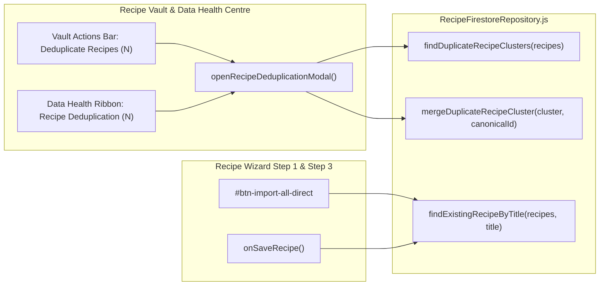

# Recipe Vault Visibility and Deduplication - Plan

## Goal Capsule

- **Objective**: Every recipe stored in the household collection is visible and filterable in the Recipe Vault without silent truncation, and duplicate recipes can be consolidated without losing enhanced variants, favourites, metadata, or active Meal Plan references.
- **Means**: Remove the orphaned 50-recipe slice in `src/views/RecipeVaultView.js`, unify meal-type normalization across `types` and `mealSuitability` (including `Snacking`), provide a Recipe Deduplication modal in the Recipe Vault and Data Health Centre (`KTD1`, `KTD2`), and merge duplicate titles on save in the Recipe Wizard (`KTD3`).
- **Authority Hierarchy**: Product Contract (`R1`–`R9`) > Planning Contract (`KTD1`–`KTD3`) > Implementation Units (`U1`–`U3`).
- **Stop Conditions**: Stop if a required Firestore persistence primitive is unavailable or if any verification gate in the Verification Contract fails.
- **Execution Profile**: Single PR targeting `development` from `dev/recipe-vault-visibility-and-deduplication`, finished and verified locally before handoff.

## Product Contract

### Summary

Remove the hard-coded 50-recipe rendering cap in the Recipe Vault, normalize recipe meal-type tags so imported and Snacking recipes appear under all filters, add an interactive Recipe Deduplication modal in both the Recipe Vault and Data Health Centre, and prevent new duplicate recipe documents when saving in the Recipe Wizard.

### Problem Frame

`src/views/RecipeVaultView.js` slices `sortedRecipes` to `50` items because `window.platePlanListLimits` and `window.progressiveListButton` were removed without cleaning up the caller. In addition, recipes saved through bulk import only populate `mealSuitability` (`['Dinner']` or `['Snacking']`) rather than `types`, hiding them from Vault filters and badges, and repeated imports or wizard saves of the same recipe title create duplicate Firestore documents.

### Key Decisions

- **Interactive canonical selection for existing duplicates** (`session-settled: user-directed — chosen over silent background auto-merge: lets the household inspect duplicate clusters and confirm which recipe copy to keep before deleting duplicates`). Governs `R4`, `R5`, `R6`.
- **Automatic duplicate-title consolidation on Recipe Wizard save** (`session-settled: user-approved — chosen over creating a second Firestore document with the same title: prevents new duplicate recipes while preserving existing enhanced variants and favourites`). Governs `R8`, `R9`.

### Requirements

#### Recipe Vault Visibility & Filtering

- R1. `renderRecipeGrid` in `src/views/RecipeVaultView.js` renders all recipes in `sortedRecipes` without a 50-recipe slice cap.
- R2. Recipe Vault filtering (`src/views/RecipeVaultView.js`) and card badge rendering (`src/components/vault/VaultRecipeCard.js`) resolve meal types from the union of `types`, `mealSuitability`, `type`, and `mealType`, normalizing both `'snack'` and `'snacking'` so `#filter-type` includes a `Snacking` option in `index.html` and `src/components/vault/VaultFilterToolbar.js`.
- R3. `handleRecipeSearch` in `src/views/RecipeVaultView.js` applies the active meal-type, person (`#filter-who`), and favourites (`window.vaultFilterFavouritesOnly`) filters alongside the search query, and `window.toggleVaultFavouritesFilter` is bound for the toolbar button in `index.html`.

#### Recipe Deduplication Modal & Consolidation

- R4. Duplicate recipe clusters are detected by normalized title key (NFC-normalized, case-insensitive, stripping trailing `(Copy)` or `(Enhanced)` suffixes and collapsing punctuation/whitespace) and pre-select the richest recipe (preferring an existing `enhanced` variant, more linked `ingredientId` mappings, favourite status, and newest `updatedAt`) as the default canonical copy.
- R5. Both the Recipe Vault action bar (`src/views/RecipeVaultView.js`) and the Data Health Centre ribbon (`src/views/DataQualityTableRenderService.js`) expose a Deduplicate Recipes trigger showing the current duplicate cluster count and opening the interactive modal.
- R6. Confirming a merge in the Recipe Deduplication modal consolidates each cluster into the selected canonical recipe by preserving or copying any missing `enhanced` variant, unioning `mealSuitability` and `types`, retaining non-empty source metadata (`sourceType`, `sourceUrl`, `sourceBook`, `sourcePage`, `source`) and favourite status (`isFavourite` and `favouriteVariantIds`), and deleting the non-canonical duplicate recipe documents from Firestore and store state.
- R7. Consolidating duplicate recipes re-points any active Meal Plan references (`currentPlan.days`, `currentPlan.slots`, and `skeletonGrid`, including split `elliott` and `chloe` nodes) from deleted duplicate recipe IDs to the canonical recipe ID and persists the updated plan.

#### Prevention on Recipe Wizard Save

- R8. Saving a recipe in Step 3 of the Recipe Wizard (`onSaveRecipe` in `src/components/recipe/RecipeWizardStep3Handlers.js`) whose normalized title matches an existing recipe in `state.recipes` reuses the existing recipe's `id` and `createdAt`, merges `mealSuitability`/`types`, and preserves the existing `enhanced` variant and favourite status when the wizard save does not supply an replacement `enhanced` variant.
- R9. Direct bulk import (`#btn-import-all-direct` in `src/components/recipe/RecipeWizardStep1Handlers.js`) populates both `mealSuitability` and normalized `types`/`mealType` and reuses any existing recipe with the same normalized title instead of creating a duplicate Firestore document.

### Acceptance Examples

- AE1. Covers `R1`, `R2`, `R3`: When `state.recipes` contains 65 recipes including a recipe with `mealSuitability: ['Snacking']` and no `types` array, opening the Recipe Vault renders all 65 cards, and selecting `Snacking` in `#filter-type` filters down to the snacking recipe with a `SNACKING` badge.
- AE2. Covers `R4`, `R5`, `R6`, `R7`: When `state.recipes` contains `"Cinnamon Roll Baked Oats"` (`rec_1`, has `enhanced` variant) and `"cinnamon roll baked oats (Copy)"` (`rec_2`, referenced in `currentPlan.slots.Mon.breakfast.recipeId`), merging the cluster into `rec_1` keeps `rec_1`'s `enhanced` variant, updates `currentPlan.slots.Mon.breakfast.recipeId` to `'rec_1'`, and deletes `rec_2`.
- AE3. Covers `R8`, `R9`: When `"Chicken Fajitas"` (`rec_existing`, with `enhanced` variant) is already in `state.recipes` and the user imports and saves a new `"Chicken Fajitas"` recipe in Original mode without an enhanced variant, `onSaveRecipe` updates `rec_existing` in place and preserves `rec_existing.enhanced`.

### Scope Boundaries

- Fuzzy ingredient-similarity clustering across recipes with different titles is out of scope; duplicate clustering matches normalized titles only (`R4`).
- Historical archived plans in `plans/{planId}` other than the active plan (`currentPlan` / `skeletonGrid`) are not rewritten.

## Planning Contract

### Key Technical Decisions

- KTD1. **Extend existing repository and view owners rather than adding a new modal file**: Place pure recipe title normalization, duplicate cluster detection, canonical scoring, and cluster merge persistence in `src/services/RecipeFirestoreRepository.js` (re-exported via `src/services/HouseholdRepository.js`), and place the interactive modal renderer/controller in `src/views/RecipeVaultView.js` so `DataQualityTableRenderService.js` and `RecipeVaultView.js` share one implementation without adding a new module to `LEDGER.md`.
- KTD2. **Deterministic canonical scoring and lossless field merge** (`session-settled: user-directed — chosen over silent background auto-merge: lets the household inspect duplicate clusters and confirm which recipe copy to keep before deleting duplicates`, governs `R4`, `R6`, `R7`): Score each candidate in a duplicate cluster by `(hasEnhanced ? 1000 : 0) + (linkedIngredientCount * 10) + (isFavourite ? 50 : 0) + (totalIngredientCount)` with `updatedAt` timestamp as tie-breaker, sort candidates descending so index `0` is pre-selected in the modal, and merge missing `enhanced`, `mealSuitability`/`types`, source fields, `isFavourite`, and `favouriteVariantIds` into the user-selected canonical recipe before deleting duplicates and re-pointing `currentPlan` / `skeletonGrid`.
- KTD3. **Idempotent title matching on Recipe Wizard save and direct import** (`session-settled: user-approved — chosen over creating a second Firestore document with the same title: prevents new duplicate recipes while preserving existing enhanced variants and favourites`, governs `R8`, `R9`): Use `findExistingRecipeByTitle(recipes, title, excludeId)` from `src/services/RecipeFirestoreRepository.js` inside `onSaveRecipe` (`src/components/recipe/RecipeWizardStep3Handlers.js`) and `#btn-import-all-direct` (`src/components/recipe/RecipeWizardStep1Handlers.js`).

### High-Level Technical Design

## Implementation Units

### U1. Full Recipe Vault Visibility & Meal-Type Filter Normalization

- **Goal**: Render all recipes in the Recipe Vault without truncation and unify meal-type normalization (`types`, `mealSuitability`, `Snacking`), search + filter composition, and card title fallbacks.
- **Requirements**: `R1`, `R2`, `R3`, `AE1`.
- **Dependencies**: None.
- **Files**:
  - `src/views/RecipeVaultView.js`
  - `src/components/vault/VaultRecipeCard.js`
  - `src/components/vault/VaultFilterToolbar.js`
  - `index.html`
  - `scripts/test_recipe_wizard.js`
- **Approach**:
  - Export `getNormalizedRecipeTypes(r)` from `src/views/RecipeVaultView.js` (and use it in `VaultRecipeCard.js`) to collect values from `r.types`, `r.mealSuitability`, `r.type`, and `r.mealType`, lowercase and trim them, include both `'snack'` and `'snacking'` matching when either is present (normalizing display badge label to `'snacking'` when `mealSuitability` has `'Snacking'`), and default to `['dinner']` only when no tags exist.
  - Remove the `.slice(0, limit)` truncation in `renderRecipeGrid` (`src/views/RecipeVaultView.js`) so `visibleRecipes` is `sortedRecipes`.
  - Update `handleRecipeSearch(query)` in `src/views/RecipeVaultView.js` to set `currentRecipeSearchQuery` and call `renderRecipeVault()`, and bind `window.toggleVaultFavouritesFilter = toggleVaultFavouritesFilter`.
  - Add `<option value="snacking">Snacking</option>` to `#filter-type` in `index.html` and `src/components/vault/VaultFilterToolbar.js`, and update `VaultRecipeCard.js` to use `r.name || r.title || 'Untitled Recipe'` and style `snack`/`snacking` badges.
- **Execution note**: Proof-first — add `Test 17` in `scripts/test_recipe_wizard.js` asserting >50 recipes render in `renderRecipeGrid` without truncation and `getNormalizedRecipeTypes` matches `mealSuitability: ['Snacking']` before modifying production files.
- **Test Scenarios**:
  - Passing 65 recipes to `renderRecipeGrid` renders all 65 `.recipe-card` elements in `#vault-list`.
  - A recipe with `mealSuitability: ['Snacking']` and no `types` array returns `['snacking', 'snack']` (or matches both `'snacking'` and `'snack'` filter values) and renders its title when only `r.title` is populated.
  - Calling `handleRecipeSearch('oats')` while `#filter-type` is `'breakfast'` filters by both the search query and `'breakfast'`.
- **Verification**: `node scripts/test_recipe_wizard.js`.

### U2. Recipe Deduplication Service, Modal UI & Data Health Centre Integration

- **Goal**: Detect duplicate recipe clusters by normalized title, let the user review and merge clusters into a chosen canonical recipe while preserving enhanced variants, favourites, metadata, and Meal Plan references, and expose the modal from both the Recipe Vault and Data Health Centre.
- **Requirements**: `R4`, `R5`, `R6`, `R7`, `AE2`, `KTD1`, `KTD2`.
- **Dependencies**: `U1`.
- **Files**:
  - `src/services/RecipeFirestoreRepository.js`
  - `src/services/HouseholdRepository.js`
  - `src/views/RecipeVaultView.js`
  - `src/views/DataQualityTableRenderService.js`
  - `scripts/test_recipe_wizard.js`
- **Approach**:
  - In `src/services/RecipeFirestoreRepository.js`, implement and export `normalizeRecipeTitleKey(title)`, `scoreRecipeCompleteness(recipe, favVariantIds)`, `findDuplicateRecipeClusters(recipes, favVariantIds)`, `findExistingRecipeByTitle(recipes, title, excludeId)`, `repointMealPlanRecipeIds(plan, skeletonGrid, duplicateIds, canonicalId)`, and `mergeDuplicateRecipeCluster(clusterOrRecipes, canonicalId, options)` (re-exported via `src/services/HouseholdRepository.js`).
  - In `src/views/RecipeVaultView.js`, implement and export `openRecipeDeduplicationModal()` and `closeRecipeDeduplicationModal()` using `#view-modal-wrap` / `#view-modal-content` (mirroring `CategoryMergeModalUI.js`), add a `🧹 Deduplicate Recipes (N)` button to `.recipe-actions-bar` when duplicate clusters exist (or always accessible), and bind `window.openRecipeDeduplicationModal`.
  - In `src/views/DataQualityTableRenderService.js`, add a `🍲 Recipe Deduplication (N)` button to the Guided Resolution Action Ribbon (`data-action-dq="open-recipe-dedup"`) and render a Duplicate Recipes audit card when clusters exist.
- **Execution note**: Proof-first — add `Test 18` in `scripts/test_recipe_wizard.js` testing `normalizeRecipeTitleKey`, `findDuplicateRecipeClusters`, and `mergeDuplicateRecipeCluster` (including enhanced variant preservation, favourite variant migration, and Meal Plan slot re-pointing) before implementing the functions.
- **Test Scenarios**:
  - `findDuplicateRecipeClusters` groups `"Cinnamon Roll Baked Oats"`, `"cinnamon roll baked oats"`, and `"Cinnamon Roll Baked Oats (Copy)"` into one cluster and ranks the copy with an `enhanced` variant and more linked `ingredientId`s first.
  - `mergeDuplicateRecipeCluster` copies a missing `enhanced` variant from a duplicate into the chosen canonical recipe, unions `mealSuitability` and `types`, migrates `favouriteVariantIds` (`<dupId>_original` -> `<canonicalId>_original`), re-points `currentPlan.slots`, `currentPlan.days`, and `skeletonGrid` (including split `elliott`/`chloe` slots), saves the canonical recipe, and removes duplicate IDs from `state.recipes`.
- **Verification**: `node scripts/test_recipe_wizard.js`.

### U3. Duplicate-Title Consolidation on Recipe Wizard Save & Direct Import

- **Goal**: Prevent duplicate Firestore documents when saving a recipe in Step 3 of the Recipe Wizard or importing directly in Step 1A when a recipe with the same normalized title already exists.
- **Requirements**: `R8`, `R9`, `AE3`, `KTD3`.
- **Dependencies**: `U2`.
- **Files**:
  - `src/components/recipe/RecipeWizardStep3Handlers.js`
  - `src/components/recipe/RecipeWizardStep1Handlers.js`
  - `scripts/test_recipe_wizard.js`
- **Approach**:
  - In `onSaveRecipe` (`src/components/recipe/RecipeWizardStep3Handlers.js`), look up `findExistingRecipeByTitle(state.recipes, safeTitle, rec.id || baseOrig.id)`. When an existing recipe matches, reuse its `id` and `createdAt`, union its `mealSuitability` and `types` with the newly selected tags, preserve its `isFavourite`/`isFavorite` flags, and if the wizard save has no new `enhanced` variant (`!hasEnh && existingMatch.enhanced`), preserve `existingMatch.enhanced`, `existingMatch.enhancedFitScore`, and `existingMatch._scoreEnhanced`.
  - In `#btn-import-all-direct` (`src/components/recipe/RecipeWizardStep1Handlers.js`), normalize title with `toTitleCase`, populate `types` and `mealType` from `mealSuitability`, check `findExistingRecipeByTitle(getState().recipes, safeTitle)`, reuse the existing recipe's `id`, `createdAt`, `enhanced`, and favourite flags when matched, and call `updateRecipeInStore(recipeToSave)` after `saveRecipe(recipeToSave)`.
- **Execution note**: Proof-first — add `Test 19` in `scripts/test_recipe_wizard.js` verifying that saving a new recipe in `onSaveRecipe` whose title matches an existing recipe reuses the existing recipe ID and preserves its `enhanced` variant rather than creating a second entry in `state.recipes`.
- **Test Scenarios**:
  - Saving a newly parsed `"Chicken Fajitas"` recipe in `onSaveRecipe` when `"chicken fajitas"` (`id: 'rec_existing_1'`, with `enhanced: { calories: 480 }`) already exists in `state.recipes` updates `'rec_existing_1'` in place, keeps `state.recipes.length === 1`, and preserves `enhanced`.
- **Verification**: `node scripts/test_recipe_wizard.js` and `node scripts/test_variant_save_and_taxonomy_mapping.js`.

## Verification Contract

- `node scripts/test_recipe_wizard.js` — passes all existing tests (`Test 1`–`Test 16`) plus new `Test 17` (`U1`), `Test 18` (`U2`), and `Test 19` (`U3`).
- `node scripts/test_variant_save_and_taxonomy_mapping.js` — passes all variant save and taxonomy mapping checks.
- `npm run ledger && node scripts/test_ledger.js` — confirms `LEDGER.md` has zero errors, no dead modules introduced, and deterministic output.
- `npm run build` — stamps `dist/` cleanly with zero unreplaced placeholders.

## Definition of Done

- All requirements (`R1`–`R9`) and implementation units (`U1`–`U3`) are implemented with proof-first tests in `scripts/test_recipe_wizard.js`.
- `node scripts/test_recipe_wizard.js`, `node scripts/test_variant_save_and_taxonomy_mapping.js`, `npm run ledger && node scripts/test_ledger.js`, and `npm run build` all pass with zero errors.
- No dead, scaffold, or abandoned-attempt code remains in `git diff origin/development`.
- Changes are reviewed with `ce-code-review`, committed cleanly on `dev/recipe-vault-visibility-and-deduplication`, and ready for localhost verification.
