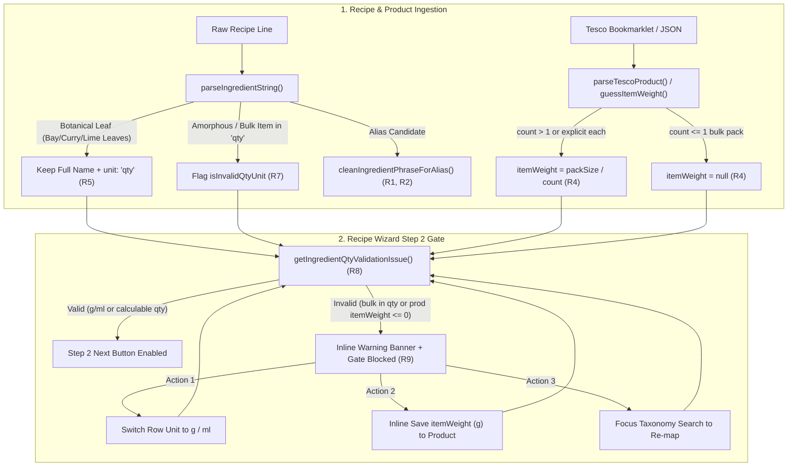

# Recipe Parser, Single-Item Weights, Alias Sanitization, and Taxonomy Search - Plan

## Goal Capsule

- **Objective:** Recipe parsing, alias learning, product weight imports, Step 2 wizard validation, and Pantry Bank category search operate on accurate culinary units and strict taxonomy boundaries without polluting aliases with measurements, copying total pack weights into single-item weights, truncating leaf ingredient names, silently guessing 100g for uncalculable `qty` rows, or mixing Root Items into Category dropdowns.
- **Means:** Strip measurements from new, edited, and stored aliases (KTD1); decouple product unit selectors and only populate `itemWeight` for countable items (KTD2); preserve botanical leaf nouns in `qty` (KTD3); gate Step 2 on uncalculable `qty` rows with inline resolution actions (KTD4); and enforce mode-strict category/item rendering in `createTaxonomySearchInput` using `getUnifiedCategories` (KTD5).
- **Authority hierarchy:** Product Contract requirements (`R1`–`R11`) govern user-visible behavior; Planning Contract technical decisions (`KTD1`–`KTD5`) govern implementation mechanisms within those constraints; implementation units (`U1`–`U5`) execute those decisions without overriding either.
- **Execution profile:** Single pull request targeting `development` with 5 dependency-ordered implementation units (`U1`–`U5`), verified via standalone Node assertion suites (`scripts/test_*.js`), `npm run ledger`, and `npm run build`.
- **Stop conditions:** Stop and surface to the user if any existing unit conversion fixture in `scripts/fixtures/unit-conversion-lines.json` would be broken by the parser changes or if Firestore alias/product sanitization encounters schema conflicts.
- **Completion owner:** `ce-work` implements `U1`–`U5`, runs all verification suites, and prepares the branch for review/PR.

---

## Product Contract

### Summary

This plan resolves six interconnected defects across recipe ingestion, Pantry Bank taxonomy management, and product nutrition/weight resolution:
1. Strip all quantities, units, multipliers, and packaging nouns from learned, manually edited, and existing Firestore aliases.
2. Stop the Tesco bookmarklet, `TescoImportService`, `ProductBankView`, and `NutritionService` from copying total pack weight/unit into `1 Usable item size` (`itemWeight` / `itemWeightUnit`).
3. Preserve compound leaf ingredient names (`Bay Leaves`, `Curry Leaves`, `Lime Leaves`, `Vine Leaves`, `Salad Leaves`) with unit `qty` rather than stripping `"leaves"` into `"Bay"`.
4. Flag non-discrete bulk ingredients parsed as `qty` (such as `1 qty Natural Yoghurt`).
5. Block Step 2 → Step 3 progression in the Recipe Wizard when a `qty` ingredient is a bulk non-discrete item or maps to a product without a calculable single-item weight, offering inline quick-fix actions on the row.
6. Ensure the Category search in `AddItemWizardUI` and `EditPantryTaxonomyModalUI` uses `getUnifiedCategories(state)` (including `"Noodles"`) and filters strictly to Categories only.

### Problem Frame

Recipe macros, Fit Scores, and shopping list pack counts depend on converting every recipe ingredient into a canonical weight (`g`) or volume (`ml`), or multiplying a discrete count (`qty`) by a known single-item weight (`itemWeight`). Four defects currently corrupt that pipeline:
- The Tesco bookmarklet and `guessItemWeight()` copy `packSize` into `itemWeight` for single-weight products (`count <= 1`), while `ProductBankView.js` locks the unit selectors together. Bulk products (like a 500g tub of yoghurt or 500g bag of pasta) get a bogus `itemWeight: 500`, and multipacks (like `"6 Sausages 400g"`) get `itemWeight: 400` instead of `400 / 6 = 66.7g`.
- When a recipe line defaults to `qty` on a bulk item (`1 qty Natural Yoghurt`) or maps to a product without a real `itemWeight`, Step 2 lets the user proceed and `NutritionService.js` silently guesses `100g` per unit (`DEFAULT_ITEM_GRAMS`).
- In `RecipeIngredientParser.js`, `trailingUnitMatch` treats trailing `"leaves"` as a measurement unit and strips it from `"Bay Leaves"`, producing `"2g Bay"`; meanwhile `cleanIngredientPhraseForAlias()` leaves mid-string/trailing measurements and container words inside learned aliases.
- In `RecipeSearchDropdownHelper.js`, `createTaxonomySearchInput()` overwrites caller-supplied `getUnifiedCategories(state)` with raw `state.categories` (hiding categories like `"Noodles"` that exist on items/products) and overwrites `rootItems: []` with `state.ingredients` (dumping Root Items and Sub-Types into Category search inputs).

### Key Decisions

- **Historical and future alias sanitization** `(session-settled: user-directed — chosen over stripping only new aliases going forward: ensures existing measurement-polluted aliases in Firestore are also cleaned and deduplicated)`. Governs R1, R2.
- **Botanical leaf nouns kept as `qty` with full name** `(session-settled: user-directed — chosen over converting leaf counts to estimated grams at parse time: keeps recipes and shopping lists reading naturally as "2 qty Bay Leaves" while only treating "leaf/leaves" as a unit in prepositional phrases like "4 leaves of basil")`. Governs R5, R6.
- **Inline Step 2 resolution banner for uncalculable `qty` rows** `(session-settled: user-directed — chosen over opening the full Product Bank Editor modal: lets the user switch the row to g/ml, inline-save 1 Usable item size (g) to the mapped product, or re-map without leaving Step 2)`. Governs R7, R8, R9.
- **Category-only dropdown filtering with unified categories** `(session-settled: user-directed — confirmed that "Noodles" is an existing Category missing from the Category search and that Category inputs must never list Root Items or Sub-Types)`. Governs R10, R11.

### Requirements

#### Alias Sanitization
- R1. `cleanIngredientPhraseForAlias()` strips all leading, mid-string, and trailing numeric quantities, fractions, multipliers (including no-space forms like `2x400g`), measurement units (`g`, `kg`, `ml`, `l`, `oz`, `lb`, `tbsp`, `tsp`, `cup`, `qty`, `cm`, `mm`, `inch`), parenthetical notes, and packaging/container words (`tin`, `can`, `pot`, `tub`, `pouch`, `sachet`, `carton`, `jar`, `bottle`, `pack`, `packet`, `bag`, `box`, `block`) from candidate alias strings.
- R2. Manual alias edits in `EditPantryTaxonomyModalUI` and existing aliases stored on Root Items and Sub-Types in state/Firestore are sanitized through `cleanIngredientPhraseForAlias()`, deduplicated case-insensitively, and stripped of any alias that collapses to the item's own canonical name.

#### Single-Item Weight (`itemWeight`) & Unit Independence
- R3. In `ProductBankView`, the unit selectors `#mi-pack-unit`, `#mi-item-weight-unit`, and `#mi-drained-weight-unit` operate independently without overwriting one another on load or change.
- R4. `parseTescoProduct()` / `guessItemWeight()` (and the Tesco bookmarklet in `index.html`) only populate `itemWeight` when an explicit per-item weight is present (`4 x 50g` or per-item nutrition header), when a multipack count `> 1` (`itemCount > 1` or title/notes count like `"6 Pack"`, `"4 Wraps"`, `"Twin Pack"`) divides `drainedWeight || packSize`, or when `packUnit` is `'each'` / `'units'` for a single loose item; otherwise `itemWeight` is `null`, and `resolveProductItemWeight()` ignores bogus `itemWeight === packSize` values on bulk or multipack products.

#### Botanical Leaf Nouns
- R5. `parseIngredientString()` preserves `"Bay Leaf"` / `"Bay Leaves"`, `"Curry Leaves"`, `"Lime Leaves"` / `"Kaffir Lime Leaves"`, `"Vine Leaves"`, and `"Salad Leaves"` as the ingredient name with `unit: 'qty'`, and only treats `leaf`/`leaves` as a measurement unit when followed by `of <ingredient>` (e.g. `"4 leaves of basil"`).
- R6. `stemIngredientName()` preserves singularized leaf identity (`bay leaf`, `curry leaf`, `lime leaf`, `vine leaf`) so `"Bay Leaves"` and `"Bay Leaf"` match in taxonomy lookup while never collapsing to `"bay"`.

#### Non-Discrete `qty` Flagging & Step 2 Validation Gate
- R7. `parseIngredientString()` and Step 2 validation flag non-discrete bulk ingredients (liquids, yoghurts, milks, creams, oils, sauces, pastes, condiments, flours, sugars, loose grains/rice/pasta/noodles/oats/lentils, tinned tomatoes/beans) whenever their unit is `'qty'`.
- R8. In Recipe Wizard Step 2, any ingredient row with `unit === 'qty'` that is either a flagged non-discrete bulk ingredient or mapped to a taxonomy entity whose resolved product has no calculable single-item weight (`resolveProductItemWeight(prod) <= 0` and not a self-weighed culinary item like garlic cloves, stock cubes, bay leaves, or water) is marked invalid and blocks the Step 2 → Step 3 footer gate (`#btn-next-step2` and `#wiz-gate-pill`).
- R9. Each blocked `qty` row in Step 2 renders an inline warning banner with three quick-fix actions: (a) switch the row's unit to `g` or `ml`, (b) enter and save `1 Usable item size (g)` directly onto the resolved product (when a product is mapped and not a bulk liquid/powder), or (c) focus the taxonomy search input to map to a different item.

#### Category Search Completeness & Mode Isolation
- R10. `createTaxonomySearchInput()` in `RecipeSearchDropdownHelper.js` resolves categories via `getUnifiedCategories(state)` merged with any caller-supplied `categories` prop so all existing categories (including `"Noodles"`) appear in Category search inputs.
- R11. `createTaxonomySearchInput()` strictly isolates dropdown items by mode: when `newItemType === 'category'` (or `categoriesOnly: true`), it renders only Category options; when `newItemType === 'item'` or `categories` is empty on a Root Item picker, it renders only Root Items; and `EditPantryTaxonomyModalUI` uses this category-only searchable autocomplete instead of a native `<select>`.

### Acceptance Examples

- AE1. **Covers R1, R2:** Given a raw recipe line `"2 x 400g tins of best-quality chopped tomatoes"` or `"Cheddar Cheese 100g"`, when `cleanIngredientPhraseForAlias()` runs, then it returns `"best quality chopped tomatoes"` and `"cheddar cheese"` with all numbers, units, and container nouns removed.
- AE2. **Covers R3, R4:** Given a Tesco import for `"Tesco Natural Yoghurt 500G"` (`packSize: 500, packUnit: 'g', itemCount: 1`), when parsed by `parseTescoProduct()`, then `itemWeight` is `null` (not `500`); given `"Linda McCartney 6 Vegan Sausages 270G"` with a legacy `itemWeight: 270, packSize: 270`, when `resolveProductItemWeight()` runs, then it returns `45` (`270 / 6`).
- AE3. **Covers R5, R6:** Given `"2 bay leaves"` or `"2 dried bay leaves"`, when `parseIngredientString()` runs, then it returns `{ qty: 2, unit: 'qty', name: 'Bay Leaves' }` (or `'Dried Bay Leaves'`), and `toGrams(2, 'qty', 'Bay Leaves')` returns `2`.
- AE4. **Covers R7, R8, R9:** Given an ingredient row `"1 qty Natural Yoghurt"` mapped to `"Tesco Natural Yoghurt 500G"` (which has `itemWeight: null`), when Step 2 renders, then `#btn-next-step2` is disabled, `#wiz-gate-pill` includes the invalid `qty` count, and clicking the inline `Use g` quick-fix switches the row unit to `'g'` and clears the block.
- AE5. **Covers R10, R11:** Given `"Noodles"` exists on an item or category in state, when opening `"📦 Add Root Item"` and focusing the Category search input (`#wiz-cat-container`), then `"📂 [Category] Noodles"` appears in the dropdown and zero `📦` Root Items or `🏷️` Sub-Types are rendered in that dropdown.

### Scope Boundaries

- **In scope:** Parser unit/leaf/alias rules, product weight extraction and unit decoupling, Firestore/state alias and bogus `itemWeight` hygiene helper, Step 2 invalid-`qty` gate and inline quick-fix UI, and `RecipeSearchDropdownHelper.js` / `EditPantryTaxonomyModalUI.js` category-only autocomplete.
- **Out of scope:** Changing Fit Score tapering formulas or altering `scripts/fixtures/unit-conversion-lines.json` strict rules.

---

## Planning Contract

### Key Technical Decisions

- KTD1. **Multi-pass regex + token filter in `cleanIngredientPhraseForAlias` and hydration/maintenance sanitization** `(session-settled: user-directed — chosen over front-only regex stripping: handles mid/trailing measurements and cleans existing Firestore aliases)`. Strip parentheticals and comma suffixes first, then remove leading/mid/trailing measurement tokens (`\b\d+(?:\.\d+)?\s*(?:[xX×]\s*\d+(?:\.\d+)?)?\s*(?:g|grams?|kg|ml|millilitres?|l|litres?|oz|fl\s*oz|lbs?|tbsp|tablespoons?|tsp|teaspoons?|cups?|scoops?|pinch(?:es)?|cloves?|slices?|cm|mm|inch(?:es)?|qty)\b`), container words (`\b(?:tins?|cans?|pots?|tubs?|pouches?|sachets?|cartons?|jars?|bottles?|packs?|packets?|packages?|bags?|boxes?|blocks?)\b`), and standalone numbers/fractions. Add `sanitizeStoredAliasesAndItemWeights()` in `src/services/MaintenanceService.js` (invoked during hydration/recalibration) to clean and persist existing `state.ingredients` aliases in Firestore.
- KTD2. **Independent unit selectors and strict `itemWeight` derivation** `(session-settled: user-approved — chosen over keeping unified unit selects: allows packSize in 'units' with itemWeight in 'g' and stops bulk items from masquerading as single countable items)`.
  1. In `src/views/ProductBankView.js`, remove `syncUnitSelects()` and bind `#mi-pack-unit`, `#mi-item-weight-unit`, and `#mi-drained-weight-unit` independently to `prod.packUnit || 'g'`, `prod.itemWeightUnit || 'g'`, and `prod.drainedWeightUnit || 'g'`.
  2. In `index.html` (bookmarklet) and `src/services/TescoImportService.js` (`guessItemWeight`), set `iw = r.each` (never `r.total` when `r.count <= 1`). In `guessItemWeight(data, name)`, if `explicit > 0 && explicit === packSize && count <= 1` and `packUnit !== 'each'`, treat `explicit` as an unverified copy of `packSize`: check for an embedded multipack count in `name`/`notes` (`"6 Pack"`, `"4 Wraps"`, `"Twin Pack"`) to divide `packSize / parsedCount`, or return `''` (`null`) so bulk products keep `itemWeight: null`.
  3. In `src/services/NutritionService.js` (`resolveProductItemWeight`), before returning `explicit` at step 1, check whether `explicit === packSize`: if the product has `itemCount > 1` or an embedded multipack count `> 1` in `name`/`notes`, divide `baseWeight / count`; if `isNonDiscreteBulkIngredient(name, product.category)` is true and `explicit === packSize`, ignore `explicit` and return `0`.
- KTD3. **Protected botanical leaf nouns in `RecipeIngredientParser.js`** `(session-settled: user-directed — chosen over converting leaf counts to grams: preserves "2 qty Bay Leaves" in recipes)`.
  1. Remove `leaves?|leaf` from `trailingUnitMatch` (`src/services/RecipeIngredientParser.js:365`) so `"2 bay leaves"`, `"8 curry leaves"`, `"4 kaffir lime leaves"`, `"6 vine leaves"`, and `"salad leaves"` retain `parsedUnit = 'qty'` and their full leaf name.
  2. In `unitMatch` (`RecipeIngredientParser.js:355`), only treat leading `leaf`/`leaves` as a unit when followed by `of\b` (e.g. `"4 leaves of basil"` → `qty: 4, unit: 'qty', name: 'Basil'`) or when the remainder is not a botanical leaf adjective (`bay`, `curry`, `lime`, `kaffir`, `vine`, `salad`).
  3. In `stemIngredientName()`, normalize `(bay|curry|lime|vine|salad)\s+leaves\b` to `$1 leaf` instead of stripping `leaves`/`leaf` completely.
- KTD4. **Canonical `isNonDiscreteBulkIngredient` & `validateIngredientQtyCalculable` gate in Step 2** `(session-settled: user-directed — chosen over modal popups: provides 1-click inline resolution in Step 2)`.
  1. Export `isNonDiscreteBulkIngredient(name, category = '')` from `src/services/UnitConversionService.js`: returns `true` for liquids (`isLiquidIngredient(name)`), yoghurts/creams/custards/soft cheeses (`yoghurt`, `yogurt`, `cream`, `creme fraiche`, `mascarpone`, `ricotta`, `cottage cheese`), bulk dry goods (`flour`, `sugar`, `rice`, `pasta`, `spaghetti`, `penne`, `fusilli`, `macaroni`, `orzo`, `noodles`, `couscous`, `quinoa`, `bulgur`, `polenta`, `oats`, `porridge`, `lentils`, `beans`, `chickpeas`, `peas`, `corn`, `sweetcorn`, `spinach`, `watercress`, `rocket`, `salad`), pastes/sauces/condiments (`paste`, `puree`, `purée`, `pesto`, `chutney`, `jam`, `marmalade`, `peanut butter`, `tahini`, `hummus`, `miso`, `harissa`, `curry powder`, `spices`, `herbs`, `seasoning`), and tinned/chopped bulk items (`chopped tomatoes`, `tinned tomatoes`, `plum tomatoes`, `mince`, `grated`). Explicitly exclude discrete countable exceptions (`stock cube`, `cube`, `sheet`, `nest`, `wrap`, `tortilla`, `bun`, `roll`, `bagel`, `pitta`, `naan`, `biscuit`, `cracker`, `egg`, `bay leaf`, `bay leaves`, `curry leaf`, `curry leaves`, `lime leaf`, `lime leaves`, `clove`, `bulb`, `head`, `sprig`, `stalk`, `slice`, `fillet`, `breast`, `thigh`, `sausage`, `burger`, `patty`, `meatball`, `potato`, `onion`, `shallot`, `carrot`, `pepper`, `chilli`, `courgette`, `aubergine`, `cucumber`, `avocado`, `lemon`, `lime`, `apple`, `banana`, `mushroom`, `tomato` when not chopped/tinned/plum/passata).
  2. Export `getIngredientQtyValidationIssue(item, productsBank, ingredientsBank)` from `src/components/recipe/RecipeWizardTaxonomySearch.js`: when `item.unit === 'qty'`, checks:
     - If `isNonDiscreteBulkIngredient(item.name)` is true (and the mapped product does not have an explicit discrete `itemWeight > 0` with `itemWeight !== packSize`), return `{ invalid: true, reason: 'bulk_item_in_qty', suggestedUnit: isLiquidIngredient(item.name) ? 'ml' : 'g', resolvedProd }`.
     - Otherwise, if the ingredient is linked (`!isIngredientUnlinked`) and resolves via `resolveProductForIngredient` to a product `resolvedProd` where `resolveProductItemWeight(resolvedProd) <= 0` AND the ingredient name is not a self-weighed culinary count (`garlic`, `bay leaf`, `bay leaves`, `curry leaves`, `lime leaves`, `stock cube`, `water`), return `{ invalid: true, reason: 'missing_product_item_weight', suggestedUnit: 'g', resolvedProd }`.
     - Otherwise return `{ invalid: false }`.
  3. In `RecipeWizardStep2View.js` and `RecipeWizardStep2Handlers.js`, render an inline warning banner on any row where `qtyIssue.invalid` is true, offering:
     - `Use g` / `Use ml` button (updates `item.unit` and focuses the quantity input),
     - Inline `1 item = [ input ] g [Save]` control when `resolvedProd` exists (saves `itemWeight` and `itemWeightUnit: 'g'` onto `resolvedProd` via `saveProduct` and re-renders Step 2),
     - `Change mapping` button (focuses and opens `#wiz-ing-tax-search-${sIdx}-${iIdx}`),
     and block `#btn-next-step2` while any row is unlinked OR has `qtyIssue.invalid`.
- KTD5. **Mode-strict `createTaxonomySearchInput` with `getUnifiedCategories`** `(session-settled: user-directed — fixes missing "Noodles" category and eliminates Root Item pollution in Category dropdowns)`.
  1. In `src/components/pantry/RecipeSearchDropdownHelper.js`, import `getUnifiedCategories` from `../../services/CategoryRepository.js`. Build `liveCategories` as the deduplicated union of `getUnifiedCategories(state)` and the caller's `categories` prop.
  2. Enforce mode isolation in `filterAndRender()`:
     - When `resolvedNewType === 'category'` (or `categoriesOnly: true`), render **only** Category options (`liveCategories`) and never render `liveRootItems` or Sub-Types.
     - When `resolvedNewType === 'item'` or `categories.length === 0` (when `rootItems.length > 0` and `newItemType !== 'category'`), render **only** Root Items (and Sub-Types only if `includeSubtypes` is not false; in `AddItemWizardUI` `#wiz-item-container` and `#wiz-parent-item-container`, pass `rootItemsOnly: true` so parent root item pickers only show Root Items).
  3. In `src/components/pantry/EditPantryTaxonomyModalUI.js`, replace `<select id="edit-item-category">` with `createTaxonomySearchInput({ container, categories, rootItems: [], newItemType: 'category', initialValue: item.category })`.

### High-Level Technical Design



---

## Implementation Units

### U1. Botanical Leaf Parsing, Bulk `qty` Detection, and Multi-Pass Alias Stripping

- **Goal:** Preserve compound leaf ingredient names (`Bay Leaves`, `Curry Leaves`, `Lime Leaves`, `Vine Leaves`, `Salad Leaves`) with `unit: 'qty'`, strip all measurements and container nouns from aliases, and expose `isNonDiscreteBulkIngredient()`.
- **Requirements:** R1, R2, R5, R6, R7 (KTD1, KTD3, KTD4).
- **Dependencies:** None.
- **Files:**
  - `src/services/UnitConversionService.js`
  - `src/services/RecipeIngredientParser.js`
  - `src/services/MaintenanceService.js`
  - `src/services/HydrationService.js`
  - `scripts/test_parser_aliases_and_leaves.js` (new test file — verifies parser leaf rules, alias stripping, and bulk-item detection; does not cover DOM modals)
- **Approach:**
  1. In `src/services/UnitConversionService.js`, implement and export `isNonDiscreteBulkIngredient(name, category = '')` per KTD4, and ensure `inferIngredientWeightByName()` returns `1` for `bay leaf` / `bay leaves`, `curry leaf` / `curry leaves`, and `lime leaf` / `lime leaves`.
  2. In `src/services/RecipeIngredientParser.js`:
     - Update `trailingUnitMatch` (line 365) to remove `leaves?|leaf` from the general trailing unit stripper so `"2 bay leaves"`, `"2 large bay leaves"`, `"8 curry leaves"`, `"4 kaffir lime leaves"`, and `"6 vine leaves"` stay `unit: 'qty'` with their leaf noun intact.
     - Update `unitMatch` (line 355) so a leading `leaf`/`leaves` word is only consumed as a unit when followed by `of\b` (e.g. `"4 leaves of basil"` → `qty: 4, unit: 'qty', name: 'Basil'`).
     - Attach `isInvalidQtyUnit: true` on the returned object from `parseIngredientString()` when `normalised.unit === 'qty'` and `isNonDiscreteBulkIngredient(cleanedName)` is true.
     - Update `stemIngredientName()` so `(bay|curry|lime|vine|salad)\s+leaves\b` normalizes to `$1 leaf` instead of stripping `leaves`/`leaf`.
     - Rewrite `cleanIngredientPhraseForAlias()` per KTD1 so all leading, mid-string, and trailing quantities, fractions, multipliers (`2x400g`, `2 x 150g`), units, parentheticals, and container words (`tin`, `can`, `pot`, `tub`, `pouch`, `sachet`, `carton`, `jar`, `bottle`, `pack`, `packet`, `bag`, `box`, `block`) are stripped and normalized.
  3. In `src/services/MaintenanceService.js` (and called non-blockingly after hydration in `src/services/HydrationService.js`), add `sanitizeStoredAliasesAndItemWeights()` to clean existing `ing.aliases` and `sub.aliases` in `state.ingredients` via `cleanIngredientPhraseForAlias()`, deduplicate them, remove any alias equal to the item/subtype's own name, and persist modified root items via `saveRootItem()`.
- **Patterns to follow:** `src/services/RecipeIngredientParser.js` (`parseIngredientString`, `stemIngredientName`), `src/services/MaintenanceService.js`.
- **Test scenarios:**
  - **Happy path (Covers AE1):** `cleanIngredientPhraseForAlias("2 x 400g tins of best-quality chopped tomatoes")` returns `"best quality chopped tomatoes"`, `"Cheddar Cheese 100g"` returns `"cheddar cheese"`, and `"1 pouch (250g) cooked basmati rice"` returns `"cooked basmati rice"`.
  - **Happy path (Covers AE3):** `parseIngredientString("2 bay leaves")` returns `{ qty: 2, unit: 'qty', name: 'Bay Leaves' }`; `parseIngredientString("8 fresh curry leaves")` returns `{ qty: 8, unit: 'qty', name: 'Fresh Curry Leaves' }`; `toGrams(2, 'qty', 'Bay Leaves')` returns `2`.
  - **Edge case:** `parseIngredientString("4 leaves of fresh basil")` strips `"leaves of"` and returns `{ qty: 4, unit: 'qty', name: 'Fresh Basil' }`.
  - **Edge case:** `stemIngredientName("Bay Leaves")` and `stemIngredientName("Bay Leaf")` both return `"bay leaf"`, and `matchIngredientTaxonomy({ name: "Bay Leaves" }, [{ id: "ing_bay", name: "Bay Leaves" }])` matches `ing_bay`.
  - **Happy path (Covers R7):** `parseIngredientString("1 natural yoghurt")` and `parseIngredientString("1 pot natural yoghurt")` return `unit: 'qty'` with `isInvalidQtyUnit: true`, whereas `parseIngredientString("2 red onions")` and `parseIngredientString("4 tortilla wraps")` return `isInvalidQtyUnit: false`.
  - **Integration:** `sanitizeStoredAliasesAndItemWeights()` cleans `aliases: ["400g chopped tomatoes", "1 tbsp olive oil", "Chopped Tomatoes"]` on a `"Chopped Tomatoes"` root item down to `["olive oil"]`.
- **Verification:** `node scripts/test_parser_aliases_and_leaves.js` and `node scripts/test_unit_conversion.js` pass with zero regressions.

### U2. Independent Product Unit Selectors and Accurate Single-Item Weight (`itemWeight`) Resolution

- **Goal:** Decouple the three unit dropdowns in `ProductBankView.js` and stop `index.html`, `TescoImportService.js`, and `NutritionService.js` from equating `1 Usable item size` (`itemWeight`) with `Total pack size` (`packSize`).
- **Requirements:** R3, R4 (KTD2).
- **Dependencies:** U1 (uses `isNonDiscreteBulkIngredient`).
- **Files:**
  - `src/views/ProductBankView.js`
  - `src/services/TescoImportService.js`
  - `src/services/NutritionService.js`
  - `src/services/MaintenanceService.js`
  - `index.html`
  - `scripts/test_product_item_weights.js`
- **Approach:**
  1. In `src/views/ProductBankView.js` (lines 309–377 and `applyTescoUpdate()` at lines 431–436):
     - Remove `syncUnitSelects()`, the `onchange` listeners that forced `#mi-pack-unit`, `#mi-item-weight-unit`, and `#mi-drained-weight-unit` to mirror each other, and the cross-overwrite loop in `applyTescoUpdate()`.
     - Set `#mi-pack-unit` from `prod.packUnit || prod.unit || 'g'`, `#mi-item-weight-unit` from `prod.itemWeightUnit || prod.item_weight_unit || 'g'`, and `#mi-drained-weight-unit` from `prod.drainedWeightUnit || 'g'` (and similarly for `tescoData` and empty form initialization).
  2. In `index.html` (line 581, Tesco bookmarklet):
     - Update `parsePack` so a single weight match `(\d+(?:\.\d+)?)\s*(g|kg|ml|l)\b` returns `{ count: 1, each: null, total: parseFloat(m[1]), unit: m[2].toLowerCase() }`, and `pick(r, src)` sets `iw = r.each != null ? r.each : null` (never copying `r.total` into `iw` when `each` is null).
  3. In `src/services/TescoImportService.js` (`guessItemWeight`, lines 106–115):
     - Extract embedded multipack counts from `name` (e.g. `"6 Pack"`, `"4 Baking Potatoes"`, `"Twin Pack"`, `"6 Vegan Sausages"`) when `data.itemCount` is missing or `<= 1`.
     - If `explicit > 0`: when `explicit === packSize` and `(effectiveCount > 1 || String(data.packUnit || 'g').toLowerCase() !== 'each')`, do not return `explicit` blindly — if `effectiveCount > 1`, return `Math.round((packSize / effectiveCount) * 10) / 10`; otherwise if `explicit === packSize` on a weight/volume pack (`g`/`ml`), return `''` (`null`).
  4. In `src/services/NutritionService.js` (`resolveProductItemWeight`, lines 92–154):
     - Before returning `explicit` at step 1, check if `explicit > 0 && explicit === packSize`:
       - If `itemCount > 1` or an embedded multipack count `parsedCount > 1` exists in `name` or `notes`, compute and return `Math.round((baseWeight / count) * 10) / 10`.
       - If `isNonDiscreteBulkIngredient(name, product.category)` is true and `explicit === packSize`, ignore `explicit` and return `0`.
  5. In `src/services/MaintenanceService.js`, extend `sanitizeStoredAliasesAndItemWeights()` to clear bogus `itemWeight` where `itemWeight === packSize` on bulk products or recalculate `itemWeight = Math.round((packSize / parsedCount) * 10) / 10` on multipack products imported with the old bookmarklet.
- **Patterns to follow:** `src/services/NutritionService.js` (`resolveProductItemWeight`), `src/views/ProductBankView.js`.
- **Test scenarios:**
  - **Happy path (Covers AE2):** `parseTescoProduct({ name: "Tesco Natural Yoghurt 500G", packSize: 500, packUnit: "g", itemWeight: 500, itemCount: 1 })` sets `data.itemWeight` to `''` / `null`, and `resolveProductItemWeight()` on that product returns `0`.
  - **Happy path (Covers AE2):** `resolveProductItemWeight({ name: "Linda McCartney 6 Vegan Sausages", packSize: 270, itemWeight: 270, itemCount: 1 })` detects the embedded count `6` and returns `45` instead of `270`.
  - **Happy path:** `parseTescoProduct({ name: "Tesco Finest 4 Brioche Burger Buns 200G", packSize: 200, packUnit: "g", itemWeight: 200 })` derives `itemWeight: 50`.
  - **Edge case:** A product with legitimate distinct `itemWeight: 62, packSize: 372` (`6 Tortilla Wraps`) returns `62`.
  - **Edge case (Covers R3):** In `ProductBankView`, setting `#mi-pack-unit` to `'units'` and `#mi-item-weight-unit` to `'g'` preserves both units independently when `saveManualIng()` reads the form.
- **Verification:** `node scripts/test_product_item_weights.js` passes all existing and new assertions.

### U3. Category-Only Taxonomy Search, Missing "Noodles" Fix, and Edit Modal Autocomplete

- **Goal:** Ensure `createTaxonomySearchInput` includes all unified categories (such as `"Noodles"`), strictly filters to Categories only when in category mode (and Root Items only when in root-item mode), and upgrade `EditPantryTaxonomyModalUI` to use both alias sanitization and category autocomplete.
- **Requirements:** R2, R10, R11 (KTD1, KTD5).
- **Dependencies:** U1.
- **Files:**
  - `src/components/pantry/RecipeSearchDropdownHelper.js`
  - `src/components/pantry/AddItemWizardUI.js`
  - `src/components/pantry/EditPantryTaxonomyModalUI.js`
  - `scripts/test_category_manager.js`
- **Approach:**
  1. In `src/components/pantry/RecipeSearchDropdownHelper.js`:
     - Import `getUnifiedCategories` from `../../services/CategoryRepository.js`.
     - Accept optional boolean flags `categoriesOnly = false` and `rootItemsOnly = false` in `createTaxonomySearchInput()`.
     - Compute `isCategoriesOnly = categoriesOnly || resolvedNewType === 'category'`.
     - Compute `isRootItemsOnly = rootItemsOnly || resolvedNewType === 'item' || (!isCategoriesOnly && categories.length === 0 && rootItems.length > 0)`.
     - Build `liveCategories` by merging `getUnifiedCategories(state)` with the caller's `categories` array (case-insensitively deduplicated and sorted), rather than overwriting with raw `state.categories`.
     - When `isCategoriesOnly` is true, render **only** the `✨ Create New Category` option and matching `liveCategories` rows — skip rendering `liveRootItems` and Sub-Types completely.
     - When `isRootItemsOnly` is true, skip rendering Category rows and render matching `liveRootItems` (omitting indented `↳ 🏷️` sub-type rows when `rootItemsOnly` is true, as in parent root item selection in `AddItemWizardUI`).
  2. In `src/components/pantry/AddItemWizardUI.js`:
     - Pass `categoriesOnly: true` for `#wiz-cat-container`, and `rootItemsOnly: true` for `#wiz-item-container` and `#wiz-parent-item-container`.
  3. In `src/components/pantry/EditPantryTaxonomyModalUI.js`:
     - Replace `<select id="edit-item-category">` with a container `<div id="edit-item-category-container"></div>` initialized via `createTaxonomySearchInput({ container, categories, rootItems: [], newItemType: 'category', categoriesOnly: true, initialValue: item.category })`, and strip any `cat:` or `📂 [Category]` prefix when reading the selected category value in `saveBtn.onclick` (matching `AddItemWizardUI.js:287-288`).
     - Pass manual comma-separated aliases in both `openEditItemModal` and `openEditSubtypeModal` through `cleanIngredientPhraseForAlias()`, filtering out empty strings and duplicates before calling `renameRootItem` / `renameSubtype`.
- **Patterns to follow:** `src/components/pantry/AddItemWizardUI.js` (`#wiz-cat-container`), `src/services/CategoryRepository.js` (`getUnifiedCategories`).
- **Test scenarios:**
  - **Happy path (Covers AE5):** When `state.categories` is `['Produce', 'Dairy & Eggs']` and `state.ingredients` has `{ id: 'ing_1', name: 'Egg Noodles', category: 'Noodles' }`, opening `createTaxonomySearchInput({ newItemType: 'category', categoriesOnly: true })` renders `📂 [Category] Noodles` and renders zero `📦` Root Item or `🏷️` Sub-Type options.
  - **Happy path (Covers R11):** When `createTaxonomySearchInput({ rootItemsOnly: true, rootItems: state.ingredients })` renders for Parent Root Item selection, it lists `📦` Root Items only and zero `📂 [Category]` or `🏷️` Sub-Type options.
  - **Happy path (Covers R2):** Saving aliases `"500g fusilli pasta, 2 packs penne, Fusilli"` in `EditPantryTaxonomyModalUI` strips the measurements and saves `["fusilli pasta", "penne"]`.
- **Verification:** `node scripts/test_category_manager.js` and `node scripts/test_pantry_item_rename.js` pass.

### U4. Recipe Wizard Step 2 Invalid-`qty` Gate and Inline Quick-Fix Banner

- **Goal:** Detect when a Step 2 ingredient row is measured in `qty` but is either a non-discrete bulk ingredient or mapped to a product without a calculable single-item weight, block the Step 2 → Step 3 Next button, and render inline quick-fix actions on the row.
- **Requirements:** R7, R8, R9 (KTD4).
- **Dependencies:** U1, U2.
- **Files:**
  - `src/components/recipe/RecipeWizardTaxonomySearch.js`
  - `src/components/recipe/RecipeWizardStep2View.js`
  - `src/components/recipe/RecipeWizardStep2Handlers.js`
  - `scripts/test_recipe_wizard_qty_gate.js` (new test file — verifies `getIngredientQtyValidationIssue`, Step 2 footer gate blocking, and inline quick-fix handlers)
- **Approach:**
  1. In `src/components/recipe/RecipeWizardTaxonomySearch.js`:
     - Implement and export `getIngredientQtyValidationIssue(item, productsBank = [], ingredientsBank = [])` per KTD4.
     - Use `resolveProductForIngredient(item, { products: productsBank, ingredients: ingredientsBank })` and `resolveProductItemWeight(resolvedProd)` along with `isNonDiscreteBulkIngredient(item.name)`.
  2. In `src/components/recipe/RecipeWizardStep2View.js`:
     - In `renderStep2Footer()`, compute both `unlinkedIngs` and `invalidQtyIngs` (`allIngs.filter(i => !isIngredientUnlinked(i, productsBank, ingredientsBank) && getIngredientQtyValidationIssue(i, productsBank, ingredientsBank).invalid)`).
     - Set `isBlocked = unlinkedIngs.length > 0 || invalidQtyIngs.length > 0`. Update `#wiz-gate-pill` text to show the breakdown (e.g. `1 unmapped, 1 invalid qty (jump)` or `1 item needs weight/unit (jump)`).
     - In `renderState2Mapping()`, for each ingredient row where `qtyIssue.invalid` is true:
       - Add class `wiz-row-invalid-qty` and an amber/red left border (`#f59e0b`).
       - Render a compact inline resolution box `.wiz-qty-issue-banner` beneath the row's taxonomy/name area explaining the issue:
         - If `reason === 'bulk_item_in_qty'`: `⚠️ "${item.name}" cannot be measured as a discrete quantity (qty). Switch to ${qtyIssue.suggestedUnit}:` with quick buttons `Switch to g` and `Switch to ml`.
         - If `reason === 'missing_product_item_weight'`: `⚠️ Mapped product "${resolvedProd.name}" has no single-item weight for "qty".` with:
           1. Quick buttons: `Switch row to g` / `Switch row to ml`,
           2. Inline product item-weight setter: `1 item = [input.wiz-inline-item-weight (g)] [Save to Product]`,
           3. `Change mapping` button.
  3. In `src/components/recipe/RecipeWizardStep2Handlers.js`:
     - Update `updateStep2NextButtonState(modalWrap)` (and `updateLiveStep2NutritionDOM(modalWrap)`) so changing quantity, unit (`#wiz-ing-unit-*`), ingredient name, or taxonomy mapping immediately re-evaluates `getIngredientQtyValidationIssue`, updates the row warning banner, and enables/disables `#btn-next-step2`.
     - Bind click handlers for `.wiz-quick-switch-unit-btn` (sets `item.unit` to `'g'` or `'ml'`, re-renders Step 2, and focuses `#wiz-ing-qty-${sIdx}-${iIdx}`), `.wiz-save-inline-item-weight-btn` (saves `itemWeight` and `itemWeightUnit: 'g'` onto the resolved product via `saveProduct` + updates `state.products`, recalculates macros, and re-renders Step 2), and `.wiz-remap-item-btn` (clears/focuses `#wiz-ing-tax-search-${sIdx}-${iIdx}`).
     - Update the `#wiz-gate-pill` jump handler and `#btn-next-step2` click guard to scroll to the first `.wiz-row-unlinked` or `.wiz-row-invalid-qty` row.
- **Patterns to follow:** `src/components/recipe/RecipeWizardStep2View.js` (`renderStep2Footer`), `src/components/recipe/RecipeWizardStep2Handlers.js` (`updateStep2NextButtonState`).
- **Test scenarios:**
  - **Happy path (Covers AE4):** A Step 2 recipe with `{ name: 'Natural Yoghurt', qty: 1, unit: 'qty', ingredientId: 'ing_yog' }` mapped to a 500g yoghurt product (`itemWeight: null`) returns `invalid: true, reason: 'bulk_item_in_qty'`, disables `#btn-next-step2`, and renders `.wiz-qty-issue-banner`.
  - **Happy path (Covers R8, R9):** A Step 2 recipe with `{ name: 'Courgette', qty: 2, unit: 'qty', ingredientId: 'ing_courgette' }` mapped to `"Tesco Courgettes 500G"` (`packSize: 500, itemWeight: null`) returns `invalid: true, reason: 'missing_product_item_weight'`; saving `180g` via the inline item-weight setter updates the product's `itemWeight` to `180` and enables `#btn-next-step2`.
  - **Happy path:** Switching the row's unit from `'qty'` to `'g'` immediately clears the warning and enables `#btn-next-step2`.
  - **Edge case:** `"2 qty Bay Leaves"` and `"3 qty Garlic Cloves"` return `invalid: false` without requiring a product `itemWeight`.
- **Verification:** `node scripts/test_recipe_wizard_qty_gate.js` and `node scripts/test_vault_enhanced_fit_and_wizard_gate.js` pass.

### U5. Full Regression Verification, Code Ledger Check, and Build

- **Goal:** Verify that all new and existing test suites, the code ledger (`LEDGER.md`), and the production build (`dist/`) pass cleanly with zero regressions.
- **Requirements:** R1–R11.
- **Dependencies:** U1, U2, U3, U4.
- **Files:**
  - `LEDGER.md`
  - `scripts/test_parser_aliases_and_leaves.js`
  - `scripts/test_recipe_wizard_qty_gate.js`
- **Approach:**
  1. Run all unit and integration suites across parser, unit conversion, product item weights, category manager, and recipe wizard flows.
  2. Run `npm run ledger && node scripts/test_ledger.js` and `npm run build && node scripts/test_pwa_build.js`.
- **Test scenarios:**
  - **Integration:** Full test sweep across `test_parser_aliases_and_leaves.js`, `test_product_item_weights.js`, `test_recipe_wizard_qty_gate.js`, `test_unit_conversion.js`, `test_multi_recipe_parser.js`, `test_category_manager.js`, `test_variant_save_and_taxonomy_mapping.js`, `test_vault_enhanced_fit_and_wizard_gate.js`, `test_ledger.js`, and `test_pwa_build.js` exits `0`.
- **Verification:** All verification commands exit `0` and `git status` is clean of untracked scaffold files.

---

## Verification Contract

```bash
node scripts/test_parser_aliases_and_leaves.js
node scripts/test_product_item_weights.js
node scripts/test_recipe_wizard_qty_gate.js
node scripts/test_unit_conversion.js
node scripts/test_multi_recipe_parser.js
node scripts/test_category_manager.js
node scripts/test_pantry_item_rename.js
node scripts/test_variant_save_and_taxonomy_mapping.js
node scripts/test_vault_enhanced_fit_and_wizard_gate.js
npm run ledger && node scripts/test_ledger.js
npm run build && node scripts/test_pwa_build.js
```

---

## Definition of Done

- All requirements `R1`–`R11` and acceptance examples `AE1`–`AE5` are implemented and verified by automated tests.
- No `dev/*` branch bumps `package.json` version.
- `npm run ledger`, `node scripts/test_ledger.js`, and `npm run build` succeed with zero dead modules or build warnings.
- Any temporary scratch or experimental code created during implementation is removed before committing.
